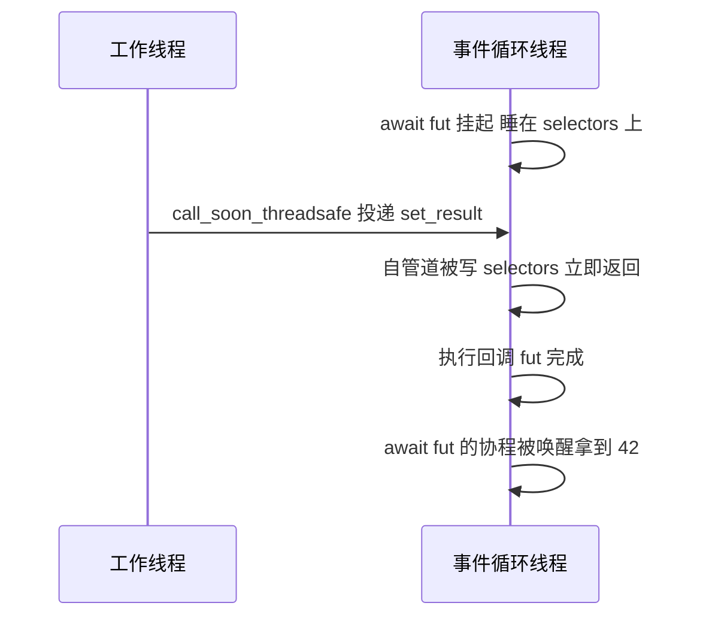

### Q2405 · 跨线程唤醒事件循环:call_soon_threadsafe

> 难度:★★★★ | 标签:call_soon_threadsafe, Future, 线程安全

**问**:工作线程拿到了结果,怎么安全地交给正在 await 的事件循环?

**答**:Future 与回调都绑定在事件循环线程上,别的线程直接 set_result 是数据竞争;正门只有 call_soon_threadsafe:把回调排进循环的线程安全队列,并敲醒正在 selectors 上睡觉的循环。

- 实测正确姿势:工作线程 call_soon_threadsafe 投递 set_result,循环内的 await fut 拿到 42,全程无线程竞争;

- 实测错误姿势:直接跨线程 set_result,在 debug 模式被 RuntimeError 当场抓获——而且状态已经被改掉,危害在于静默时根本不报;

- 非调试模式下越界写可能"恰好能跑",这种碰巧正确最危险,开发期开着 debug 跑一遍线程桥接代码是纪律;

- 记住唯一例外方向:循环线程调用普通 call_soon 即可,线程安全版本是给外面的人用的。

```python
# file: code/02_并发与网络工程/q2405_call_soon_threadsafe.py
# -*- coding: utf-8 -*-
"""跨线程唤醒事件循环: call_soon_threadsafe 是唯一的正门。

- Future/回调都绑定在事件循环线程上, 别的线程直接 set_result 是数据竞争;
- debug 模式下这种越界会被 RuntimeError 当场抓获, 非调试则可能静默出错;
- call_soon_threadsafe 先把回调排进循环的线程安全队列, 再敲醒 selectors。
"""
import asyncio
import threading
import time


async def main():
    loop = asyncio.get_running_loop()
    fut = loop.create_future()
    fut_bad = loop.create_future()          # 只用来演示错误姿势, 不去等它
    fut_bad.add_done_callback(lambda f: None)   # 有等待者, 才会让越界写现形
    errors = []

    def worker():
        time.sleep(0.1)
        # 错误姿势: 直接在别的线程 set_result
        try:
            fut_bad.set_result(1)
        except RuntimeError as e:
            errors.append(type(e).__name__)
        # 正确姿势: 线程安全投递, 顺带敲醒正在 await 的循环
        def deliver():
            if not fut.done():
                fut.set_result(42)
        loop.call_soon_threadsafe(deliver)

    t = threading.Thread(target=worker)
    t.start()
    result = await fut                       # 循环线程在此挂起, 等 cross-thread 唤醒
    t.join()
    await asyncio.sleep(0)                   # 让异常点名的日志先落地
    print("await 拿到跨线程结果:", result)
    print("越界 set_result 被抓获:", errors)
    assert result == 42, "call_soon_threadsafe 必须把结果送达"
    assert errors == ["RuntimeError"], "debug 模式必须能抓住越界写"


if __name__ == "__main__":
    asyncio.run(main(), debug=True)
```

**追问**:1) call_soon_threadsafe 和 run_coroutine_threadsafe 什么关系?——后者是前者的封装:submit 协程、包成 concurrent Future、异常与取消都穿回来。2) 事件循环睡了怎么被敲醒?——线程安全队列写入后向自身管道写一字节,selectors 立即返回,这就是唤醒机制。3) call_soon_threadsafe 的唤醒机制与性能账?——回调排进线程安全队列+向 self-pipe 写一字节敲醒 selectors;唤醒本身轻量,高频跨线程投递会有管道写入开销——批量投递(队列+一个唤醒)优于逐条;自检:debug 模式下越界 set_result 被 RuntimeError 抓获(见原问)。4) 「越界写在非调试下静默」的危害怎么防?——debug 跑一遍线程桥接代码(CI 纪律);代码评审盯「线程里动 loop 对象」;唯一例外方向:循环线程内用普通 call_soon——「线程边界」是 asyncio 并发模型的核心(Q2405 原问)。5) 生产陷阱?——直接跨线程 set_result/改共享状态(数据竞争,静默出错);call_soon 误用在线程侧(非线程安全);高频逐条投递(管道开销);debug 模式只在开发开(CI 没跑线程桥接测试);投递的回调里再阻塞(堵循环,Q2401)。



---
