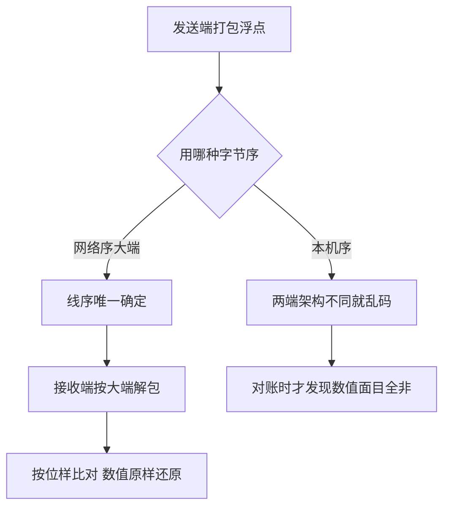

### Q2411 · 浮点数的跨端互操作

> 难度:★★★☆ | 标签:IEEE754, 字节序, 浮点

**问**:浮点数走网络协议,除了字节序还要注意什么?

**答**:两个坑叠加:一是浮点同样分大小端,struct 默认按本机序打包;二是 IEEE754 位样按错的序读,得到的不是精度损失,而是完全不相干的数。

- 实测 PI 的网络序与小端位样互为字节倒置;

- 按错序读双精度,得到 3.2e-192 这样的天文小数,与原值毫无关系,这种 bug 在对账时才会现形;

- 正解:协议里显式 '>d'/'>f',跨端比对比位样而非浮点相等;

- 精度要写进协议文档:实测 PI 过一遍 float32 就变成 3.14159274,发什么精度、收什么精度,双方文档对齐。

```python
# file: code/02_并发与网络工程/q2411_float_endian.py
# -*- coding: utf-8 -*-
"""浮点数的跨端互操作: IEEE754 位样 + 字节序, 两个坑叠一起。

- float 的字节序跟整数一样分大小端, struct 默认按本机序打包;
- 同一位样按错的序读, 得到的不是精度损失, 是完全不相干的浮点数;
- 跨端协议里浮点一律 struct 的 '>d'/'>f' 打包, 并用位样而非数值比对。
"""
import binascii
import struct

PI = 3.141592653589793


def main():
    be = struct.pack(">d", PI)                   # 网络序 8 字节
    le = struct.pack("<d", PI)                   # 本机小端 8 字节
    print("PI 的网络序位样:", binascii.hexlify(be).decode())
    print("PI 的小端位样  :", binascii.hexlify(le).decode())
    assert le == be[::-1], "浮点同样适用字节翻转规律"

    # 事故现场: 小端机器按本机序去读网络序的 8 字节
    wrong = struct.unpack("<d", be)[0]
    print("字节序读错得到的数: %.6g" % wrong)
    assert wrong != PI and (abs(wrong) > 1e100 or abs(wrong) < 1e-100), \
        "读错字节序得到的是完全不相干的数, 不是精度损失"

    # 正确姿势: 两端都用大端 d
    ok = struct.unpack(">d", be)[0]
    print("统一网络序读回: %.17g, 与原值 bits 相等: %s" %
          (ok, struct.pack(">d", ok) == be))
    assert struct.pack(">d", ok) == be, "跨端浮点必须按位样比对, 不按 =="

    # 精度提示: float32 会丢精度, 协议里要显式选择 f 或 d
    f32 = struct.unpack(">f", struct.pack(">f", PI))[0]
    print("过一遍 float32: %.9g (精度已损)" % f32)
    assert f32 != PI, "float32 往返必有精度损失, 要在协议文档里写明"

    # 同步发送双精度与单精度, 接收端按字段序解
    payload = struct.pack(">df", PI, 2.5)
    v1, v2 = struct.unpack(">df", payload)
    assert abs(v1 - PI) < 1e-15 and v2 == 2.5
    print("混合字段打包 12 字节, 解包一致")


if __name__ == "__main__":
    main()
```

**追问**:1) JSON 传浮点为什么没这个问题?——JSON 用十进制文本承载,问题换成了十进制表示的舍入,形式不同但同样要约定精度。2) 金融金额能用浮点吗?——不能,用整数最小单位或 Decimal,浮点只给度量值。3) 浮点位样错序读「完全不相干」的机制?——IEEE754 位样按错序重排=指数位/尾数位全变,得到 3.2e-192 类天文数字(不是精度损失)——与整数字节序同根,但后果更隐蔽(值「看起来像数」);对账比对要用位样(struct.pack 后比 bytes)而非数值相等。4) 精度约定与 float32 陷阱?——float64→float32 一次往返就丢精度(实测 PI 变 3.14159274);协议文档写明「发什么精度收什么精度」;金融金额禁浮点(整数最小单位/Decimal,Q2411 原问)——「精度是协议契约」的一部分。5) 生产陷阱?——struct 浮点用本机序(裸 'd');按数值相等比对(位样差异被掩盖或放大);float32 中转(精度静默丢失);JSON 承载换成了十进制舍入问题(allow_nan/精度约定,Q686);对账差异被当「计算误差」(其实是字节序/精度 bug)。



---
