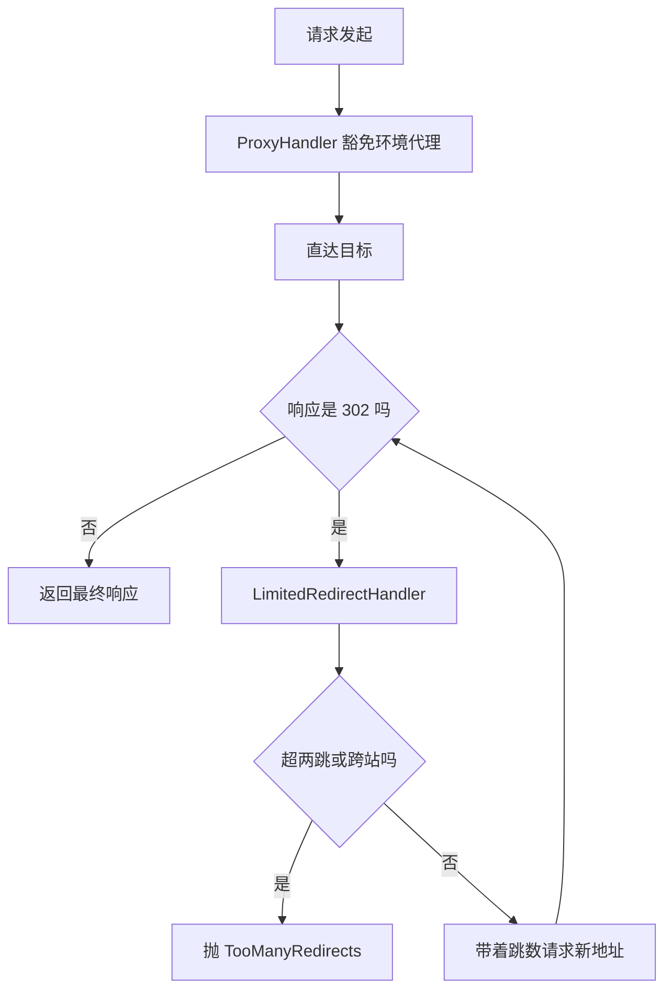

### Q2416 · urllib opener 链定制:代理豁免与重定向闸门

> 难度:★★★ | 标签:urllib, opener, 重定向

**问**:build_opener 的 Handler 链怎么定制出“不走环境代理、重定向受限”的客户端?

**答**:build_opener 把一串 Handler 拧成链条,每类 HTTP 事件由对应 Handler 接手;ProxyHandler({}) 顶掉环境里的 http_proxy 实现直连,自定义 HTTPRedirectHandler 则把跟随重定向的权力收回来。

- 实测代理豁免:opener 带 ProxyHandler({}) 后直连回环服务,不受 shell 里代理变量影响;

- 实测限跳数:自定义 Handler 维护 hop_count,超过两跳抛 TooManyRedirects,自环重定向在第三次被斩断,服务端实测恰好收到三次 /loop;

- 实测跨站防线:比较新旧 URL 的 scheme 与 netloc,跨站重定向直接拒绝,防 open redirect 滥用;

- 计数长在 Request 对象上随重定向旅行,这是 urllib 的惯用挂载点。

```python
# file: code/02_并发与网络工程/q2416_urllib_opener_chain.py
# -*- coding: utf-8 -*-
"""urllib opener 链定制: 代理豁免与重定向闸门都长在 Handler 上。

- build_opener 把一串 Handler 拧成链条, 每种 HTTP 事件找对应的 Handler 处理;
- ProxyHandler({}) 顶掉环境里的 http_proxy, 内网联调必备;
- 自定义 HTTPRedirectHandler 可以限跳数、禁跨站, 把跟随重定向的权力收回来。
"""
import http.server
import socketserver
import threading
import time
import urllib.error
import urllib.parse
import urllib.request

CALLS = []


class Handler(http.server.BaseHTTPRequestHandler):
    def do_GET(self):
        CALLS.append(self.path)
        routes = {
            "/target": (200, "final-page"),
            "/redirect": (302, "/target"),
            "/chain": (302, "/redirect"),
            "/loop": (302, "/loop"),
        }
        code, target = routes[self.path]
        if code == 302:
            self.send_response(302)
            self.send_header("Location", target)
            self.send_header("Content-Length", "0")
            self.end_headers()
        else:
            body = target.encode()
            self.send_response(200)
            self.send_header("Content-Length", str(len(body)))
            self.end_headers()
            self.wfile.write(body)

    def log_message(self, *args):
        pass


class CountingServer(socketserver.ThreadingMixIn, http.server.HTTPServer):
    daemon_threads = True


class TooManyRedirects(Exception):
    pass


class LimitedRedirectHandler(urllib.request.HTTPRedirectHandler):
    """限两跳、禁跨站的重定向处理器。"""

    max_redirects = 2

    def redirect_request(self, req, fp, code, msg, headers, newurl):
        count = getattr(req, "hop_count", 0) + 1
        if count > self.max_redirects:
            raise TooManyRedirects("超过 %d 跳: %s" % (self.max_redirects, newurl))
        here = urllib.parse.urlsplit(req.full_url)
        dest = urllib.parse.urlsplit(newurl)
        if (here.scheme, here.netloc) != (dest.scheme, dest.netloc):
            raise TooManyRedirects("拒绝跨站重定向: %s://%s -> %s://%s" %
                                   (here.scheme, here.netloc,
                                    dest.scheme, dest.netloc))
        newreq = super().redirect_request(req, fp, code, msg, headers, newurl)
        newreq.hop_count = count                 # 计数随新请求继续旅行
        return newreq


def build_opener():
    return urllib.request.build_opener(
        urllib.request.ProxyHandler({}),         # 豁免环境代理, 直连回环
        LimitedRedirectHandler())


def main():
    srv = CountingServer(("127.0.0.1", 0), Handler)
    port = srv.server_address[1]
    base = "http://127.0.0.1:%d" % port
    threading.Thread(target=srv.serve_forever, daemon=True).start()
    time.sleep(0.1)
    opener = build_opener()

    r = opener.open(base + "/target", timeout=3)
    print("直达:", r.status, r.read().decode())

    r = opener.open(base + "/redirect", timeout=3)
    print("一跳重定向:", r.status, r.read().decode())

    r = opener.open(base + "/chain", timeout=3)
    print("两跳重定向:", r.status, r.read().decode())
    assert r.url == base + "/target"

    try:
        opener.open(base + "/loop", timeout=3)
        raise AssertionError("自环重定向必须被闸门拦下")
    except TooManyRedirects as e:
        print("闸门拦截:", e)

    print("服务端共收到:", CALLS)
    assert CALLS.count("/loop") == 3, "两跳闸门让自环在第三次被斩断"
    srv.shutdown()


if __name__ == "__main__":
    main()
```

**追问**:1) 为什么每个网络演示都要 ProxyHandler({})?——CI 与开发者机器常配 http_proxy,不豁免的话回环请求会被代理截走,测试结果由代理决定。2) 重定向时 POST 会怎样?——urllib 对 301/302 改写为 GET,业务上依赖方法保持的跳转要单独处理 307/308。3) ProxyHandler({}) 与环境代理的完整交互?——urllib 默认 getproxies() 读环境(HTTP_PROXY/NO_PROXY,Q697);ProxyHandler({}) 显式空代理顶掉环境;CI 与开发者机器常配代理,回环请求被截走=「测试结果由代理决定」——「每个网络演示都豁免代理」是测试卫生。4) 重定向闸门的定制点?——HTTPRedirectHandler 子类:redirect_request 里检查跳数/跨站(比较 scheme+netloc),拒绝时返回 None(urllib 抛 HTTPError);计数挂在 Request 对象随跳转旅行——「把跟随权收回来」是 SSRF 防线的客户端侧。5) 生产陷阱?——不豁免代理(CI 挂在代理上);跨站重定向跟随(凭据泄露 Q1598);POST 被 301/302 改 GET(丢 body,要 307/308);跳数无上限(自环吊死);open redirect 只在服务端防(客户端也要闸门)。



---
