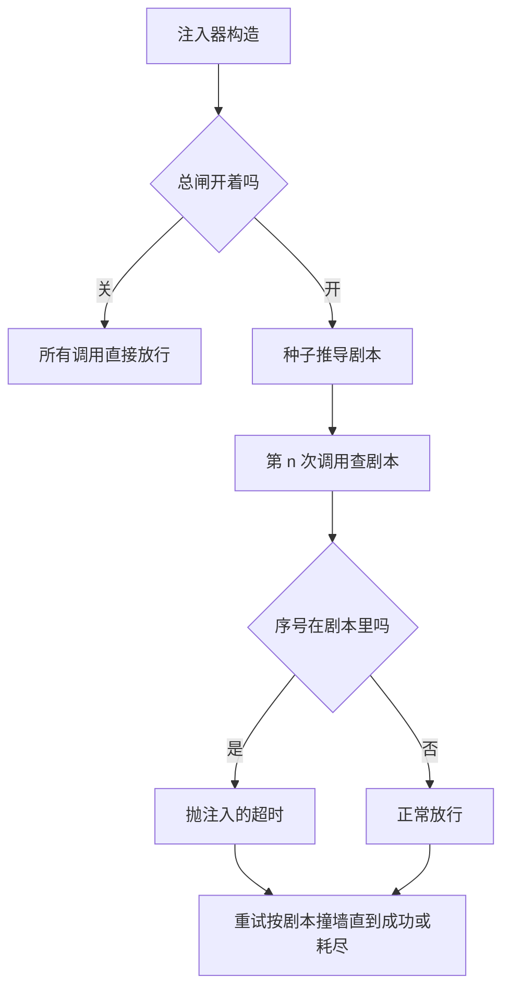

### Q2419 · 失败注入的确定性开关

> 难度:★★★ | 标签:故障注入, 确定性, 混沌工程

**问**:想给重试逻辑做测试,怎么注入故障才能“每次测试都一样”?

**答**:确定性注入三件套:种子推导剧本(第几次调用失败、失败成什么)、总闸开关(CHAOS=off 一键还原干净世界)、剧本可打印可断言。

- 实测同种子两次构造,剧本逐位一致;不同种子剧本不同,可复现性可验证;

- 实测剧本 1 失败 2 失败 3 成功:重试逻辑按剧本撞墙后成功,尝试记录与剧本逐位对齐;

- 实测总闸关闭:同一剧本但注入失效,第一次调用直接成功,排障时能瞬间回到无混沌世界;

- 剧本要覆盖耗尽场景:全部失败时重试预算耗尽的路径同样是测试对象。

```python
# file: code/02_并发与网络工程/q2419_failure_injection.py
# -*- coding: utf-8 -*-
"""失败注入的确定性开关: 同一颗种子同一份剧本, 关掉就风平浪静。

- 注入剧本由种子推导: 第几次调用失败、失败成什么, 跨次运行完全一致;
- 环境开关 CHAOS=off 是总闸, 生产排障时一键还原成干净世界;
- 确定性是回归测试的前提: 修好了就是修好了, 不靠抽签。
"""
import os
import random


class ChaosDisabled(Exception):
    pass


class FailureInjector:
    """按种子生成确定性剧本: attempt 序号 -> 是否失败。"""

    def __init__(self, seed, fail_attempts, total_calls=5, enabled=None):
        if enabled is None:
            enabled = os.environ.get("CHAOS", "on") != "off"
        self.enabled = enabled
        rng = random.Random(seed)
        pool = list(range(1, total_calls + 1))
        rng.shuffle(pool)
        self.plan = set(pool[:fail_attempts])    # 失败的调用序号
        self.schedule = [(i, i in self.plan) for i in range(1, total_calls + 1)]

    def check(self, attempt):
        """返回注入的异常或 None; 总闸关闭时天下太平。"""
        if not self.enabled:
            return None
        if attempt in self.plan:
            return TimeoutError("注入: 第 %d 次调用超时" % attempt)
        return None


def call_with_retry(injector, max_attempts=5):
    attempts = []
    for n in range(1, max_attempts + 1):
        exc = injector.check(n)
        attempts.append((n, exc is None))
        if exc is None:
            return "成功", attempts
        print("  尝试 %d 失败: %s" % (n, exc))
    raise RuntimeError("预算耗尽")


def main():
    # 同一种子, 两次独立运行, 剧本逐位一致
    a = FailureInjector(seed=42, fail_attempts=2).schedule
    b = FailureInjector(seed=42, fail_attempts=2).schedule
    c = FailureInjector(seed=43, fail_attempts=2).schedule
    print("种子 42 剧本 A:", a)
    print("种子 42 剧本 B:", b)
    print("种子 43 剧本 C:", c)
    assert a == b, "同种子必须可复现"
    assert a != c, "不同种子应产生不同剧本"

    # 注入开启: 剧本前两次失败, 第三次成功
    print("CHAOS=on 重放, 剧本:", sorted(FailureInjector(5, 2).plan))
    inj = FailureInjector(seed=5, fail_attempts=2)
    result, log = call_with_retry(inj)
    print("  结局:", result, "尝试记录:", log)
    expected = [not fail for _, fail in inj.schedule[:len(log)]]
    assert result == "成功" and [x[1] for x in log] == expected, \
        "尝试结局必须与剧本逐位一致"
    assert len(log) == 3 and log[-1][1], "两次注入失败后第三次应成功"

    # 总闸关闭: 同一剧本但注入失效
    print("CHAOS=off 重放:")
    result, log = call_with_retry(FailureInjector(seed=42, fail_attempts=2,
                                                  enabled=False))
    print("  结局:", result, "尝试记录:", log)
    assert log == [(1, True)], "总闸一关, 第一次就该直接成功"


if __name__ == "__main__":
    main()
```

**追问**:1) 注入点和真实故障的差距怎么补?——注入异常用真实异常类型(TimeoutError 而非自定义),让分诊逻辑也被测到。2) 时间类故障怎么注入?——慢调用注入用延迟而不是异常,配合预算系统测超时路径。3) 「种子推导剧本」的可复现性怎么验证?——同种子两次构造逐位一致、不同种子剧本不同(实测);固定种子让「出问题的样本永远能重放」——回归测试的入场券;种子进测试名/CI 日志,失败样本自动固化成回归用例。4) 注入的真实性与覆盖度?——注入用真实异常类型(TimeoutError 而非自定义,让分诊逻辑被测到);慢调用注入用延迟(测超时路径);剧本要覆盖「全部失败耗尽预算」的路径——「异常类型真实+场景覆盖完整」是混沌测试的深度指标。5) 生产陷阱?——注入自定义异常(分诊逻辑没被测);总闸缺失(生产排障无法还原干净世界);剧本不可打印(断言失败不知道剧本);只测成功路径(耗尽路径漏测);种子随机(不可复现,修了不知道修没修)。



---
