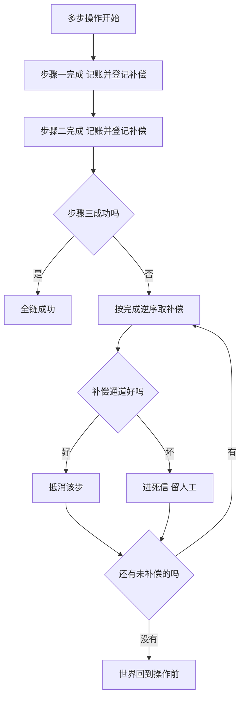

### Q2423 · 多步操作的补偿回滚

> 难度:★★★ | 标签:Saga, 补偿, 回滚

**问**:一个操作跨三个外部系统,第二步成功了第三步失败,怎么办?

**答**:Saga 模式:每完成一步记入 forward 日志并登记补偿动作;任一步失败,按完成顺序的逆序执行补偿,把世界推回操作前的样子。

- 实测出差预订:机票、酒店成功,租车失败,补偿按酒店、机票逆序执行,剩余预订清空,世界回到操作前;

- 补偿闭包必须捕获自己的 record,借 forward[-1] 取值在 pop 之后会错位,实测修正前后行为差异;

- 补偿本身也会失败:实测酒店补偿通道坏,该步进死信留人工,机票照常补偿,死信与成功补偿共存互不阻塞;

- 补偿要幂等:重复执行无副作用,因为"重试补偿"和"补偿后原操作迟到"都可能发生。

```python
# file: code/02_并发与网络工程/q2423_compensation_rollback.py
# -*- coding: utf-8 -*-
"""多步操作的补偿回滚: 前进日记账, 失败时倒着抵消。

- 每完成一步就记入 forward 日志, 每步配一个补偿动作;
- 任一步失败, 按完成的逆序执行补偿, 世界回到操作前的样子;
- 补偿闭包必须捕获自己的 record, 借 forward[-1] 取值会错位;
- 补偿本身也可能失败, 进死信留人工, 不能中断其余补偿。
"""
import threading

bookings = []
bookings_lock = threading.Lock()


def book(kind, item):
    with bookings_lock:
        record = "%s:%s" % (kind, item)
        bookings.append(record)
    return record


def cancel(record):
    """幂等补偿: 重复执行无副作用。"""
    with bookings_lock:
        if record in bookings:
            bookings.remove(record)
            return "已抵消 " + record
        return "已不存在 " + record


class Workflow:
    def __init__(self, name):
        self.name = name
        self.forward = []            # (record, undo 闭包, undo 结果)
        self.compensated = []
        self.dead_letter = []
        self.error = None

    def step(self, do, undo_of):
        """执行一步并登记补偿; undo_of 以 record 为参, 各自捕获各自的。"""
        record = do()
        self.forward.append((record, lambda r=record: undo_of(r)))
        return record

    def rollback(self):
        while self.forward:
            record, undo = self.forward.pop()     # 逆序抵消
            try:
                undo()
                self.compensated.append(record)
            except Exception as e:                # 补偿失败不中断其余补偿
                self.dead_letter.append((record, str(e)))

    def run(self, steps):
        """steps: [(do, undo_of)], 某一步会抛错。"""
        try:
            for do, undo_of in steps:
                self.step(do, undo_of)
            return True
        except Exception as e:
            self.error = str(e)
            self.rollback()
            return False


def main():
    def do_car():
        raise RuntimeError("租车网点瘫痪, 预订未受理")

    wf = Workflow("出差预订")
    ok = wf.run([
        (lambda: book("flight", "CA1858"), cancel),
        (lambda: book("hotel", "rm1208"), cancel),
        (do_car, cancel),
    ])
    print("流程成功?", ok, "| 失败原因:", wf.error)
    print("已补偿:", wf.compensated)
    print("剩余预订:", bookings)
    assert not ok
    assert wf.compensated == ["hotel:rm1208", "flight:CA1858"], \
        "补偿必须按完成顺序的逆序执行"
    assert bookings == [], "全部抵消后, 世界应回到操作前"

    # 对照: 补偿通道也坏时, 死信与成功补偿共存, 互不阻塞
    def do_pay():
        raise RuntimeError("支付通道失败")

    def broken_cancel(record):
        raise RuntimeError("酒店补偿通道也坏")

    wf2 = Workflow("补偿半失灵")
    ok2 = wf2.run([
        (lambda: book("flight", "MU5100"), cancel),
        (lambda: book("hotel", "rm301"), broken_cancel),
        (do_pay, cancel),
    ])
    assert not ok2
    assert wf2.dead_letter, "补偿失败必须进死信留人工"
    assert wf2.compensated == ["flight:MU5100"], "死信不能拖累其余补偿"
    print("死信留待人工:", wf2.dead_letter, "| 其余照常补偿:", wf2.compensated)
    assert bookings == ["hotel:rm301"], "死信里的预订保留, 等人工处置"


if __name__ == "__main__":
    main()
```

**追问**:1) 能补偿的操作有哪些要求?——有逆操作、幂等、允许最终不一致;没有逆操作的(如发短信)只能靠预检查与人工兜底。2) 顺序执行补偿就够了吗,要不要并行?——按依赖逆序串行最稳,无依赖的补偿并行只是优化,先保正确。3) 补偿闭包「捕获自己的 record」为什么是经典 bug?——用 forward[-1] 取值:pop 之后索引错位,补偿操作作用在错误的 record 上(实测修正前后行为差异);正确写法:闭包捕获循环变量当前值(functools.partial 或默认参数绑定)——「延迟求值 vs 捕获时求值」是闭包的通用陷阱。4) 补偿失败与死信的处置?——补偿按逆序串行执行(依赖关系),失败的进死信留人工,其余照常(死信与成功共存不互阻);补偿要幂等:「重试补偿」与「补偿后原操作迟到」都会发生(原操作在补偿后到达=回滚竞态,要拒收)。5) 生产陷阱?——补偿闭包借 forward[-1](错位);补偿非幂等(重复执行);补偿失败中断后续(半回滚);无 forward 日志(回滚无依据); Saga 与本地事务混用边界不清(能补偿 vs 要预检查,见原问)。



---
