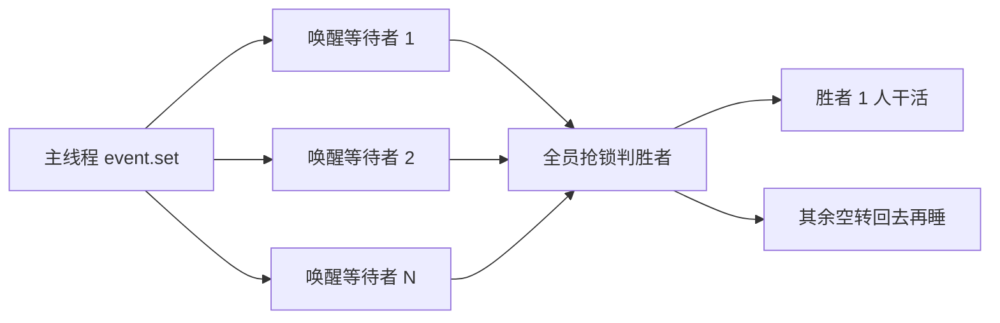

### Q2651 · Event 并发唤醒实测:set 一声,唤醒时延展开与羊群代价

> 难度:★★ | 标签:Event, 并发唤醒, 惊群

**问**:一个 Event 上睡了 8 个等待线程,主线程调用一次 set(),这 8 个人会发生什么?代价是什么?

**答**:Event.set 是一次广播:所有 wait() 一起醒来。实测 8 个等待者从 set 到各自恢复运行的时延有约 1ms 的展开,而且资源只有一份时,8 个人全部抢锁检查、只有 1 人干成活,其余全是空转,这就是 Event 版的羊群效应。

- 唤醒是逐个进行的,时延随唤醒顺序单调展开;

- Event 适合"状态质变"的广播(停机、配置切换),不适合"来了一件货"的点对点通知;

- 点对点该用 Semaphore 或 Condition.notify(1),让唤醒次数等于成功次数;

- Event 是一次性闸门:set 之后必须 clear 才能再次广播,clear 前新来的等待者直接通过。

```python
# file: code/02_并发与网络工程/q2651_event_wake.py
# -*- coding: utf-8 -*-
"""Event 的并发唤醒实测: set 一声, 8 个等待者的唤醒时延展开。

- 8 个等待者都睡在 event.wait() 上, 主线程 set() 一次;
- 每个等待者记录从 set 到自己恢复运行的时延, 观察唤醒展开;
- 羊群效应: 全部 8 人被唤醒并抢锁, 但资源只有一份, 只有 1 人干成活。
"""
import threading
import time

N = 8
event = threading.Event()
ready = threading.Barrier(N + 1)     # 全员就位后再 set
wake_lat = [None] * N                # 每个等待者的唤醒时延
t_set = [0.0]
winner_lock = threading.Lock()
winner = []


def waiter(idx):
    ready.wait()
    event.wait()                     # 睡在 Event 上
    wake_lat[idx] = time.perf_counter() - t_set[0]
    # 资源只有一份: 只有第一个抢到名额的人算"干成活"
    with winner_lock:
        if not winner:
            winner.append(idx)


if __name__ == "__main__":
    ts = [threading.Thread(target=waiter, args=(i,)) for i in range(N)]
    for t in ts:
        t.start()
    ready.wait()
    time.sleep(0.05)                 # 确保它们都已睡在 event 上
    t_set[0] = time.perf_counter()
    event.set()                      # 一声哨响, 广播唤醒
    for t in ts:
        t.join()

    lat = sorted(x * 1000 for x in wake_lat if x is not None)
    print("各等待者唤醒时延 ms:", ["%.3f" % x for x in lat])
    print("最快 %.3f ms / 最慢 %.3f ms / 展开 %.3f ms"
          % (lat[0], lat[-1], lat[-1] - lat[0]))
    print("被唤醒人数: %d/%d, 真正干成活: %d 人"
          % (len(lat), N, len(winner)))

    # 对照: clear 之后再 set 才能再次广播, Event 是一次性闸门
    event.clear()
    second = threading.Event()
    blocked = []

    def late_waiter():
        blocked.append(event.wait(timeout=0.2))

    tl = threading.Thread(target=late_waiter)
    tl.start()
    tl.join()
    print("clear 后未 set, 新等待者 0.2s 超时返回:", blocked)
```

**追问**:1) Event.wait 返回值有什么用?——它返回内部标志位的现值,配合 timeout 可以区分"被唤醒"与"超时",不必再二次查询。2) 羊群效应和锁竞争是什么关系?——唤醒瞬间全员抢同一把锁,等待者越多锁竞争峰值越高,这是惊群的真实代价。3) 底层机制:Event.set 的广播是怎么展开的?——CPython 的 Event 内部是 Condition,set 先置标志再 notify_all,逐个唤醒 waiters 里的等待者;每个醒来的人都要重新抢同一把条件锁,唤醒本质是串行的,时延因此随队列长度展开。4) 生产陷阱?——拿 Event 做"来了一件货"的点对点通知,N 个消费者全被唤醒只有 1 个抢到,其余空转再睡白烧 CPU,该用 Semaphore/Queue;set 之后忘 clear,新等待者直接通过,闸门语义静默失效。



---
