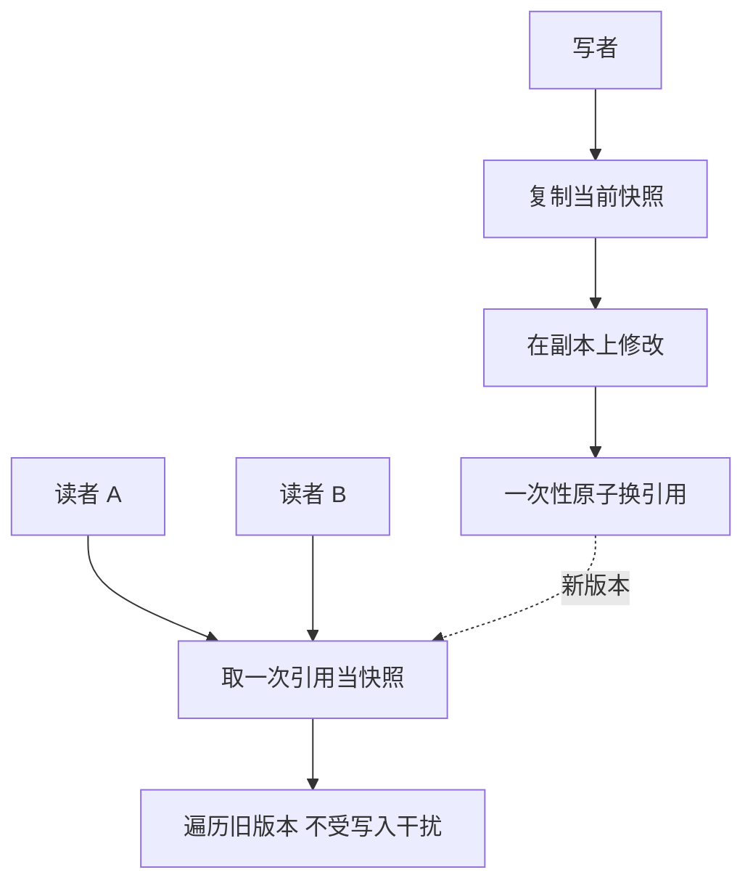

### Q2656 · 写时复制的遍历安全:边遍历边改的 RuntimeError

> 难度:★★★ | 标签:写时复制, 遍历安全, 快照

**问**:一个线程在遍历共享 dict,另一个线程在往里加键,会发生什么?怎么根治?

**答**:dict 在遍历时被结构性修改会抛 RuntimeError: dictionary changed size during iteration,实测 28 万轮遍历撞出 45 次。根治靠写时复制:写者复制整表、在副本上修改、最后一次性原子换引用;读者拿一次引用安心遍历旧版本,实测 19 万轮零异常。

- 错误的根源是"迭代器与结构变更共享同一份可变结构",不是缺锁;

- 写时复制的复制成本随表增长,适合读多写少、表不大的场景;

- 换引用依赖 GIL 的赋值原子性,读者侧完全无锁;

- 与双缓冲的差别:写时复制强调"遍历期间结构不变"的一致性,双缓冲强调"读侧零锁"。

```python
# file: code/02_并发与网络工程/q2656_cow_iteration.py
# -*- coding: utf-8 -*-
"""写时复制的遍历安全: 边遍历边改的 RuntimeError 与快照替换。

- 读者正在 for 循环里遍历 dict, 写者插入新键 -> RuntimeError;
- 写时复制: 写者复制整表、改完一次性换引用, 读者拿着旧引用安心遍历;
- 复制成本随表增长, 所以写时复制适合"读多写少 + 表不大"的场景。
"""
import threading
import time

errors = [0]
rounds = [0]
stop = threading.Event()


def bare_reader(table):
    """直接遍历共享 dict: 撞上写入就抛 RuntimeError。"""
    while not stop.is_set():
        rounds[0] += 1
        try:
            for k in table:
                _ = table[k]         # 读每个值
        except RuntimeError as e:
            errors[0] += 1


def cow_reader(holder):
    """取一次引用当快照, 遍历的是不可变副本。"""
    while not stop.is_set():
        snap = dict(holder["snap"])  # 取引用 + 局部快照
        for k in snap:
            _ = snap[k]


if __name__ == "__main__":
    # 阶段一: 裸遍历共享 dict, 写者同时插键
    table = {i: i for i in range(8)}
    r = threading.Thread(target=bare_reader, args=(table,))
    r.start()
    for i in range(100, 160):
        table[i] = i                 # 边遍历边改
        time.sleep(0.0005)
    stop.set()
    r.join()
    print("裸遍历: %d 轮里撞出 %d 次 RuntimeError" % (rounds[0], errors[0]))

    # 阶段二: 写时复制, 读者只碰快照
    holder = {"snap": {i: i for i in range(8)}}
    writer_lock = threading.Lock()
    err2 = [0]

    def cow_writer():
        for i in range(100, 160):
            new = dict(holder["snap"])   # 复制旧版本
            new[i] = i                   # 在副本上改
            with writer_lock:
                holder["snap"] = new     # 一次性原子换引用
            time.sleep(0.0005)

    stop2 = threading.Event()
    rounds2 = [0]

    def cow_reader2():
        while not stop2.is_set():
            rounds2[0] += 1
            try:
                for k, v in list(holder["snap"].items()):
                    _ = v
            except RuntimeError:
                err2[0] += 1

    w = threading.Thread(target=cow_writer)
    r2 = threading.Thread(target=cow_reader2)
    w.start()
    r2.start()
    w.join()
    stop2.set()
    r2.join()
    print("写时复制: %d 轮遍历, RuntimeError %d 次, 最终键数 %d"
          % (rounds2[0], err2[0], len(holder["snap"])))
```

**追问**:1) 为什么 for k in dict 期间加键必炸,改已有键的值却不炸?——改值不动哈希表结构,迭代器只感知 size 与槽位布局。2) list 也有这个问题吗?——list.append 不改长度字段以外的布局,遍历中 append 不炸但可能看到新元素,语义上同样不该依赖。3) 底层机制:换引用凭什么对读者原子?——写者复制出完整副本后一次性赋值 holder["snap"] = new,单次引用赋值在 CPython 下原子;读者取到引用后遍历的是那一刻的完整版本,写者后续修改落在另一个对象上,互不可见。4) 生产陷阱?——表很大还用写时复制,每次写 O(n) 复制拖垮写路径;多写者不加锁各复制各的、互相覆盖丢更新;读者把快照引用长期缓存,拿陈旧版本当最新。



---
