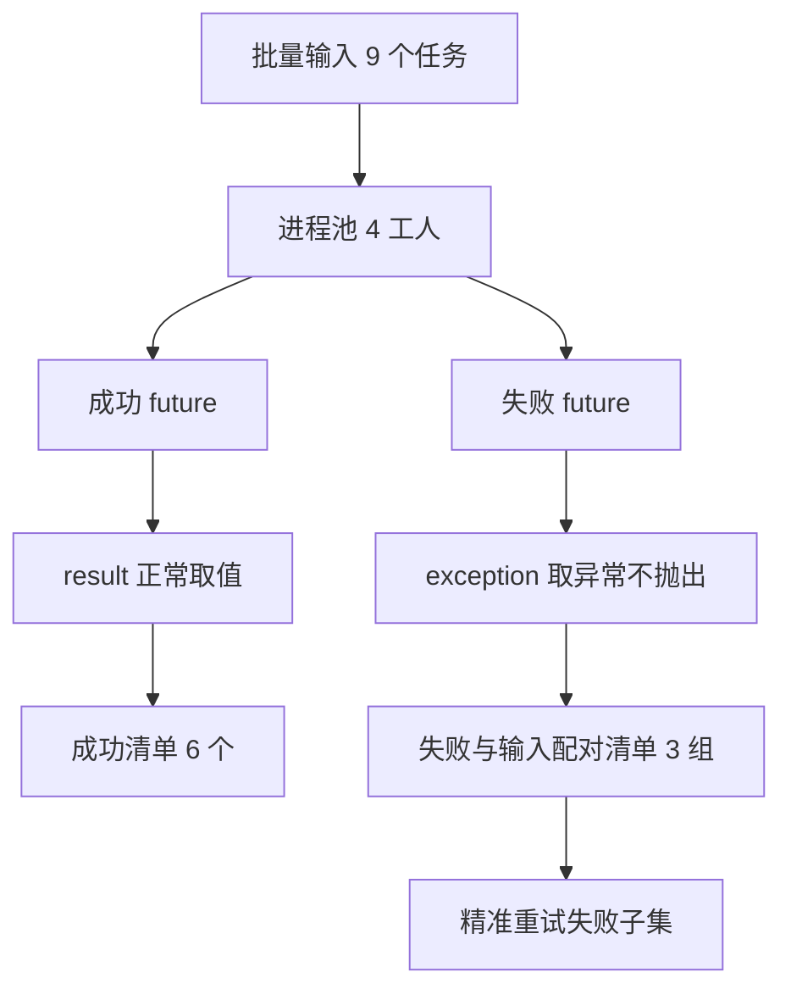

### Q2662 · imap_unordered 的完成序实测:先跑完的先回来

> 难度:★★★ | 标签:imap_unordered, 完成序, 长尾

**问**:12 个任务里 0 号要跑 1 秒,其余只要 50 毫秒,imap 和 imap_unordered 的交付差别有多大?

**答**:实测:imap 的首个结果要等 1.01 秒(必须等 0 号完成才能按序交付第一个),imap_unordered 的首个结果 0.06 秒就到,快结果在长尾任务还在跑的时候就陆续交付。imap_unordered 适合"结果独立、越快越好"的场景,代价是结果与输入的对应关系要自己带编号维护。

- map/imap 严格按提交序产出,长尾任务挡住整批交付;

- imap_unordered 按完成序产出,吞吐不变但首个响应大幅提前;

- 用法上让任务返回 (编号, 结果) 或在闭包里带索引,别指望顺序对应;

- 下游需要按序处理时应自己重排,而不是退回 imap 牺牲首响应。

```python
# file: code/02_并发与网络工程/q2662_imap_unordered.py
# -*- coding: utf-8 -*-
"""imap_unordered 的完成序实测: 先跑完的先回来。

- map/imap: 结果严格按提交序产出, 慢任务挡住后面所有快任务的交付;
- imap_unordered: 谁先完成谁先产出, 长尾任务不再阻塞整批;
- 代价: 结果与输入的对应关系要自己带着编号走。
"""
import multiprocessing as mp
import time

WORKERS = 4


def job(i):
    """0 号是长尾: 睡 1.0s; 其余都是 0.05s 的快任务。"""
    time.sleep(1.0 if i == 0 else 0.05)
    return i


if __name__ == "__main__":
    with mp.Pool(WORKERS) as pool:
        pool.map(int, range(4))          # 预热: 排除 worker 启动噪声

        t0 = time.perf_counter()
        first_unordered = None
        arrival = []
        for r in pool.imap_unordered(job, range(12)):
            if first_unordered is None:
                first_unordered = time.perf_counter() - t0
            arrival.append(r)
        t_unordered = time.perf_counter() - t0

        t0 = time.perf_counter()
        first_ordered = None
        in_order = []
        for r in pool.imap(job, range(12)):
            if first_ordered is None:
                first_ordered = time.perf_counter() - t0
            in_order.append(r)
        t_ordered = time.perf_counter() - t0

    print("imap_unordered 到达序:", arrival)
    print("imap         到达序:", in_order)
    print("首个结果延迟: unordered %.2fs vs ordered %.2fs"
          % (first_unordered, first_ordered))
    print("总耗时:       unordered %.2fs vs ordered %.2fs"
          % (t_unordered, t_ordered))
    print("unordered 期间快结果已陆续交付, 长尾只在最后收一次")
```

**追问**:1) chunksize 对 imap_unordered 有影响吗?——有,chunk 大会把多个任务绑给一个 worker,完成序被块内顺序拉平。2) 什么时候必须用 imap?——结果之间有顺序依赖(比如按序写文件)时,乱序反而制造额外排序成本。3) 底层机制:完成序从哪来?——池的任务处理线程从结果队列收到谁就先交付谁,imap_unordered 不按提交序重排;imap 则维护索引压着 0 号等齐;worker 的执行分配仍按 chunk 走,所以 unordered 只是交付层乱序,不是并行度提升。4) 生产陷阱?——假设第 i 个输出对应第 i 个输入,错位事故(任务必须自带编号);轻任务用默认 chunksize,长尾被块内顺序掩盖;把 unordered 当成"更快",总耗时其实与 imap 相同。



---
