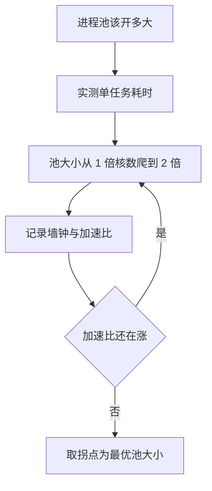

### Q2666 · 进程池的 pickle 税:传参与回传都要过序列化这道关

> 难度:★★ | 标签:进程池, pickle, 序列化成本

**问**:给进程池传一个 200 万元素的列表做计算,为什么比传一个整数慢一倍?

**答**:进程池的每次调用都要把参数 pickle 后经管道发给子进程,结果再 pickle 回来,这是跨进程的固定税。实测传 9.9MB 的列表耗时 0.42 秒,改传生成指令(只传 N 让子进程现场生成数据)只要 0.22 秒,结果完全一致。优化方向是"传指令不传数据":传描述而非实体。

- 参数与返回值双向都要 pickle,大返回值的税同样可观;

- 数据确实巨大时用 shared_memory 一次放置、多方零拷贝;

- 不能 pickle 的对象(锁、socket、lambda)在提交瞬间就报错;

- chunksize 与 pickle 税叠加:块越大传输次数越少但尾部越不均衡。

```python
# file: code/02_并发与网络工程/q2666_pickle_tax.py
# -*- coding: utf-8 -*-
"""进程池的 pickle 税: 传参与回传都要过序列化这道关。

- 池的每次调用: 参数 pickle 后发给子进程, 结果 pickle 后传回来;
- 大数据当参数传: 双程 pickle 税可能超过计算本身;
- 改传"生成指令"(只传 N), 让子进程自己造数据, 税就没了。
"""
import pickle
import time
from multiprocessing import Pool

N = 2000000


def sum_squares(data):
    """传数据: 参数是一整个大列表。"""
    return sum(x * x for x in data)


def sum_squares_lite(n):
    """传指令: 只传一个整数, 数据在子进程现场生成。"""
    return sum(x * x for x in range(n))


if __name__ == "__main__":
    data = list(range(N))
    payload = pickle.dumps(data)
    print("数据方案参数体积: %.1f MB" % (len(payload) / 1e6))
    print("指令方案参数体积: 0.0 MB (一个 int)")

    with Pool(2) as pool:
        t0 = time.perf_counter()
        r1 = pool.apply(sum_squares, (data,))
        tax_time = time.perf_counter() - t0

        t0 = time.perf_counter()
        r2 = pool.apply(sum_squares_lite, (N,))
        lite_time = time.perf_counter() - t0

    print("传数据: 结果=%s, 耗时 %.2fs" % (r1, tax_time))
    print("传指令: 结果=%s, 耗时 %.2fs" % (r2, lite_time))
    print("结果一致:", r1 == r2, "/ 指令方案提速 %.1f 倍"
          % (tax_time / lite_time))
```

**追问**:1) 怎么量化任务的 pickle 税?——用 pickle.dumps 实测参数体积,再对比任务本身的计算耗时,税占比一目了然。2) 为什么生成数据的指令方案更快?——它把数据生产挪进子进程,省掉双向序列化与管道传输,只多花本地生成的钱。3) 底层机制:税发生在哪几步?——提交侧 pickle.dumps 参数并写管道,worker 侧 loads、执行、把结果 dumps 回传,父进程再 loads,大对象四步全中外加管道拷贝;shared_memory 能做到一次放置多方零拷贝,但段的生命周期(引用计数、close/unlink)要自己管。4) 生产陷阱?——lambda/锁/socket 当参数,submit 现场报 PicklingError;返回的大对象又被当参数传给下一个池任务,税付两遍;进程池适合小参数大计算,数据密集任务先算税再上池。



---
