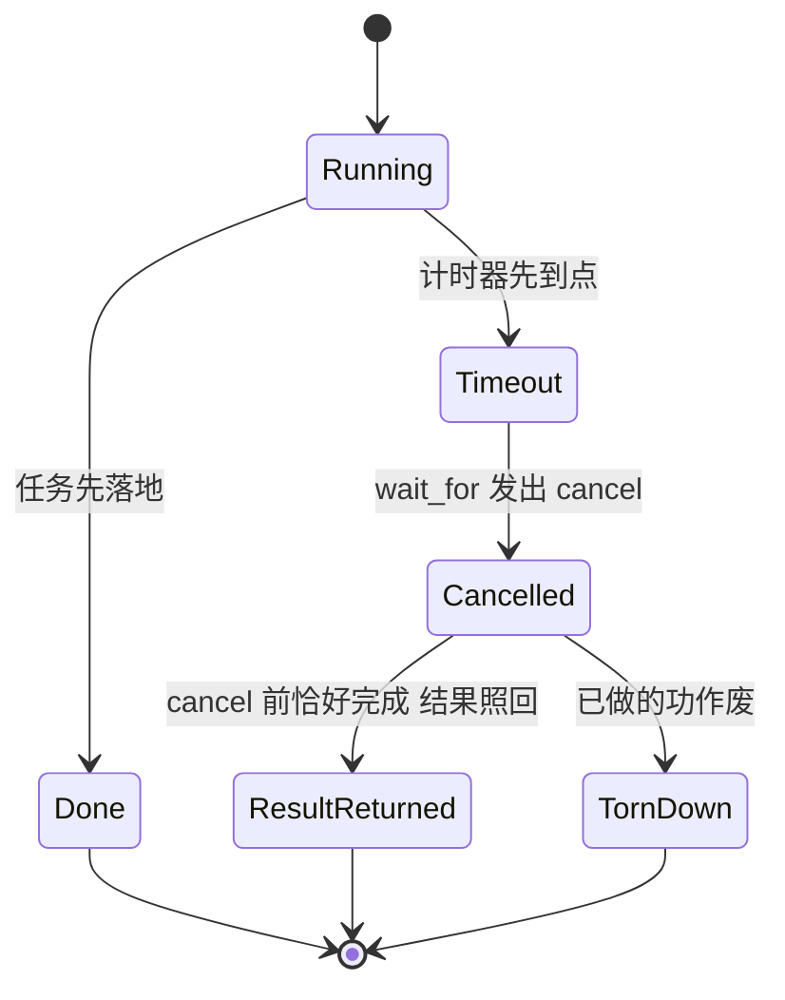

### Q2672 · wait_for 的边界竞争:超时与完成同时到达,结果不确定

> 难度:★★★★ | 标签:wait_for, 取消竞争, 超时

**问**:把 wait_for 的 timeout 设得和任务耗时几乎一样长,结果是确定的吗?

**答**:不确定。实测 60 次同参数试验:31 次任务先完成返回结果,29 次计时器先到点抛 TimeoutError——贴线的超时判定不可复现。更关键的是超时获胜时 wait_for 会 cancel 内部任务,已做的功直接作废;而若任务在取消落地前恰好完成,现代实现会返回结果而不是 TimeoutError。

- 超时是保险丝不是精确闸门,预算必须留余量;

- 超时获胜的取消是异步的:cancel 发出与任务真正停下之间有窗口;

- 被取消任务若有副作用(已发出请求),需要幂等机制兜底;

- 竞争区的存在意味着"临界任务用超时判定成败"本身就是设计缺陷。

```python
# file: code/02_并发与网络工程/q2672_wait_for_race.py
# -*- coding: utf-8 -*-
"""wait_for 的边界竞争: 超时与完成同时到达, 结果不确定。

- 内部任务的耗时恰好贴着超时线时, 谁先落地是调度决定的;
- 实测 60 次同参数试验: 两种结局都出现, 证明边界是不确定区;
- 超时获胜时 wait_for 会 cancel 内部任务, 已做的功直接作废。
"""
import asyncio
import random

random.seed(42)
TIMEOUT = 0.05


async def inner(flag):
    try:
        await asyncio.sleep(TIMEOUT + random.uniform(-0.01, 0.01))
        return "done"
    except asyncio.CancelledError:
        flag["cancelled"] = True
        raise


async def trial():
    flag = {"cancelled": False}
    task = asyncio.get_running_loop().create_task(inner(flag))
    try:
        r = await asyncio.wait_for(task, timeout=TIMEOUT)
        return ("完成", r, flag["cancelled"])
    except asyncio.TimeoutError:
        await asyncio.wait([task])            # 等内部任务走到终态再收尸
        return ("超时", "cancelled" if task.cancelled() else "done",
                flag["cancelled"])


async def main():
    tally = {}
    for _ in range(60):
        kind, tail, cancelled = await trial()
        tally[(kind, tail)] = tally.get((kind, tail), 0) + 1
    print("60 次同参数试验的结局分布:")
    for k in sorted(tally):
        print("  ", k, "->", tally[k])
    print("要点: 贴线的超时判定不可复现, 预算要留余量, 别把超时当成精确闸门")
    print("要点: 超时获胜时内部任务被 cancel, 已完成的副作用要靠幂等兜底")


if __name__ == "__main__":
    asyncio.run(main())
```

**追问**:1) 为什么 cancel 之后任务还可能返回结果?——cancel 只是请求,若任务恰在完成点之后才检查取消,结果已产生。2) 怎么让边界更稳?——把超时放宽到任务耗时的数倍,或改用带截止时间的重试,把不确定性吸收进重试。3) 底层机制:超时获胜那一拍发生了什么?——内部计时器先触发时,wait_for 对内部 Task 发 cancel 并抛 TimeoutError;cancel 是协作式的,任务在下一个 await 点才收到 CancelledError,若它已跑到 return,结果照样产出——现代实现会在取消落地前任务完成时把结果返回而不是 TimeoutError。4) 生产陷阱?——超时后默认"请求没发出去",而已发生的副作用(写请求已发出)没有幂等兜底;贴线超时当精确闸门,判定不可复现;捕获 TimeoutError 后不 await 内部 task 收尸,任务悬空泄漏。



---
