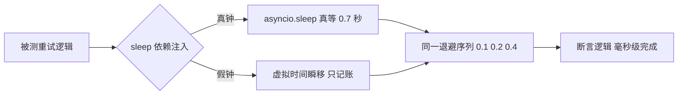

### Q2677 · 假时钟测试:把 sleep 变成瞬移,重试逻辑毫秒级跑完

> 难度:★★★★ | 标签:假时钟, 时间注入, 测试

**问**:指数退避重试的测试要真睡 0.7 秒,几十个用例下来测试跑不动,怎么办?

**答**:时间注入:把 sleep 作为依赖传入被测逻辑,测试时换成假时钟——假 sleep 只记账(记录退避序列、推进虚拟时间)并让出调度,瞬间完成。实测同一份重试逻辑,真钟 0.706 秒跑完,假钟 0.0002 秒,退避序列 [0.1, 0.2, 0.4] 完全一致:逻辑验证与真实耗时解耦。

- 依赖注入是假时钟的前提:被测代码不直接调 asyncio.sleep,而是调注入的 sleep;

- 假时钟的价值是确定性:无真实时间抖动,断言可以精确到调度序列;

- 虚拟时间要与逻辑一致:假 sleep 推进 fake.t,断言总耗时即断言退避策略;

- 代价是被测代码要为可测试性改一个参数,这是值得付的架构税。

```python
# file: code/02_并发与网络工程/q2677_fake_clock.py
# -*- coding: utf-8 -*-
"""假时钟测试: 把 sleep 变成瞬移, 重试逻辑毫秒级跑完。

- 把 sleep 作为依赖注入, 被测代码不直接调 asyncio.sleep;
- 假时钟虚拟时间瞬时推进, 真实时间只花在调度让步上;
- 同一参数下两种时钟的调度序列一致, 逻辑验证与耗时解耦。
"""
import asyncio
import time


class RealClock:
    """真时钟: 记账并真睡。"""

    def __init__(self):
        self.waits = []

    async def sleep(self, s):
        self.waits.append(s)
        await asyncio.sleep(s)


class FakeClock:
    """虚拟时钟: sleep 只记账不真等。"""

    def __init__(self):
        self.t = 0.0
        self.waits = []

    async def sleep(self, s):
        self.waits.append(s)
        self.t += s
        await asyncio.sleep(0)               # 让出调度, 保持协作式


async def retry_with_backoff(clock, should_fail):
    """指数退避重试: 时钟是注入的依赖, should_fail 决定前几次失败。"""
    delay = 0.1
    attempts = 0
    while True:
        attempts += 1
        if not should_fail(attempts):
            return attempts, list(clock.waits)
        await clock.sleep(delay)
        delay = min(delay * 2, 0.8)


async def main():
    fail_plan = lambda n: n <= 3             # 前 3 次失败

    real = RealClock()
    t0 = time.perf_counter()
    real_result = await retry_with_backoff(real, fail_plan)
    real_elapsed = time.perf_counter() - t0

    fake = FakeClock()
    t0 = time.perf_counter()
    fake_result = await retry_with_backoff(fake, fail_plan)
    fake_elapsed = time.perf_counter() - t0

    print("重试次数: 真钟 %s / 假钟 %s" % (real_result[0], fake_result[0]))
    print("退避序列: 真钟 %s / 假钟 %s" % (real_result[1], fake_result[1]))
    print("调度序列一致:", real_result[1] == fake_result[1])
    print("真实耗时: 真钟 %.3fs / 假钟 %.4fs (虚拟时间推进 %.1fs)"
          % (real_elapsed, fake_elapsed, fake.t))
    print("要点: 时间注入让退避逻辑的测试从秒级降到毫秒级")


if __name__ == "__main__":
    asyncio.run(main())
```

**追问**:1) 不改代码能实现假时钟吗?——可以 patch 事件循环时钟,但侵入面大且脆,显式注入是更稳的工程选择。2) 假时钟测不出的东西是什么?——真实调度延迟、系统时钟行为、IO 等待,这些留给少量真钟集成测试。3) 底层机制:假 sleep 里的 await asyncio.sleep(0) 起什么作用?——它让当前协程让出一拍,保持协作式调度语义,否则假钟下重试循环一口气跑完,与真实语义(期间其他协程可能推进)不等价;虚拟时间只推进被测逻辑的时钟观,不推进循环的真实定时器。4) 生产陷阱?——patch 同步 time.sleep 去测异步代码,根本不生效;假钟只验了退避序列,超时上限与最大重试次数的交互漏测;注入接口泄漏进生产路径,默认实现忘了真睡。



---
