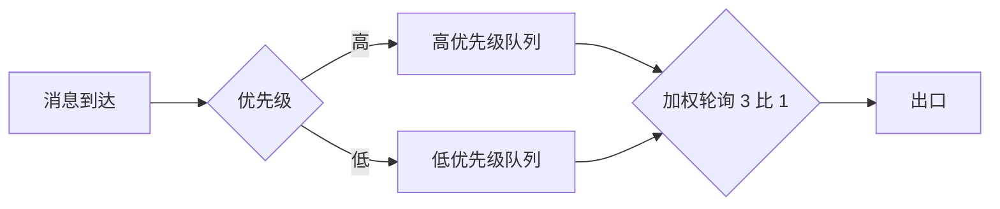

### Q2682 · 双队列加权轮询:优先级的比例保证,而非绝对抢占

> 难度:★★★ | 标签:双队列, 加权轮询, 优先级

**问**:严格优先级队列里,低优先级消息可能永远轮不上,怎么给它保底?

**答**:双队列 + 加权轮询:高队列与低队列分开,调度器每 4 拍里 3 拍给高队列、强制 1 拍给低队列。实测同一负载:严格优先级下低优先级消息平均延迟 1.50 秒、最大 3.65 秒;加权轮询把两者压到 0.90 与 1.40 秒,高优先级只多付 0.3 秒。单堆优先级队列保证的是顺序,双队列加权保证的是比例——过载时低优先级至少活着。

- 权重是容量分配:3:1 表示低优先级保底 25% 的出口带宽;

- 与优先级堆的取舍:堆给绝对顺序,加权给比例与延迟上界;

- 权重可动态调:高峰时压到 4:1,低谷放回 2:1;

- 若低队列长期空转,强制配额自动归还高队列,不浪费出口。

```python
# file: code/02_并发与网络工程/q2682_dual_queue.py
# -*- coding: utf-8 -*-
"""双队列加权轮询: 优先级的比例保证, 而非绝对抢占。

- 严格优先级: 高队列为空才轮到低队列, 低优先级延迟不可控;
- 加权轮询 3:1: 每抢 3 个名额就强制留给低队列 1 个, 低延迟有上界;
- 单堆优先级队列只保证顺序, 双队列才保证比例。
"""
from collections import deque


def simulate(jobs, policy):
    """jobs: (到达时刻, 优先级 0高/1低, 时长, 名字); 返回 (名字, 延迟)。"""
    hi, lo = deque(), deque()
    t = 0.0
    i = 0
    picks = 0
    done = []
    while i < len(jobs) or hi or lo:
        while i < len(jobs) and jobs[i][0] <= t:
            arr, prio, dur, name = jobs[i]
            (hi if prio == 0 else lo).append(jobs[i])
            i += 1
        if not hi and not lo:
            t = jobs[i][0]                       # 空转: 快进到下一到达
            continue
        if policy == "strict":
            q = hi if hi else lo                 # 高队列非空就绝不看低队列
        else:                                    # weighted 3:1
            if hi and lo:
                q = lo if picks % 4 == 3 else hi  # 每 4 拍里第 4 拍给低队列
            else:
                q = hi or lo
        arr, prio, dur, name = q.popleft()
        t += dur
        picks += 1
        done.append((name, t - arr))
    return done


def build_jobs():
    jobs = []
    for k in range(12):                          # 高优先级: 每 0.5s 一个, 每个 0.45s
        jobs.append((round(k * 0.5, 2), 0, 0.45, "hi-%d" % k))
    for k in range(6):                           # 低优先级: 每 2s 一个, 每个 0.5s
        jobs.append((round(0.3 + k * 2.0, 2), 1, 0.5, "lo-%d" % k))
    jobs.sort(key=lambda j: j[0])
    return jobs


def report(title, done):
    hi_lat = [lat for name, lat in done if name.startswith("hi")]
    lo_lat = [lat for name, lat in done if name.startswith("lo")]
    print("%s: hi 平均延迟 %.2fs, lo 平均延迟 %.2fs, lo 最大 %.2fs"
          % (title, sum(hi_lat) / len(hi_lat),
             sum(lo_lat) / len(lo_lat), max(lo_lat)))


if __name__ == "__main__":
    jobs = build_jobs()
    report("严格优先级", simulate(jobs, "strict"))
    report("加权 3:1    ", simulate(jobs, "weighted"))
    print("要点: 加权轮询用 hi 的一点延迟, 换来 lo 的延迟上界")
    print("要点: 比例保证在过载时最值钱——低优先级至少活着")
```

**追问**:1) 为什么不把低优先级消息延迟打包成批?——批会引入额外延迟,加权轮询在消息粒度上实现同样的保底。2) 比例保证在什么场景最值钱?——过载时:高优先级抢不满也轮得到低优先级,系统整体不失去一侧的可用性。3) 底层机制:强制配额怎么避免低队列空转浪费出口?——只在两队列都非空时执行 3:1 交替,低队列为空则配额自动让回高队列(调度分支 q = hi or lo);这是加权公平队列的工作保全(work-conserving)性质:空闲权重不白占出口带宽。4) 生产陷阱?——权重拍脑袋不定标,过载实测才发现一侧饿死;多级优先级嵌套加权,组合语义没人算得清;把比例保证当 SLA 上限,没配最小带宽兜底与延迟监控。



---
