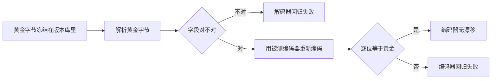

### Q2686 · 帧级排障日志:十六进制 dump 与现场还原

> 难度:★★ | 标签:hexdump, 排障, 抓包

**问**:协议出问题时,"应该发了什么"和"实际发了什么"对不上,第一现场怎么看?

**答**:落字节级日志:hexdump 三段式——偏移、十六进制、ASCII 侧写,不可打印字节显形为点。实测对一段 17 字节的抓包流 dump 后,手工按 TLV 结构解出两帧,类型、长度、载荷全部还原,第二帧载荷里的 0x00 与 0xff 在 dump 里一目了然。有字节在,争论就变成了核对。

- dump 要在分帧之前落,这样才能看到粘包、半包的原始形态;

- 不可打印字节必须转义显示,否则肉眼对不出来;

- 高频路径上 dump 要采样与限流,别让排障日志自己变成洪峰;

- dump 配协议文档,才能把字节翻译成字段。

```python
# file: code/02_并发与网络工程/q2686_hexdump.py
# -*- coding: utf-8 -*-
"""帧级排障日志: 十六进制 dump 与现场还原。

- 排障第一现场是字节: hexdump 让人眼直接核对线上到底发了什么;
- dump 的三段式: 偏移 + 十六进制 + ASCII 侧写, 不可打印字节显形为点;
- 拿着 dump 可以手工解帧, 验证协议实现的边界对不对。
"""
import struct


def hexdump(data, width=16):
    lines = []
    for off in range(0, len(data), width):
        chunk = data[off:off + width]
        hx = " ".join("%02x" % b for b in chunk)
        pad = " " * (width * 3 - len(hx))
        asc = "".join(chr(b) if 32 <= b < 127 else "." for b in chunk)
        lines.append("%08x  %s%s |%s|" % (off, hx, pad, asc))
    return "\n".join(lines)


def make_stream():
    """模拟抓包: 两帧 TLV 粘在一起, 第二帧载荷里有不可打印字节。"""
    f1 = struct.pack(">BH", 1, 4) + b"PING"
    f2 = struct.pack(">BH", 2, 7) + b"hi\x00\xff!"
    return f1 + f2


def dissect(stream):
    """从原始字节里手工解帧, 还原协议结构。"""
    off = 0
    while off < len(stream):
        typ, ln = struct.unpack_from(">BH", stream, off)
        payload = stream[off + 3: off + 3 + ln]
        print("  帧 @%#x type=%d len=%d payload=%r"
              % (off, typ, ln, payload))
        off += 3 + ln
    return off


if __name__ == "__main__":
    stream = make_stream()
    print("== 抓包原始字节 hexdump ==")
    print(hexdump(stream))
    print("== 手工解帧还原 ==")
    total = dissect(stream)
    print("共解析 %d 字节, 无剩余" % total)
    print("要点: 有 dump 在, '应该发了什么'与'实际发了什么'才对得上")
```

**追问**:1) 为什么不直接打日志说"发送了帧 type=2"?——结构化日志丢失了字节细节,载荷里的坏字节恰恰是事故根因。2) ASCII 侧写有什么用?——人眼快速定位文本协议的可读片段,二进制区域则一眼识别为噪音。3) 底层机制:dump 为什么必须落在分帧之前?——分帧器按自己的假设切流,切错之后再打日志就带着错误假设;原始字节 dump 保留粘包半包的真实形态,配合协议文档手工解帧,才能区分"实现错"还是"对端发错"。4) 生产陷阱?——高频路径全量 dump,排障日志自己变成 IO 洪峰(要采样+限流);dump 打在格式化之后,坏字节已被转义替换;只 dump 发送方向不 dump 接收方向,现场对不上账。



---
