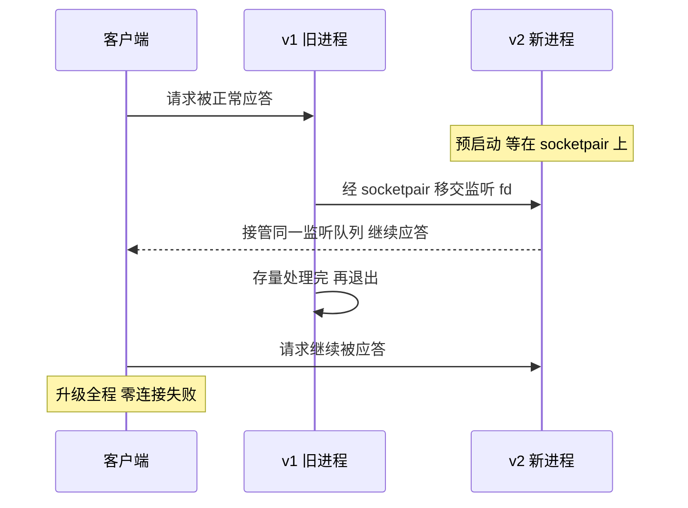

### Q2691 · 优雅重启的双进程交接:监听 fd 经 socketpair 移交,客户端零失败

> 难度:★★★★ | 标签:优雅重启, fd 移交, 双进程

**问**:服务要升级,怎么做到重启期间客户端一次都不被拒?

**答**:双进程交接:新进程预启动并等在 socketpair 上;旧进程把监听 socket 的文件描述符经 socketpair 发过去,新进程接管同一个监听 socket 继续 accept,旧进程处理完存量再退出。实测升级全程哨兵客户端 37 次轮询,v1 应答 20 次、v2 应答 17 次、失败 0 次——零失败的根因是监听队列随 fd 走,交接窗口内没人真正关闭它。

- fd 移交用 Unix 域 socketpair 的 SCM_RIGHTS(socket.send_fds / recv_fds);接管方 fromfd 复用同一内核 socket;

- 就绪握手靠管道:新进程 READY 消息到了,父进程才让旧进程退;

- 这是 nginx、HAProxy 平滑 reload 的原理缩影,生产还叠加 SO_REUSEPORT 与配置热加载;

- 旧进程退出前要排空存量连接,新进程同时开始接新。

```python
# file: code/02_并发与网络工程/q2691_handover.py
# -*- coding: utf-8 -*-
"""优雅重启的双进程交接: 监听 fd 经 socketpair 移交, 客户端零失败。

- v1 持有监听 socket; 升级时把监听 fd 经 Unix socketpair 发给 v2;
- v2 接管 fd 后继续 accept, v1 处理完存量再退出;
- 监听队列随 fd 走: 交接窗口内没人真正关闭它, 客户端一次都不被拒。
"""
import os
import select
import socket
import subprocess
import sys
import threading
import time


def handle(conn, version):
    try:
        conn.settimeout(0.5)
        conn.recv(64)
        conn.sendall(version.encode() + b"\n")
    finally:
        conn.close()


def read_cmd(fd):
    line = b""
    while True:
        ch = os.read(fd, 1)
        if not ch or ch == b"\n":
            break
        line += ch
    return line.decode()


def serve(version, handoff_fd_no):
    hs = socket.socket(fileno=handoff_fd_no)     # 与另一进程的 fd 通道
    if version == "v1":
        lst = socket.socket(socket.AF_INET, socket.SOCK_STREAM)
        lst.setsockopt(socket.SOL_SOCKET, socket.SO_REUSEADDR, 1)
        lst.bind(("127.0.0.1", 0))
        lst.listen(64)
    else:
        _, fds, _, _ = socket.recv_fds(hs, 64, 1)
        lst = socket.socket(fileno=fds[0])       # 接管同一个监听 socket

    print("READY %d" % lst.getsockname()[1], flush=True)

    while True:
        r, _, _ = select.select([lst, sys.stdin], [], [], 0.5)
        for s in r:
            if s is lst:
                conn, _ = lst.accept()
                handle(conn, version)
            else:
                cmd = read_cmd(sys.stdin.fileno())
                if cmd == "HANDOFF" and version == "v1":
                    socket.send_fds(hs, [b"f"], [lst.fileno()])
                    print("HANDED", flush=True)  # fd 已移交, 存量继续服务
                elif cmd == "EXIT":
                    return


def supervise():
    a, b = socket.socketpair()                   # v1 -> v2 的 fd 通道
    p1 = subprocess.Popen(
        [sys.executable, __file__, "serve", "v1", str(a.fileno())],
        stdin=subprocess.PIPE, stdout=subprocess.PIPE,
        pass_fds=(a.fileno(),))
    a.close()
    port = int(p1.stdout.readline().split()[1])
    print("v1 就绪, 服务于端口 %d" % port)

    stats = {"v1": 0, "v2": 0, "fail": 0}
    stop = threading.Event()

    def poller():                                # 哨兵客户端: 30ms 一次
        while not stop.is_set():
            try:
                c = socket.create_connection(("127.0.0.1", port), timeout=0.5)
                c.sendall(b"GET\n")
                ans = c.recv(64).decode().strip()
                stats[ans if ans in stats else "fail"] += 1
                c.close()
            except OSError:
                stats["fail"] += 1
            time.sleep(0.03)

    th = threading.Thread(target=poller, daemon=True)
    th.start()
    time.sleep(0.4)                              # 阶段一: 只有 v1

    p2 = subprocess.Popen(
        [sys.executable, __file__, "serve", "v2", str(b.fileno())],
        stdin=subprocess.PIPE, stdout=subprocess.PIPE,
        pass_fds=(b.fileno(),))
    b.close()
    p1.stdin.write(b"HANDOFF\n")
    p1.stdin.flush()
    p1.stdout.readline()                         # HANDED
    p2.stdout.readline()                         # v2 READY
    print("v2 已接管监听 socket, 新旧并存")
    time.sleep(0.4)                              # 阶段二: 新旧并存

    p1.stdin.write(b"EXIT\n")
    p1.stdin.flush()
    p1.wait(timeout=5)
    print("v1 已退出, 只剩 v2")
    time.sleep(0.4)                              # 阶段三: 只有 v2
    stop.set()
    th.join()
    p2.kill()

    print("客户端统计: v1 应答 %d 次, v2 应答 %d 次, 失败 %d 次"
          % (stats["v1"], stats["v2"], stats["fail"]))
    print("要点: 零失败的根因是监听 socket 的队列随 fd 走, 接力不断流")


if __name__ == "__main__":
    if len(sys.argv) > 1 and sys.argv[1] == "serve":
        serve(sys.argv[2], int(sys.argv[3]))
    else:
        supervise()
```

**追问**:1) 为什么不用 SO_REUSEPORT 让两个进程各绑一次?——各绑各的 socket 会在内核分流,交接瞬间连接归属飘忽;移交 fd 是同一个 socket,队列共享,语义最干净。2) 父进程在交接里扮演什么角色?——编排者:起新进程、传话 HANDOFF、等 READY、让旧进程退,自己不碰业务 socket。3) 底层机制:fd 号变了为什么还是同一个 socket?——send_fds 经 Unix 域辅助消息传的是内核文件描述的引用,接收进程在自己 fd 表里拿到新号,但指向同一内核 socket,监听队列、端口、连接状态全部共享;socket.socket(fileno=...) 只是把这个 fd 包回 Python 对象。4) 生产陷阱?——握手顺序错,新进程 recv_fds 前旧进程先退,监听 socket 引用归零端口释放、排队连接被重置;交接后新旧进程日志混写,断代难查;误以为还需要重新 bind(SO_REUSEADDR 在这里是干扰项)。



---
