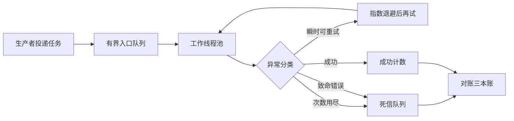

### Q2897 · 线程池+队列+重试的组合模板:从投递到死信的全链路

> 难度:★★★ | 标签:ThreadPool, Queue, 重试, 死信队列

**问**:要把"投递任务"和"执行任务"解耦,还要带重试和兜底,你脑子里有没有一个可以直接抄的组合模板?

**答**:有,四件套:有界入口队列 + 工作线程池 + 分类重试 + 死信队列。生产者只管 put,队列满自然形成背压;worker 循环 get 执行,单个任务抛异常只影响自己;重试不裸写 for 循环,而是按异常分类——瞬时错误(IOError/OSError)指数退避后再试,参数类致命错误(ValueError)一次都不重试直接进 DLQ;重试次数用尽也进 DLQ,留待人工或补偿任务处理。收尾用哨兵值加 task_done/join 精确对账,成功、重试后成功、死信三本账必须对得上。实测 12 个任务:11 个成功(其中 2 个重试后成功),1 个毒任务进死信,数字全部可预期。

- 有界队列就是背压:生产快于消费时 put 挂起,而不是内存爆炸;

- 重试必须分类:给 bug 重试等于放大故障,给瞬态故障不重试等于白丢成功率;

- DLQ 里的任务要带原始异常信息,否则事后无法归因。

```python
# file: code/02_并发与网络工程/q2897_pool_queue_retry.py
# -*- coding: utf-8 -*-
"""线程池 + 队列 + 重试的组合模板。

- 入口队列: 生产者只管投递, 有界队列天然形成背压;
- 工作池: N 个线程从队列取任务, 单个任务失败不拖垮别的任务;
- 重试: 按异常分类决定重试或直接死信, 退避用指数序列;
- 收尾: 哨兵值关门, 对账成功/重试/死信三本账。
"""
import queue
import threading
import time

SENTINEL = None            # 关门哨兵: 每个工作线程一个
N_WORKERS = 4
MAX_RETRY = 3
BASE_DELAY = 0.02          # 指数退避基数, 演示用小值

# 确定性失败计划: (任务号, 第几次尝试) -> 必失败
FAIL_PLAN = {(3, 1), (7, 1), (7, 2)}

intake = queue.Queue(maxsize=64)   # 有界队列 = 背压
dead = queue.Queue()               # 死信队列 DLQ
stats = {"ok": 0, "retried": 0, "dead": 0}
slock = threading.Lock()


def flaky(task_id, attempt):
    """模拟不稳定任务: 按计划表失败, 11 号是永远修不好的毒任务。"""
    if (task_id, attempt) in FAIL_PLAN:
        raise IOError("transient failure")
    if task_id == 11:
        raise ValueError("poison task")
    return True


def worker(wid):
    while True:
        item = intake.get()
        if item is SENTINEL:
            intake.task_done()
            break
        task_id, payload = item
        attempt, done = 0, False
        while attempt < MAX_RETRY:
            attempt += 1
            try:
                flaky(task_id, attempt)
                with slock:
                    stats["ok"] += 1
                    if attempt > 1:
                        stats["retried"] += 1
                done = True
                break
            except (IOError, OSError) as exc:      # 可重试类: 指数退避
                if attempt == MAX_RETRY:
                    dead.put((task_id, repr(exc)))
                    break
                time.sleep(BASE_DELAY * (2 ** (attempt - 1)))
            except ValueError as exc:              # 致命类: 不重试直接死信
                dead.put((task_id, repr(exc)))
                break
        if not done:
            with slock:
                stats["dead"] += 1
        intake.task_done()


if __name__ == "__main__":
    workers = [threading.Thread(target=worker, args=(i,), daemon=True)
               for i in range(N_WORKERS)]
    for t in workers:
        t.start()
    for i in range(1, 13):                 # 12 个任务, 11 号是毒任务
        intake.put((i, "payload-%d" % i))
    for _ in workers:
        intake.put(SENTINEL)
    intake.join()                          # 等全部条目(含哨兵)处理完
    for t in workers:
        t.join(timeout=2)

    ok, retried, n_dead = stats["ok"], stats["retried"], stats["dead"]
    print("对账: 成功 %d (重试后成功 %d), 死信 %d" % (ok, retried, n_dead))
    print("死信明细:", sorted(dead.queue))
    # 3 号失败一次后成功; 7 号失败两次第三次成功; 11 号进死信
    assert (ok, retried, n_dead) == (11, 2, 1), stats
    assert sorted(k for k, _ in dead.queue) == [11]
    print("要点: 队列解耦投递与执行, 重试按异常分类, 次数用尽进 DLQ")
```

**追问**:1) 为什么重试用指数退避而不用固定间隔?——故障恢复往往有个过程,等速重打只会反复撞墙,指数序列把重试自然摊开,必要时再叠 jitter。2) DLQ 之后怎么办?——人工修后重放、定时补偿任务自动重放、过期归档三选一,关键是 DLQ 必须有监控告警,不能变成黑洞。3) 底层机制:重试为什么必须按异常分类?——异常的"性质"决定策略:IOError/OSError 是环境瞬时态,退避后大概率自愈;ValueError 是输入或代码的 bug,重试只是把同一错误放大 N 次还掩盖监控;分类的本质是把"可自愈"与"必失败"分诊。4) 生产陷阱?——worker 内原地 sleep 退避,占住工作线程让其他任务排队,应改成延迟重投;多级调用各层都重试,次数相乘放大故障;DLQ 只进不出没有告警,变黑洞。



---
