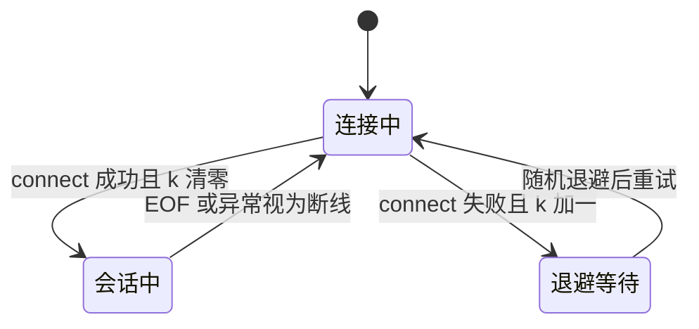

### Q2901 · 断线重连的指数退避完整实现:全抖动与成功重置

> 难度:★★★ | 标签:重连, 指数退避, full jitter

**问**:写一个断线重连,大多数人只会 while True 加 connect 再 sleep,差在哪?

**答**:差三件事。第一,退避要指数爬升:第 k 次失败后等 min(cap, base 乘 2 的 k 次方),上限防止无限翻倍;第二,要加 full jitter——在 0 到 delay 之间取均匀随机数,几百个客户端同时断线时,固定退避会让它们踩着同一个节拍重连,服务端刚喘口气就被第二波打瘫;第三,成功要重置:k 在会话建立成功的那一刻清零,恢复期不继承故障期攒出来的退避深度。实测把服务端开关四个阶段,时间线里能直接看到退避逐次爬升、重连成功后归零、下个故障期从头爬。还有一个反直觉的坑:服务端只停 accept 并不拒绝新连接,listen backlog 会让内核继续完成握手,connect 照样成功——故障期必须真正 close 监听套接字。

- 退避上限必须有,否则按 2 的 k 次方翻倍,一小时后一次重试要等几十分钟;

- EOF 和 connect 被拒是两种"断线",处理路径相同但日志要分得开;

- 重连成功后的第一件事是恢复业务状态,不是急着发包。

```python
# file: code/02_并发与网络工程/q2901_reconnect_backoff.py
# -*- coding: utf-8 -*-
"""断线重连的指数退避完整实现: 退避 + 全抖动 + 成功即重置。

- 服务端分阶段开关: 开 -> 关 -> 开 -> 关 -> 开, 模拟网络抖动;
- 失败后等待 delay = min(cap, base * 2^k) 区间内的均匀随机数 (full jitter);
- 会话成功建立即把 k 清零: 恢复期不继承故障期攒出来的退避深度;
- 时间线直接可见: 退避爬升 -> 重连成功 -> 重置归零 -> 再爬升。
"""
import random
import socket
import threading
import time

BASE = 0.03       # 首次退避基数
CAP = 0.15        # 退避上限

random.seed(11)
T0 = time.monotonic()


class FlapServer:
    """可控开关的 TCP 服务。

    关阶段必须真正 close 监听套接字: 只停 accept 不够,
    listen backlog 会让内核继续完成握手, connect 照样成功。
    """

    def __init__(self):
        self.addr = ("127.0.0.1", 0)
        self.port = 0
        self.srv = None
        self.conns = []
        self.lock = threading.Lock()
        self.opened = threading.Event()
        self._open()
        self.opened.set()
        threading.Thread(target=self._loop, daemon=True).start()

    def _open(self):
        srv = socket.socket()
        srv.setsockopt(socket.SOL_SOCKET, socket.SO_REUSEADDR, 1)
        srv.bind(self.addr)
        if self.addr[1] == 0:
            self.addr = ("127.0.0.1", srv.getsockname()[1])
            self.port = self.addr[1]
        srv.listen(16)
        srv.settimeout(0.05)
        self.srv = srv

    def _close(self):
        with self.lock:                       # 掐断存量连接
            while self.conns:
                try:
                    self.conns.pop().close()
                except OSError:
                    pass
        if self.srv is not None:
            try:
                self.srv.close()              # 拒绝新连接: 连接被拒
            except OSError:
                pass
            self.srv = None

    def set_open(self, value):
        if value and self.srv is None:
            self._open()
            self.opened.set()
        elif not value and self.srv is not None:
            self.opened.clear()
            self._close()

    def _loop(self):
        while True:
            srv = self.srv
            if srv is None:
                time.sleep(0.02)
                continue
            try:
                conn, _ = srv.accept()
            except (socket.timeout, OSError):
                continue
            with self.lock:
                self.conns.append(conn)
            threading.Thread(target=self._hold, args=(conn,), daemon=True).start()

    def _hold(self, conn):
        conn.settimeout(0.05)
        try:
            while self.opened.is_set():
                try:
                    conn.sendall(b".")        # 心跳式发字节维持会话
                except OSError:
                    break
                try:
                    conn.recv(64)
                except socket.timeout:
                    pass
                except OSError:
                    break
                time.sleep(0.03)
        finally:
            try:
                conn.close()
            except OSError:
                pass
            with self.lock:
                if conn in self.conns:
                    self.conns.remove(conn)


def client(host, port, stop, log):
    """重连循环: 连上 -> 保持会话 -> 断开 -> 退避重连。"""
    k = 0
    sessions = 0
    while not stop.is_set():
        try:
            s = socket.create_connection((host, port), timeout=0.15)
        except OSError:
            delay = random.uniform(0, min(CAP, BASE * (2 ** k)))   # 全抖动
            log.append(("retry", round(time.monotonic() - T0, 3), k,
                        round(delay * 1000)))
            k += 1
            if stop.wait(delay):
                break
            continue
        sessions += 1
        log.append(("up", round(time.monotonic() - T0, 3), 0, 0))
        k = 0                              # 成功即重置退避
        s.settimeout(0.05)
        alive = True
        while alive and not stop.is_set():
            try:
                if s.recv(64) == b"":      # EOF: 服务端掐线
                    alive = False
            except socket.timeout:
                pass                       # 没数据不等于死
            except OSError:
                alive = False
        try:
            s.close()
        except OSError:
            pass
        if not alive and not stop.is_set():
            log.append(("down", round(time.monotonic() - T0, 3), 0, 0))
    return sessions


if __name__ == "__main__":
    srv = FlapServer()
    stop = threading.Event()
    log = []
    result = {}

    def run():
        result["sessions"] = client("127.0.0.1", srv.port, stop, log)

    ct = threading.Thread(target=run, daemon=True)
    ct.start()
    time.sleep(0.2)                        # 第一段会话建立
    srv.set_open(False)                    # 故障期 1
    time.sleep(0.45)
    srv.set_open(True)                     # 恢复期 1
    time.sleep(0.45)
    srv.set_open(False)                    # 故障期 2
    time.sleep(0.45)
    srv.set_open(True)                     # 恢复期 2
    time.sleep(0.5)
    stop.set()
    ct.join(timeout=3)

    ups = [e for e in log if e[0] == "up"]
    retries = [e for e in log if e[0] == "retry"]
    print("会话建立 %d 次, 重试 %d 次" % (len(ups), len(retries)))
    for ev, t, k, d in log:
        print("  t=%.3f %-5s k=%d delay=%dms" % (t, ev, k, d))
    assert len(ups) >= 3 and len(retries) >= 4
    first_after_reset = [d for ev, _, k, d in retries if k == 0]
    assert first_after_reset, "没有观察到退避重置"
    print("要点: 全抖动防重连风暴, 成功会话把 k 清零, 退避只在连续失败中爬升")
```

**追问**:1) full jitter 和 equal jitter 怎么选?——full jitter 防节拍最彻底但首次重连可能等很短,equal jitter 保底一半间隔再随机,对重连速度敏感的服务选后者。2) 怎么在测试里验证退避逻辑?——把随机源和时钟做成可注入的依赖,或者像本例一样输出真实时间线人工核对爬升与重置。3) 底层机制:为什么只停 accept 关不掉服务?——listen 之后三次握手由内核完成,连接队列照常收客,connect 照样成功;真正拒绝新连接要 close 监听 socket(对端拿到 ConnectionRefusedError),这也是压测里"拒连"与"超时"必须分开统计的原因。4) 生产陷阱?——退避无上限,几十分钟后一次重试等几十分钟;成功重连后不重置 k,恢复期继承故障期深度;只处理 connect 失败不处理会话中途 EOF,连接假活;无 jitter 的重连风暴把刚恢复的服务端二次打瘫。



---
