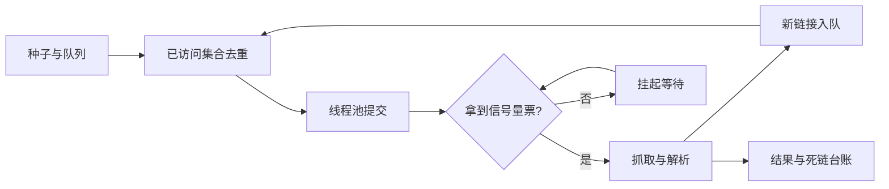

### Q2906 · 信号量限流的完整爬虫示例:窗口、去重与重试

> 难度:★★★ | 标签:爬虫, BoundedSemaphore, 限流, 去重

**问**:写一个"有礼貌"的并发爬虫,哪几个部件是必备的?

**答**:四个部件:并发窗口、去重集合、重试策略、失败隔离。BoundedSemaphore(3) 给抓取动作划窗口——线程池可以有 6 个线程,但同时在网的请求最多 3 个,实测峰值并发恰好 3,限流不是嘴上说说;已访问集合加锁去重,链接图有环也不怕死循环;5xx 重试一次,那是瞬时故障,4xx 记为死链不重试,重试无意义;单个 URL 的任何异常都被隔离在它自己的 future 里。这套结构和普通线程池爬虫的区别在限流粒度:线程池限的是线程数,信号量限的是"同时握着的连接数",对压垮对端这件事,后者才是直接原因。

- 窗口要套在"网络动作"外层,不是套在整个任务外层,解析不必占票;

- BoundedSemaphore 比裸 Semaphore 多一道防线:谁多归还一次当场爆炸;

- 生产上还要加每主机限速和 robots.txt 检查,窗口只是第一步。

```python
# file: code/02_并发与网络工程/q2906_crawler_sem.py
# -*- coding: utf-8 -*-
"""信号量限流的完整爬虫示例: 并发窗口 + 去重 + 重试。

- BoundedSemaphore(3) 划定抓取窗口: 同时在网的请求不超过 3 个;
- 已访问集合加锁去重: 同一 URL 全程只抓一次;
- 5xx 重试一次, 4xx 记为死链, 失败隔离在单 URL;
- 实测最大并发 <= 3, 用数据证明限流真的生效。
"""
import json
import re
import socket
import threading
import time
import urllib.error
import urllib.request
from concurrent.futures import ThreadPoolExecutor
from http.server import BaseHTTPRequestHandler, ThreadingHTTPServer

OPENER = urllib.request.build_opener(urllib.request.ProxyHandler({}))


class Handler(BaseHTTPRequestHandler):
    hits = {}
    lock = threading.Lock()

    def do_GET(self):
        with Handler.lock:
            Handler.hits[self.path] = Handler.hits.get(self.path, 0) + 1
            n = Handler.hits[self.path]
        time.sleep(0.02)                        # 模拟网络往返
        if self.path == "/flaky" and n < 2:     # 首次 503, 重试可愈
            self.send_response(503)
            self.send_header("Content-Length", "0")
            self.end_headers()
            return
        if re.match(r"^/p\d+$", self.path):
            body = ('<a href="/">home</a><a href="/p%d">next</a>'
                    % (int(self.path[2:]) % 8 + 1)).encode()
        elif self.path == "/":
            body = ("".join('<a href="/p%d">p%d</a>' % (i, i)
                            for i in range(1, 9))
                    + "<a href='/flaky'>flaky</a>").encode()
        elif self.path == "/flaky":
            body = b"<a href='/'>home</a>"
        else:
            self.send_response(404)
            self.send_header("Content-Length", "0")
            self.end_headers()
            return
        self.send_response(200)
        self.send_header("Content-Type", "text/html")
        self.send_header("Content-Length", str(len(body)))
        self.end_headers()
        self.wfile.write(body)

    def log_message(self, *args):
        pass


def wait_port(port, timeout=5.0):
    deadline = time.monotonic() + timeout
    while time.monotonic() < deadline:
        try:
            with socket.create_connection(("127.0.0.1", port), timeout=0.2):
                return True
        except OSError:
            time.sleep(0.05)
    return False


class Crawler:
    def __init__(self, base, window=3):
        self.base = base
        self.sem = threading.BoundedSemaphore(window)
        self.visited = set()
        self.vlock = threading.Lock()
        self.cur = 0
        self.max_cur = 0
        self.clock = threading.Lock()
        self.pages = {}
        self.dead = []

    def fetch(self, path):
        with self.sem:                          # 并发窗口: 进门先拿票
            with self.clock:
                self.cur += 1
                self.max_cur = max(self.max_cur, self.cur)
            try:
                req = urllib.request.Request(self.base + path)
                try:
                    with OPENER.open(req, timeout=2) as resp:
                        html = resp.read().decode("utf-8")
                except urllib.error.HTTPError as exc:
                    if exc.code >= 500:         # 5xx 重试一次
                        time.sleep(0.05)
                        with OPENER.open(req, timeout=2) as resp:
                            html = resp.read().decode("utf-8")
                    else:
                        self.dead.append(path)  # 4xx 死链
                        return []
            except (urllib.error.URLError, OSError) as exc:
                self.dead.append("%s (%s)" % (path, type(exc).__name__))
                return []
            finally:
                with self.clock:
                    self.cur -= 1
            self.pages[path] = len(html)
            return re.findall(r'href="(/\w*)"', html) + \
                   re.findall(r"href='(/\w*)'", html)

    def crawl(self, start="/"):
        pool = ThreadPoolExecutor(max_workers=6)
        queue = [start]
        while queue:
            batch, queue = queue[:12], queue[12:]
            futures = []
            for path in batch:
                with self.vlock:                # 提交前去重
                    if path in self.visited:
                        continue
                    self.visited.add(path)
                futures.append(pool.submit(self.fetch, path))
            for fut in futures:
                for link in fut.result():
                    with self.vlock:
                        if link not in self.visited:
                            queue.append(link)
        pool.shutdown()


if __name__ == "__main__":
    srv = ThreadingHTTPServer(("127.0.0.1", 0), Handler)
    srv.daemon_threads = True
    port = srv.server_address[1]
    threading.Thread(target=srv.serve_forever, daemon=True).start()
    assert wait_port(port)

    crawler = Crawler("http://127.0.0.1:%d" % port, window=3)
    t1 = time.perf_counter()
    crawler.crawl()
    dt = time.perf_counter() - t1

    print("抓取页面 %d 个, 死链 %d 个, 耗时 %.2fs"
          % (len(crawler.pages), len(crawler.dead), dt))
    print("最大并发观测值: %d (窗口上限 3)" % crawler.max_cur)
    assert len(crawler.pages) == 10             # 8 个 /pN + / + /flaky
    assert "/flaky" in crawler.pages, "flaky 页重试后应成功"
    assert crawler.max_cur <= 3, "限流被突破"
    assert dt < 10 * 0.02 + 1, "并发没有生效"
    srv.shutdown()
    print("要点: 信号量守门, 去重防环, 5xx 重试 4xx 死链, 并发用数据说话")
```

**追问**:1) 想对不同域名用不同窗口怎么办?——按域名分桶,每桶一个信号量,借票前先看 URL 属于哪个桶。2) 重试放在信号量里面还是外面?——里面:重试的请求也该占票,否则限流窗口在重试场景下失真。3) 底层机制:信号量限流与线程池限流的粒度差异?——线程池限 worker 数,worker 在解析、写盘时也占着名额;信号量包在网络动作外层,解析不占票,窗口真实对应"同时在网的请求数",对"压垮对端"这个被保护对象,后者才对得上因果。4) 生产陷阱?——重试无退避直接二连发,窗口内挤占加倍;异常路径漏 release,BoundedSemaphore 当场抓到、裸 Semaphore 悄悄扩容;没有每主机限速,多域名抓取时单站点被打爆;robots.txt 与 UA 声明缺失,礼貌性归零。



---
