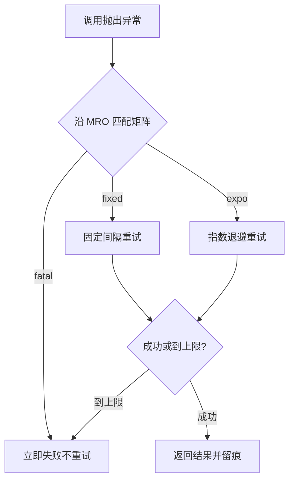

### Q2912 · 异常分类的重试矩阵:可重试、致命与退避分档

> 难度:★★★★ | 标签:异常分类, 重试, 决策表

**问**:重试代码里 if-else 堆了一屏,每个调用点还不一样,怎么治?

**答**:把"哪种异常、用什么姿势重试、试几次"提炼成一张数据表:异常类映射到策略、最大尝试次数、基础退避。执行器只认表:抛出的异常沿 isinstance 也就是 MRO 匹配,命中的行决定命运——fatal 一次都不重试,fixed 按固定间隔重试,expo 指数退避重试。表要按"从具体到一般"排序,TimeoutError 和 ConnectionError 都是 OSError 的子类,必须排在 OSError 前面,否则全被父类的慢速策略截胡,实测用例一特意验证了这一点。没登记的异常默认 fatal:重试是给瞬态故障的礼遇,不是给 bug 的,宁可失败也别重试放大。

- 矩阵是数据,执行器是算法,新增异常类型只加一行,不改逻辑;

- 每次尝试都要留痕:异常类、策略、退避时长,排障时这就是重试黑匣子;

- fatal 档的存在提醒我们:有些失败重试一百次也白搭,快速失败才是止损。

```python
# file: code/02_并发与网络工程/q2912_retry_matrix.py
# -*- coding: utf-8 -*-
"""异常分类的重试矩阵: 可重试、致命与退避分档。

- 矩阵按"从具体到一般"排列, classify 用 isinstance 沿 MRO 匹配;
- TimeoutError / ConnectionError 都是 OSError 子类, 必须排在前面;
- 未登记的异常默认致命: 重试是给瞬态故障的, 不是给 bug 的。
"""
import time

# (异常类, 策略, 最大尝试次数, 基础退避秒)
# 顺序即优先级: 子类在前, 父类在后
RETRY_MATRIX = [
    (ValueError, "fatal", 1, 0.0),         # 参数错: 重试无意义
    (TimeoutError, "fixed", 3, 0.02),      # 超时: 快速固定间隔
    (ConnectionError, "expo", 3, 0.05),    # 连接错: 指数退避
    (OSError, "expo", 2, 0.08),            # 其他 IO 错: 慢速兜底
]


def classify(exc):
    """沿 MRO 找最近的登记项。"""
    for cls, policy, tries, delay in RETRY_MATRIX:
        if isinstance(exc, cls):
            return policy, tries, delay
    return "fatal", 1, 0.0                 # 未登记: 默认不重试


def run_with_matrix(fn, log):
    """按矩阵重试执行 fn, 返回 (成功?, 尝试次数, 结果或异常)。"""
    attempt = 0
    while True:
        attempt += 1
        try:
            return True, attempt, fn()
        except Exception as exc:           # 演示: 一律接住走矩阵分诊
            policy, tries, delay = classify(exc)
            log.append((attempt, type(exc).__name__, policy,
                        round(delay * 1000)))
            if policy == "fatal" or attempt >= tries:
                return False, attempt, exc
            if policy == "fixed":
                time.sleep(delay)
            else:                          # expo
                time.sleep(delay * (2 ** (attempt - 1)))


if __name__ == "__main__":
    # 用例一: 超时两次后成功 -> 命中 TimeoutError 而非其父类 OSError
    counter = {"n": 0}

    def flaky_timeout():
        counter["n"] += 1
        if counter["n"] < 3:
            raise TimeoutError("read timeout")
        return "ok-after-2-retries"

    log1 = []
    ok, tries, result = run_with_matrix(flaky_timeout, log1)
    print("用例一: ok=%s 尝试 %d 次, 决策路径 %s"
          % (ok, tries, [(e, p) for _, e, p, _ in log1] + [("ok",)]))
    assert ok and tries == 3
    assert log1[0][2] == "fixed", "应命中 TimeoutError 而非 OSError"

    # 用例二: 连接错误一直失败 -> 指数退避 3 次后放弃
    def always_down():
        raise ConnectionError("refused")

    log2 = []
    ok, tries, exc = run_with_matrix(always_down, log2)
    print("用例二: ok=%s 尝试 %d 次, 退避 ms=%s"
          % (ok, tries, [d for _, _, _, d in log2]))
    assert not ok and tries == 3 and log2[0][2] == "expo"

    # 用例三: ValueError -> 立即放弃, 一次都不重试
    def bad_input():
        raise ValueError("invalid argument")

    log3 = []
    ok, tries, exc = run_with_matrix(bad_input, log3)
    print("用例三: ok=%s 尝试 %d 次 (fatal 不重试)" % (ok, tries))
    assert not ok and tries == 1

    # 用例四: 未登记异常 -> 默认致命
    log4 = []
    ok, tries, exc = run_with_matrix(lambda: (_ for _ in ()).throw(KeyError("x")),
                                     log4)
    print("用例四: ok=%s 尝试 %d 次 (未登记默认致命)" % (ok, tries))
    assert not ok and tries == 1

    print("矩阵一览:")
    for cls, policy, tries, delay in RETRY_MATRIX:
        print("  %-16s -> %-6s tries=%d base=%dms"
              % (cls.__name__, policy, tries, delay * 1000))
    print("要点: 矩阵排序即优先级, 子类先判; 未登记的异常宁可失败也不重试")
```

**追问**:1) 重试和熔断什么关系?——矩阵管单次调用怎么重试,熔断管失败率超标后整个依赖别再试,一个微观一个宏观,叠加使用。2) 未登记异常默认 fatal 会不会太保守?——反过来才叫激进:默认重试会把 KeyError 这类 bug 重放 N 次,还把现场搅乱。3) 底层机制:MRO 匹配为什么要求"具体在前"?——isinstance 沿表顺序命中首个为真的行,TimeoutError 与 ConnectionError 都是 OSError 子类,父类排前就把子类策略全部截胡;矩阵本质是数据化的 elif 链,顺序即优先级。4) 生产陷阱?——多级调用各层都重试,次数相乘(每层 3 次、三层 27 次);fixed 策略对"对端过载"雪上加霜,过载类应退避而不是固定节拍重打;重试日志不留策略与退避时长,排障无黑匣子;没确认幂等就给非幂等操作配重试。



---
