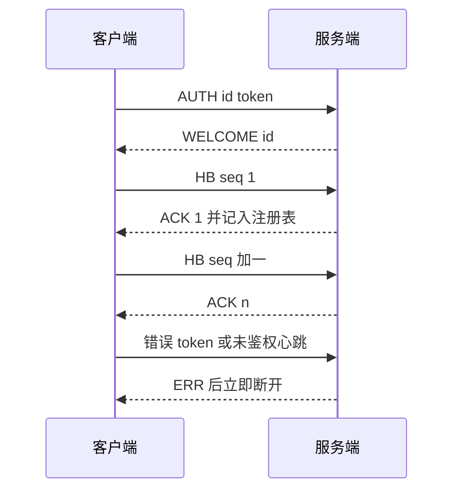

### Q2917 · 带身份的心跳协议:鉴权、序号与注册表

> 难度:★★★★ | 标签:协议设计, 鉴权, 心跳, 状态机

**问**:裸的心跳协议谁都能连、想怎么发就怎么发,怎么把它变成一个有身份、有台账的协议?

**答**:三条纪律。第一,鉴权前置:会话的第一条消息必须是 AUTH 加 id 加 token,token 对照服务端 allowlist,错一个字就回 ERR auth 然后断开——不鉴权就不给后续机会,不给试探空间;第二,状态机守序:没鉴权就发 HB,回 ERR noauth 直接断,协议顺序本身就是权限的一部分;第三,序号台账:每个合法连接的心跳带自增 seq,服务端按 client_id 记录最后序号,重连对账、检测丢包全靠它。实测三个客户端:alice 合法走完全程,注册表里精确记到 seq 3;bob 拿错 token,当场 ERR auth;eve 跳过 AUTH 直接心跳,当场 ERR noauth,注册表里查无此人。

- AUTH 是状态机的入口边,进入已鉴权状态后心跳才被受理;

- token 走 allowlist 是演示,生产上换成 HMAC 签名或 mTLS,纪律不变;

- 注册表让心跳从"保活"升级为"可审计":谁在线、最后心跳是什么时候,一查便知。

```python
# file: code/02_并发与网络工程/q2917_auth_heartbeat.py
# -*- coding: utf-8 -*-
"""带身份的心跳协议: 鉴权 -> 序号心跳 -> 注册表台账。

- 帧序即状态机: AUTH 必须是第一条, 没鉴权就发心跳直接断开;
- token 走服务端 allowlist, 鉴权失败回 ERR 后断开, 不给试探机会;
- 服务端维护注册表: 每个 client_id 的最后心跳序号, 掉线可查账。
"""
import socket
import threading
import time

ALLOWED = {"alice": "tok-a", "bob": "tok-b"}


class HeartbeatServer:
    def __init__(self):
        self.srv = socket.socket()
        self.srv.setsockopt(socket.SOL_SOCKET, socket.SO_REUSEADDR, 1)
        self.srv.bind(("127.0.0.1", 0))
        self.port = self.srv.getsockname()[1]
        self.srv.listen(8)
        self.srv.settimeout(0.1)
        self.registry = {}                  # client_id -> 最后心跳序号
        self.lock = threading.Lock()
        self.stop = threading.Event()
        threading.Thread(target=self._accept_loop, daemon=True).start()

    def _accept_loop(self):
        while not self.stop.is_set():
            try:
                conn, _ = self.srv.accept()
            except socket.timeout:
                continue
            threading.Thread(target=self._handle, args=(conn,),
                             daemon=True).start()

    def _reply(self, conn, line):
        conn.sendall(line + b"\n")

    def _handle(self, conn):
        who = None
        try:
            conn.settimeout(2)
            buf = b""
            while True:
                data = conn.recv(256)
                if not data:
                    break
                buf += data
                while b"\n" in buf:
                    line, buf = buf.split(b"\n", 1)
                    parts = line.decode().split()
                    if parts[0] == "AUTH" and len(parts) == 3:
                        cid, token = parts[1], parts[2]
                        if ALLOWED.get(cid) != token:
                            self._reply(conn, b"ERR auth")
                            return           # 鉴权失败: 回话即断
                        who = cid
                        self._reply(conn, b"WELCOME " + cid.encode())
                    elif parts[0] == "HB":
                        if who is None:
                            self._reply(conn, b"ERR noauth")
                            return           # 没鉴权就想心跳: 断
                        seq = int(parts[1])
                        with self.lock:
                            self.registry[who] = seq
                        self._reply(conn, b"ACK %d" % seq)
                    else:
                        self._reply(conn, b"ERR proto")
                        return
        except (OSError, IndexError, ValueError):
            pass
        finally:
            conn.close()

    def shutdown(self):
        self.stop.set()
        self.srv.close()


def wait_port(port, timeout=5.0):
    deadline = time.monotonic() + timeout
    while time.monotonic() < deadline:
        try:
            with socket.create_connection(("127.0.0.1", port), timeout=0.2):
                return True
        except OSError:
            time.sleep(0.05)
    return False


def talk(port, lines, want_replies):
    """发一批行, 收等量应答; 对端断开时以 EOF 结束。"""
    sock = socket.create_connection(("127.0.0.1", port), timeout=2)
    sock.settimeout(2)
    replies = []
    buf = b""
    for line in lines:
        sock.sendall(line + b"\n")
    try:
        while len(replies) < want_replies:
            data = sock.recv(256)
            if not data:
                replies.append(b"<EOF>")
                break
            buf += data
            while b"\n" in buf and len(replies) < want_replies:
                r, buf = buf.split(b"\n", 1)
                replies.append(r)
    except OSError:
        replies.append(b"<EOF>")
    sock.close()
    return replies


if __name__ == "__main__":
    srv = HeartbeatServer()
    assert wait_port(srv.port)

    good = talk(srv.port,
                [b"AUTH alice tok-a", b"HB 1", b"HB 2", b"HB 3"], 4)
    bad = talk(srv.port,
               [b"AUTH bob wrong-token"], 1)
    sneaky = talk(srv.port,
                  [b"HB 1"], 1)             # 跳过 AUTH 直接心跳

    print("合法客户端 alice:", [r.decode() for r in good])
    print("错 token 的 bob:", [r.decode() for r in bad])
    print("未鉴权的 eve:", [r.decode() for r in sneaky])
    time.sleep(0.1)
    print("服务端注册表:", dict(srv.registry))
    assert good[:4] == [b"WELCOME alice", b"ACK 1", b"ACK 2", b"ACK 3"]
    assert bad == [b"ERR auth"]
    assert sneaky == [b"ERR noauth"]
    assert srv.registry.get("alice") == 3
    assert "bob" not in srv.registry and "eve" not in srv.registry
    srv.shutdown()
    print("要点: 协议的第一条消息定身份, 心跳带序号可对账, 台账只记合法连接")
```

**追问**:1) AUTH 请求本身被重放怎么办?——加时间戳和 nonce 做挑战应答,或直接 mTLS,让"重放同一条 AUTH"失效。2) 心跳和业务消息要不要分通道?——同连接内用消息类型前缀区分即可,本例的 HB 与 AUTH 就是,只有心跳流量巨大时才考虑独立通道。3) 底层机制:为什么"回 ERR 即断"而不是容错继续?——协议状态机把每条非法消息视为对端实现有 bug 或恶意试探,继续服务等于给试探者持续机会;断开让失败显性化、可计数,配合连接级限速才构成完整防线。4) 生产陷阱?——token 明文走明文通道(生产用 HMAC/mTLS);鉴权失败不区分"错 token"与"未注册用户",给账号枚举提供信息;注册表只增不删,掉线客户端留 stale 记录误导在线判断;心跳序号不校验跳号,丢包静默。



---
