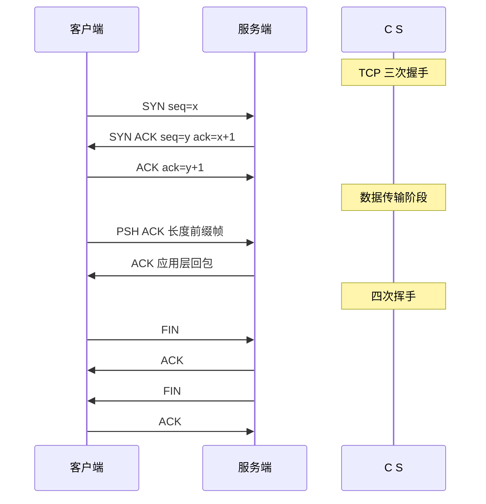

### Q363 · UDP 通信的特点与最小实现

> 难度:★★☆ | 标签:网络编程, UDP

**问**:UDP 和 TCP 在编程模型上的核心区别是什么?什么场景选 UDP?

**答**:UDP 无连接,服务端只需 `socket → bind`,用 `sendto/recvfrom` 直接收发数据报,无握手、无确认、不保证顺序与到达,但开销小、有报文边界。适合 DNS、日志上报、实时音视频、心跳广播等"允许丢、要求快"的场景;要求可靠需在应用层自己实现确认重传(如 QUIC 思路)。

```python
# file: code/02_并发与网络工程/q363_udp_demo.py
"""最小 UDP 服务端与客户端。"""
import socket
import threading


def main():
    srv = socket.socket(socket.AF_INET, socket.SOCK_DGRAM)  # UDP
    srv.bind(("127.0.0.1", 0))
    port = srv.getsockname()[1]
    threading.Thread(target=_serve, args=(srv,), daemon=True).start()

    cli = socket.socket(socket.AF_INET, socket.SOCK_DGRAM)
    cli.settimeout(2)
    cli.sendto(b"ping", ("127.0.0.1", port))  # 无连接,直接发
    data, addr = cli.recvfrom(1024)  # 返回数据和来源地址
    print("udp reply:", data, "from", addr)


def _serve(srv):
    while True:
        data, addr = srv.recvfrom(1024)
        srv.sendto(b"pong:" + data, addr)  # 回给来源地址


if __name__ == "__main__":
    main()
```

**追问**:
- UDP 单个数据报最大多大?受 MTU 影响局域网约 1472 字节安全,理论上限 65507 字节,过大易被分片丢包。
- UDP 如何"广播"?绑定 `SO_BROADCAST` 选项后向 `255.255.255.255` 或子网广播地址 `sendto`。


