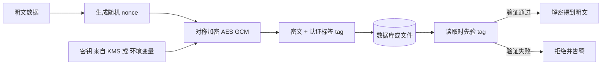

### Q377 · 对称加密概念与标准库可跑的替代方案

> 难度:★★★ | 标签:加密, AES, Fernet

**问**:Python 标准库能做 AES 吗?数据落库加密的正确姿势是什么?

**答**:标准库不做 AES(底层 C 实现未收录),生产用 `cryptography` 包:`Fernet`(AES-128-CBC + HMAC,自带认证)最省心,`AESGCM` 是现代 AEAD 首选。要点:①密钥放 KMS/环境变量,绝不入库;②每次加密用随机 nonce/IV,重置 nonce 是致命错误;③优先带认证的 AEAD 模式(GCM/ChaCha20-Poly1305),不要裸 CBC。标准库内可跑的"认证加密等价物"是"hashlib 加密 + HMAC 认证"的组合,可演示完整流程。

```python
# file: code/02_并发与网络工程/q377_symmetric_crypto.py
"""对称加密概念:标准库实现 加密混淆 + HMAC 认证 的完整流程。
生产请用 cryptography 的 Fernet/AESGCM,此处演示原理。"""
import base64
import hashlib
import hmac
import os

KEY = hashlib.sha256(b"env-secret-key").digest()  # 32 字节密钥


def derive_keystream(nonce: bytes, length: int) -> bytes:
    """用 SHA256 计数器模式生成密钥流,演示流式加密原理。"""
    stream = b""
    counter = 0
    while len(stream) < length:
        stream += hmac.new(KEY, nonce + counter.to_bytes(4, "big"), hashlib.sha256).digest()
        counter += 1
    return stream[:length]


def encrypt(plaintext: bytes) -> bytes:
    nonce = os.urandom(16)  # 每次加密必须用全新随机 nonce
    stream = derive_keystream(nonce, len(plaintext))
    ciphertext = bytes(a ^ b for a, b in zip(plaintext, stream))
    tag = hmac.new(KEY, nonce + ciphertext, hashlib.sha256).digest()  # Encrypt-then-MAC
    return nonce + ciphertext + tag


def decrypt(blob: bytes) -> bytes:
    nonce, tag, ciphertext = blob[:16], blob[-32:], blob[16:-32]
    expect = hmac.new(KEY, nonce + ciphertext, hashlib.sha256).digest()
    if not hmac.compare_digest(expect, tag):
        raise ValueError("认证失败:密文被篡改或密钥不符")
    stream = derive_keystream(nonce, len(ciphertext))
    return bytes(a ^ b for a, b in zip(ciphertext, stream))


if __name__ == "__main__":
    blob = encrypt("机密数据 salary=12345".encode())
    print("密文 b64:", base64.b64encode(blob).decode()[:40], "...")
    print("解密:", decrypt(blob).decode())
    tampered = bytearray(blob)
    tampered[20] ^= 0xFF
    try:
        decrypt(bytes(tampered))
    except ValueError as e:
        print("防篡改生效:", e)
```

**追问**:
- Fernet 一行加解密怎么写?`Fernet(key).encrypt(data)` / `.decrypt(token)`,key 是 `Fernet.generate_key()` 生成的 32 字节 urlsafe base64。
- 对称和非对称加密怎么配合?非对称(RSA/ECDH)只用来交换或封装对称密钥,大数据一律对称加密,即 TLS/信封加密的思路。


