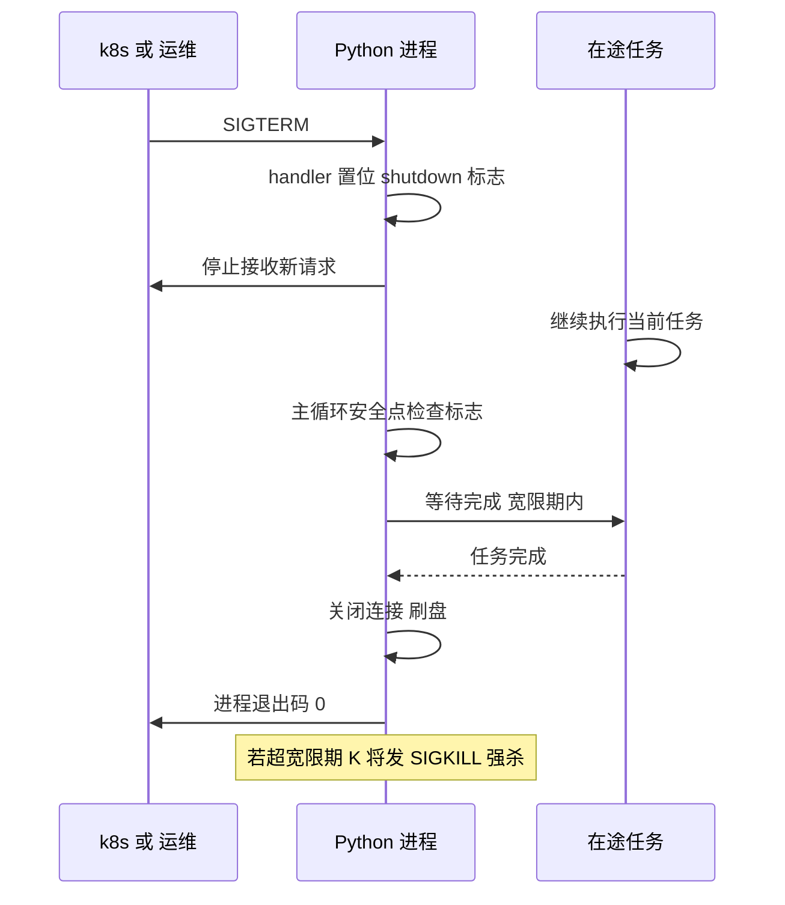

### Q384 · 信号处理:优雅停机

> 难度:★★★ | 标签:signal, 优雅停机, 运维

**问**:kill 进程时如何保证正在处理的请求做完、资源正确释放?

**答**:用 `signal.signal(SIGTERM/SIGINT, handler)` 注册处理函数,把"该停了"设为标志位,主循环在每个安全点检查标志:停止接收新任务 → 等待在途任务完成(设超时)→ 关闭连接/刷盘 → 退出。规则:①handler 里只做设置标志等轻量动作,复杂逻辑放主循环,因为信号处理器可能打断任意代码;②SIGKILL 不可捕获,是最后的强杀;③K8s 场景配合 `terminationGracePeriodSeconds`。可被捕获的信号还有 SIGHUP(常用作重载配置)。

```python
# file: code/02_并发与网络工程/q384_graceful_shutdown.py
"""优雅停机:SIGTERM/SIGINT 处理 + 安全点检查。"""
import signal
import sys
import time

shutdown = False


def handle_signal(signum, frame):
    global shutdown
    print(f"\n收到信号 {signal.Signals(signum).name}, 置位停机标志")
    shutdown = True  # handler 内只做最轻量动作


def main():
    signal.signal(signal.SIGTERM, handle_signal)
    signal.signal(signal.SIGINT, handle_signal)  # Ctrl+C

    print("worker 启动, pid =", os_getpid(), "按 Ctrl+C 演示优雅停机")
    processed = 0
    while not shutdown:
        # 模拟处理一个任务
        time.sleep(0.2)
        processed += 1
        if processed >= 3:
            # 演示用:处理 3 个后向自己发 SIGTERM
            import os
            os.kill(os.getpid(), signal.SIGTERM)
    print(f"安全点检测到停机标志, 等待在途任务... 已处理 {processed} 个")
    print("关闭连接, 刷盘, 退出码 0")
    return 0


def os_getpid():
    import os
    return os.getpid()


if __name__ == "__main__":
    sys.exit(main())
```

**追问**:
- 多线程程序里 signal handler 在哪个线程执行?只在主线程执行,这也是为什么 worker 线程里注册信号无意义;asyncio 用 `loop.add_signal_handler`。
- 优雅停机超时了怎么办?在途任务未完成且宽限期将到,应记录状态快照后退出,依赖任务幂等性由重启后恢复。


