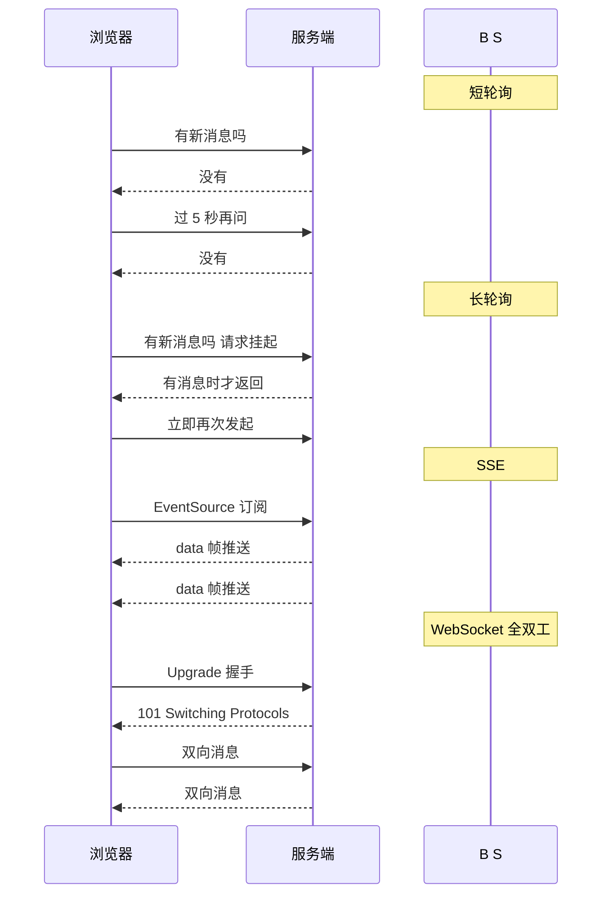

### Q393 · 轮询 vs 长轮询 vs SSE vs WebSocket

> 难度:★★★ | 标签:轮询, SSE, 实时通信

**问**:服务端要推送消息给浏览器,几种方案怎么选?

**答**:①短轮询:客户端定时请求,实现最简单,延迟=间隔,大量空请求浪费;②长轮询:请求挂起直到有数据才返回,延迟低,但服务端要维持大量挂起连接;③SSE:`Content-Type: text/event-stream` 单向服务端推送,基于 HTTP 自动重连,适合行情/进度/通知;④WebSocket:全双工,适合聊天/协作编辑,但要额外的连接管理与网关支持。选型口诀:单向推送选 SSE,双向交互选 WebSocket,低频更新短轮询足矣,兼容老基础设施用长轮询。

```python
# file: code/02_并发与网络工程/q393_sse_demo.py
"""SSE 服务端响应格式与客户端解析(标准库演示协议本身)。"""
from typing import Optional


def sse_format(data: str, event: Optional[str] = None, msg_id: Optional[str] = None) -> str:
    """把一条消息编码成 SSE 帧。注意: data 多行要拆成多个 data: 行。

    注: str | None(PEP 604)写法运行时求值要 3.10+, 参数默认值注解
    在 3.9 直接 TypeError, 兼容写法用 Optional 或 future annotations。
    """
    lines = []
    if msg_id:
        lines.append(f"id: {msg_id}")
    if event:
        lines.append(f"event: {event}")
    for chunk in data.splitlines() or [""]:
        lines.append(f"data: {chunk}")
    return "\n".join(lines) + "\n\n"  # 空行表示事件结束


def parse_sse_stream(chunks):
    """客户端侧: 按 空行 分帧解析。"""
    event = {}
    for raw in chunks:
        for line in raw.splitlines():
            if not line:
                if event:
                    yield event
                event = {}
                continue
            field, _, value = line.partition(": ")
            event[field] = value


if __name__ == "__main__":
    frames = [
        sse_format("进度 30%", event="progress", msg_id="1"),
        sse_format("进度 100%\n完成", event="progress", msg_id="2"),
    ]
    print("SSE 响应体样例:\n" + frames[0], end="")
    for ev in parse_sse_stream(frames):
        print("客户端收到:", ev)
```

**追问**:
- SSE 断线重连怎么续传?客户端带 `Last-Event-ID` 头重连,服务端据此从该 ID 之后继续推送;所以事件要分配单调递增 id。
- Nginx 反代 SSE 要注意什么?关闭缓冲(`proxy_buffering off`)、延长 `proxy_read_timeout`,否则事件会被缓冲到响应结束才发出。


