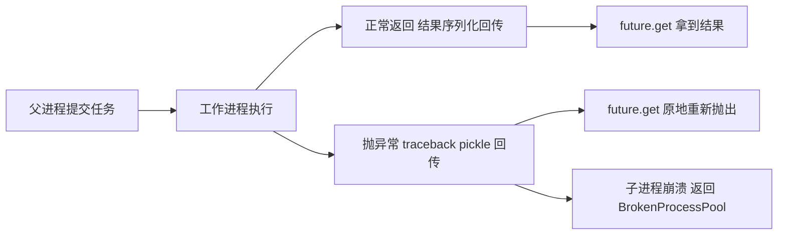

### Q565 · 线程池异常去哪了:submit 异常的捕获

> 难度:★★☆ | 标签:线程池, 异常处理, Future

**问**:线程池里任务抛了异常,主流程为什么毫无感觉?正确的异常处理姿势是什么?

**答**:submit 返回的 Future 会把异常存起来,只有调用 `future.result()` 时才重新抛出;如果没人 result、也没加回调,异常就被静默吞掉,只剩线程默认 excepthook 打一行(甚至因解释器版本而静默)。三种工程姿势:一是所有 submit 的地方必须 result 或用 as_completed 遍历;二是用 `add_done_callback` 统一检查 `future.exception()`;三是封装一个 safe_submit,在 worker 内部 try/except 记日志。批量任务一定要在 finally 里收割,否则失败的任务就"蒸发"了。

```python
# file: code/02_并发与网络工程/q565_pool_exception.py
from concurrent.futures import ThreadPoolExecutor, as_completed
import threading


def bad_task(i: int) -> int:
    if i == 3:
        raise ValueError(f"任务 {i} 失败")
    return i * 10


def safe_submit(pool, fn, *args):
    """包装 submit: worker 内部先记日志, 异常继续存入 Future。"""

    def inner():
        try:
            return fn(*args)
        except Exception as e:
            print(f"[worker {threading.current_thread().name}] 捕获异常: {e!r}")
            raise

    return pool.submit(inner)


if __name__ == "__main__":
    with ThreadPoolExecutor(max_workers=3) as pool:
        # 姿势一: as_completed 遍历时 result() 重新抛出
        futures = {pool.submit(bad_task, i): i for i in range(5)}
        for fut in as_completed(futures):
            try:
                print("结果:", fut.result())
            except ValueError as e:
                print("as_completed 收割到异常:", e)

    with ThreadPoolExecutor(max_workers=2) as pool:
        # 姿势二: done callback 统一检查
        def on_done(fut):
            exc = fut.exception()
            if exc is not None:
                print("回调发现异常:", repr(exc))

        fut = pool.submit(bad_task, 3)
        fut.add_done_callback(on_done)
        # 注意: result() 会把存入 Future 的异常原地重新抛出, 必须 try/except,
        # 否则演示脚本直接崩; 就算不收割, 回调里也会提前暴露。
        try:
            fut.result()
        except ValueError as e:
            print("主线程收割到异常:", e)
```

**追问**:1) ProcessPoolExecutor 的异常和线程池行为一致吗?——一致地通过 Future 传递,但异常对象要从子进程 pickle 回来,不能 pickle 的异常(如携带 lambda/连接句柄上下文的)会退化成 Secondary 异常(re-raised 时原 traceback 信息丢失),这点经常踩坑。2) submit 模式的纪律?——提交后必须有人拿结果:future.result()/add_done_callback;fire-and-forget 要显式收集 Future 列表统一收尾(Q603);worker 内部兜底把异常转成带上下文的业务异常(Q1558)。3) 与 callback 的边界?——回调在完成时同步执行,回调抛错只进 Future 不影响其他任务;回调里再做阻塞操作会拖慢 worker。4) 生产陷阱?——提交后丢弃 Future(异常静默,Q1561);回调里取结果自锁;裸 except 吞 KeyboardInterrupt。

---



---
