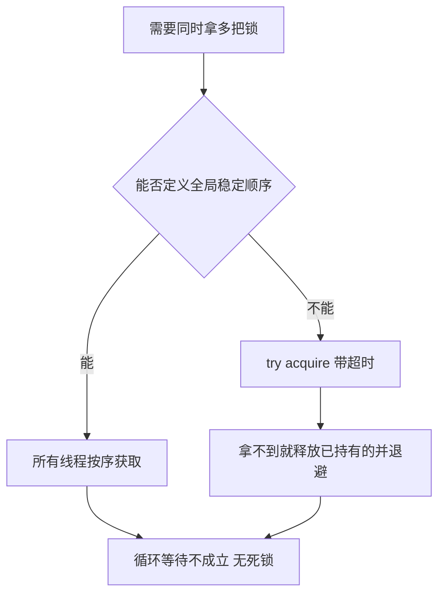

### Q572 · 锁排序与 try-acquire 回退:消除死锁的两个工程手段

> 难度:★★★☆ | 标签:死锁预防, 锁排序, Lock

**问**:业务上必须同时持有两把锁,除了"小心写代码"还有什么系统性的防死锁办法?

**答**:两个正交手段。锁排序:给所有锁定一个全局序(比如按对象 id 或业务命名),所有线程都按升序获取,循环等待条件从根上不成立——这是 Coffman 条件的釜底抽薪。try-acquire 回退:获取第二把锁用 `acquire(timeout=...)`,失败就释放已持有的锁退避重试,破坏"持有并等待"条件。排序适合锁集合固定的场景,回退适合锁集合动态的场景;两者可以叠加。注意回退策略要有退避,否则会活锁(不断抢、不断让)。

```python
# file: code/02_并发与网络工程/q572_lock_order.py
import threading
import time

lock_a = threading.Lock()
lock_b = threading.Lock()
lock_a_id, lock_b_id = id(lock_a), id(lock_b)  # 固定全局顺序的依据


def transfer_ordered(amount: float) -> None:
    """手段一: 永远先拿 id 较小的锁。"""
    first, second = (lock_a, lock_b) if lock_a_id < lock_b_id else (lock_b, lock_a)
    with first:
        time.sleep(0.05)
        with second:
            pass  # 临界区: 转账


def transfer_fallback(amount: float) -> bool:
    """手段二: try-acquire 失败则回退重来, 破坏持有并等待。"""
    while True:
        if lock_a.acquire(timeout=0.05):
            try:
                if lock_b.acquire(timeout=0.05):
                    try:
                        return True
                    finally:
                        lock_b.release()
            finally:
                lock_a.release()
        time.sleep(0.01)  # 退避, 防活锁加剧


if __name__ == "__main__":
    # 反例: 固定顺序 vs 乱序 — 乱序版本会死锁, 这里用超时探测证明
    def t_bad_1() -> None:
        with lock_a:
            time.sleep(0.1)
            got = lock_b.acquire(timeout=0.3)
            if not got:
                print("bad_1: 拿 lock_b 超时 → 若无超时这里就是死锁")
            else:
                lock_b.release()

    def t_bad_2() -> None:
        with lock_b:
            time.sleep(0.1)
            got = lock_a.acquire(timeout=0.3)
            if not got:
                print("bad_2: 拿 lock_a 超时 → 构成循环等待")
            else:
                lock_a.release()

    t1 = threading.Thread(target=t_bad_1)
    t2 = threading.Thread(target=t_bad_2)
    t1.start(); t2.start()
    t1.join(); t2.join()

    ts = [threading.Thread(target=transfer_ordered, args=(1,)) for _ in range(4)]
    ts += [threading.Thread(target=transfer_fallback, args=(1,)) for _ in range(4)]
    t0 = time.perf_counter()
    for t in ts:
        t.start()
    for t in ts:
        t.join()
    print(f"排序+回退版本 8 个任务全部完成, 耗时 {time.perf_counter() - t0:.2f}s")
```

**追问**:1) 锁排序中 id() 做序有什么坑?——CPython 对象 id 是地址,同一对象被回收后地址可能复用,序会变;应该用业务层稳定键(账户号、资源名)而不是内存地址。2) try-acquire 回退的设计?——拿不到第二把就释放第一把、退避重试;超时上限防活锁;与全局锁序二选一或并用(排序兜底 + 回退保吞吐,Q1852 的公平性思想)。3) 跨进程锁排序?——分布式锁同样要全局序(资源路径序);DB 行锁按主键序;不同层(线程/进程/分布式)各管各的循环。4) 生产陷阱?——动态创建资源的锁(无稳定键);回退无退避变成活锁风暴;嵌套调用链中序被中间层破坏。

---



---
