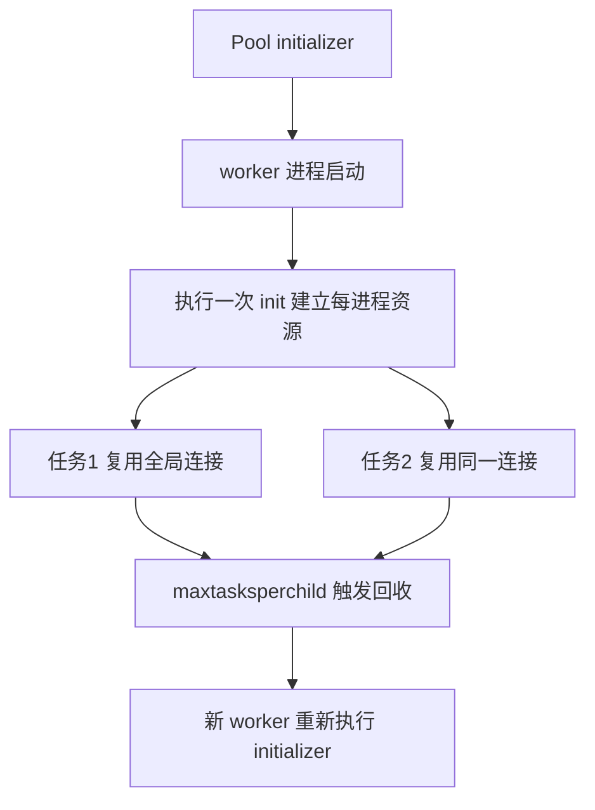

### Q575 · 进程池 initializer:每进程一次的初始化资源

> 难度:★★☆ | 标签:进程池, initializer, 资源复用

**问**:每个子进程都需要一个数据库连接/大模型句柄,怎么避免每个任务都重新建?

**答**:用池的 `initializer` + `initargs`:worker 进程启动时执行一次初始化函数,把资源挂到进程全局变量上,该进程后续处理的任务全部复用。关键认知:initializer 在每个 worker 各跑一次,资源是"每进程一份"而不是"每任务一份";配合 `maxtasksperchild` 可以控制资源周期性重建(防泄漏)。在 initializer 里要做失败处理——抛异常会让 worker 起不来,池会反复重试,应该快速失败并让上层感知。

```python
# file: code/02_并发与网络工程/q575_pool_initializer.py
from multiprocessing import Pool
import os

_CONN = None  # 每个 worker 进程各自的全局"连接"


def init_worker() -> None:
    global _CONN
    _CONN = {"pid": os.getpid(), "opened_at": "startup", "queries": 0}
    print(f"[init] worker {os.getpid()} 建立连接")


def query(sql: str) -> dict:
    _CONN["queries"] += 1  # 同一 worker 的多个任务复用同一连接
    return {"sql": sql, "conn_pid": _CONN["pid"], "queries": _CONN["queries"]}


if __name__ == "__main__":
    with Pool(processes=2, initializer=init_worker) as pool:
        results = pool.map(query, [f"SELECT {i}" for i in range(8)])
    conn_pids = {r["conn_pid"] for r in results}
    print(f"8 个任务只用了 {len(conn_pids)} 个连接 (pid: {conn_pids})")
    for r in results[:4]:
        print(r)
```

**追问**:1) initializer 里抛异常会怎样?——worker 初始化失败并退出,池会尝试拉起新 worker 再次失败,提交的任务卡住或抛 PoolNotRunning,所以初始化要幂等、快速、可诊断。2) initializer 的设计纪律?——每 worker 一次的昂贵资源(连接、模型加载)放这里;幂等 + 快速 + 失败可诊断(日志带 worker id);不依赖「worker 数」全局状态;与 gc.freeze 配合降低 fork COW(Q561 相关,Q1b 故事)。3) 与 initializer_args 的配合?——配置经参数传入而不是全局变量;每 worker 独立连接(容量×N,注意上限,Q1280)。4) 生产陷阱?——初始化连共享资源被打爆;初始化失败循环拉起;任务依赖「全局 import 时初始化」在 spawn 下失效。

---



---
