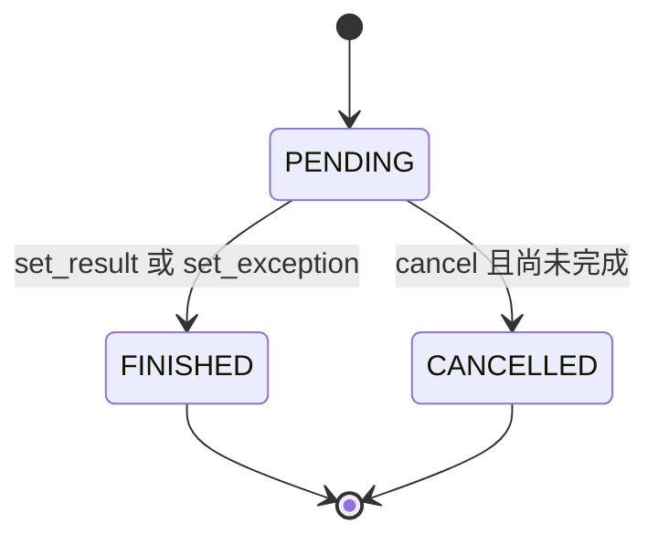

### Q578 · asyncio.Future 状态机:源码级拆解

> 难度:★★★★ | 标签:asyncio, Future, 状态机

**问**:asyncio.Future 内部有哪几个状态?set_result 之后到底发生了什么?

**答**:核心状态三个:_PENDING、_CANCELLED、_FINISHED,外加 result/exception 两个槽位。`set_result()` 做四件事:校验状态必须 PENDING 且非 done;存结果;置 _FINISHED;调用 `__schedule_callbacks()` 把每个回调用 `loop.call_soon` 排进就绪队列——注意回调不是立刻执行,而是下一轮循环才跑,这保证了单线程内的顺序性。`await future` 的本质是:Task 把自己的唤醒函数 add_done_callback 上去然后挂起,Future 完成时 call_soon 唤醒 Task 从 await 处继续。下面手写一个同构的迷你 Future 验证状态机与回调调度语义。注意一个关键差异:自定义 Future 不能直接被 asyncio.Task `await`——Task.__step 只认 asyncio.Future 和 None,yield 自定义对象会直接 `RuntimeError: Task got bad yield`,所以状态机部分用"回调 + 让出循环"驱动,挂起唤醒语义改用真 Future 演示。

```python
# file: code/02_并发与网络工程/q578_mini_future.py
import asyncio

PENDING = "PENDING"
CANCELLED = "CANCELLED"
FINISHED = "FINISHED"


class MiniFuture:
    """复刻 asyncio.Future 的状态机与回调调度语义。

    教学同构体, 刻意不实现 __await__: 若 yield self 交给 asyncio.Task,
    Task.__step 无法识别会抛 RuntimeError("Task got bad yield");
    要真正接入事件循环必须实现完整的 Future 协议(如 _asyncio.Future)。
    """

    def __init__(self, loop) -> None:
        self._state = PENDING
        self._result = None
        self._exception = None
        self._callbacks = []
        self._loop = loop

    def set_result(self, value) -> None:
        assert self._state == PENDING, "已完成状态不可再 set_result"
        self._result = value
        self._state = FINISHED
        self.__schedule_callbacks()

    def set_exception(self, exc: Exception) -> None:
        assert self._state == PENDING
        self._exception = exc
        self._state = FINISHED
        self.__schedule_callbacks()

    def cancel(self) -> bool:
        if self._state != PENDING:
            return False
        self._state = CANCELLED
        self.__schedule_callbacks()
        return True

    def __schedule_callbacks(self) -> None:
        cbs, self._callbacks = self._callbacks, []
        for cb in cbs:  # 关键: 经 call_soon 排队, 下一轮循环执行
            self._loop.call_soon(cb, self)

    def add_done_callback(self, cb) -> None:
        if self._state != PENDING:
            self._loop.call_soon(cb, self)
        else:
            self._callbacks.append(cb)

    def result(self):
        """读取结果: 带 exception 时原地重抛(同真 Future 语义)。"""
        if self._exception is not None:
            raise self._exception
        return self._result


async def main() -> None:
    loop = asyncio.get_running_loop()
    order = []

    # 1) 回调经 call_soon 排队: set 的下一轮才执行
    fut = MiniFuture(loop)
    fut.add_done_callback(lambda f: order.append("callback"))
    loop.call_soon(lambda: (order.append("set"), fut.set_result(42)))
    await asyncio.sleep(0)  # 让出一次: 排队的 set 执行(并继续把回调排进队列)
    await asyncio.sleep(0)  # 再让出一次: 回调这一轮才真正执行
    print("状态:", fut._state, "结果:", fut.result(), "顺序:", order)
    assert order == ["set", "callback"], "回调在 set 之后的下一轮循环执行"

    # 2) 已完成的 Future 拒绝再次 set
    try:
        fut.set_result(1)
    except AssertionError as e:
        print("重复 set 被拒绝:", e)

    # 3) set_exception / cancel 语义
    fut2 = MiniFuture(loop)
    fut2.set_exception(ValueError("boom"))
    try:
        fut2.result()
    except ValueError as e:
        print("set_exception 后取结果重抛:", e)
    fut3 = MiniFuture(loop)
    print("cancel 返回:", fut3.cancel(), "状态:", fut3._state)

    # 4) 挂起-唤醒语义用真 Future 演示(Task 只认 asyncio.Future)
    real = loop.create_future()
    loop.call_soon(lambda: real.set_result(99))
    print("真 Future await 唤醒:", await real)


if __name__ == "__main__":
    asyncio.run(main())
```

**追问**:1) 为什么 set_result 里要用 call_soon 而不是直接执行回调?——直接执行会在"发起者的调用栈里"运行别人注册的回调,深度嵌套且状态可能不一致;排队执行让所有回调都在事件循环的确定时机跑,维持单线程不变量。2) Future 状态机的完整转移?——PENDING→CANCELLED/CANCELLED_AND_NOT_FINISHED(3.8+ 取消语义)→FINISHED(RESULT/EXCEPTION);add_done_callback 在已完成时立即 call_soon 调度;result()/exception() 在未完成时阻塞(异步 Future 用 await)。3) 与 Task 的关系?——Task 是「驱动协程的 Future 子类」;__step 与 __wakeup 构成调度闭环(Q584)。4) 生产陷阱?——回调里抛异常没人管(内部记录);循环外 set_result(线程安全要用 call_soon_threadsafe,Q600);await 已取消 Future 的语义。

---



---
