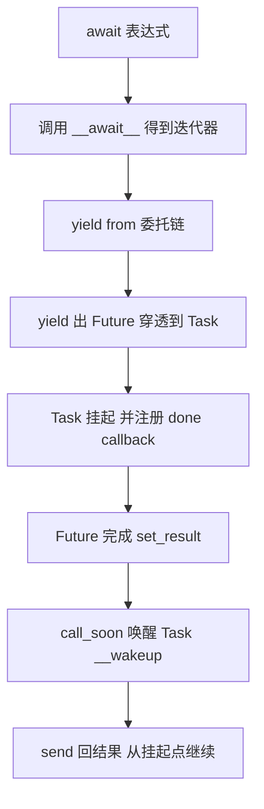

### Q584 · await 的本质:__await__ 协议与 yield from 血统

> 难度:★★★★ | 标签:await, 协议, 事件循环

**问**:await 一个对象时解释器做了什么?为什么说 async/await 是 yield from 的语法糖?

**答**:await x 要求 x 实现 `__await__`,返回一个迭代器;解释器对这个迭代器做 `yield from`,把内部 yield 出来的值(通常是 Future)一路抛给最外层的 Task,Task 看到的是 Future 就把自己挂到它的 done_callback 上,看到 None 就重新调度。协程对象本身也有 `__await__`(它的 `send/throw/close` 与生成器同源),所以 await 协程就是嵌套的 yield from 委托。这就是"用户态调度"的全部:挂起点 = yield 出 Future,恢复 = send 回结果。

```python
# file: code/02_并发与网络工程/q584_await_protocol.py
import asyncio


class Sleep:
    """自定义 awaitable: 手工实现 asyncio.sleep 的语义。"""

    def __init__(self, delay: float) -> None:
        self.delay = delay

    def __await__(self):
        # yield from 一个协程: 其中的 yield(Future) 会穿透到 Task 层
        return _sleep_impl(self.delay).__await__()


async def _sleep_impl(delay: float) -> None:
    loop = asyncio.get_running_loop()
    fut = loop.create_future()
    loop.call_later(delay, fut.set_result, None)  # 到点唤醒
    return await fut


async def main() -> None:
    print("开始")
    await Sleep(0.2)  # await 一个普通对象, 只要它有 __await__
    print("0.2 秒后继续")

    # 验证协程与生成器同源
    coro = _sleep_impl(0.05)
    print("协程有 send/close:", hasattr(coro, "send"), hasattr(coro, "close"))
    print("协程有 __await__:", hasattr(coro, "__await__"))
    coro.close()  # 不想跑完就手动关闭

    # Future 的 __await__ 会 yield 自身 — 这就是挂起机制的核心
    loop = asyncio.get_running_loop()
    fut = loop.create_future()
    agen = fut.__await__()
    yielded = next(agen)  # 手动驱动一步
    print("__await__ yield 出的是 Future 自身:", yielded is fut)
    fut.set_result("done")
    try:
        agen.send(None)
    except StopIteration as e:
        print("send 后得到结果:", e.value)


asyncio.run(main())
```

**追问**:1) Task 是怎么消费这些 yield 出来的 Future 的?——Task.__step 里捕获 yield 值,若是 Future 就 `future.add_done_callback(self.__wakeup)` 后返回;__wakeup 再 call_soon(__step) 恢复执行。2) __await__ 与 yield from 的血统?——await 编译为 GET_AWAITABLE + SEND,语义是带类型校验的 yield from(Q440);Future.__await__ yield self 是最底层挂起点;事件循环是唯一驱动者。3) 与 yield 的差异?——yield 纯迭代、yield from 委托、await = yield from + 协议校验;「穿透到最底层驱动者」是三者统一的模型。4) 生产陷阱?——在 __await__ 里 yield 循环不认识的对象(永久挂起);手动驱动协程(next)TypeError(Q439);理解错 await 阻塞的是「整个循环」(只挂起当前 Task)。

---



---
