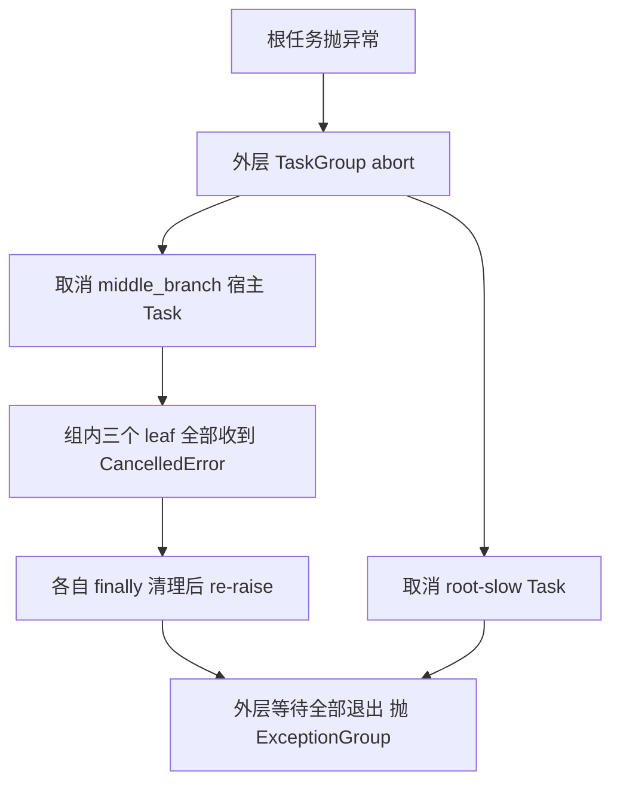

### Q589 · 取消树:TaskGroup 如何传播取消

> 难度:★★★☆ | 标签:TaskGroup, 取消, 结构化并发

**问**:TaskGroup 里一个任务抛异常,其他任务是什么命运?取消是怎么一层层传播的?

**答**:TaskGroup 是结构化并发的 asyncio 实现:进入时记录父任务,子任务出错时调用 `_abort()` 取消同组所有兄弟任务,父任务退出 `async with` 块时等待全部子任务终结,再把收集到的异常打包成 ExceptionGroup 抛出。传播是"向下一整层"的:外层取消 → 当前 Task 的 await 点抛 CancelledError → 该 Task 是 TaskGroup 的宿主,组内所有子任务一起被 cancel → 子任务 finally 清理后重新抛出。嵌套 TaskGroup 自然形成取消树,父收子、不跨层。注意 TaskGroup/`except*` 是 3.11+ 语法级特性,低版本连解析都过不了,demo 要用 exec 按需编译;3.9 用 gather 宿主 + 手动 cancel 等价演示(gather 的宿主被取消时会连带取消全部子任务)。

```python
# file: code/02_并发与网络工程/q589_cancel_tree.py
import asyncio
import sys


async def leaf(name: str, delay: float) -> str:
    try:
        await asyncio.sleep(delay)
        print(f"{name} 正常完成")
        return name
    except asyncio.CancelledError:
        print(f"{name} 被取消, 执行清理")
        await asyncio.sleep(0)  # 清理中也要给循环让位
        raise                    # 必须重新抛出


async def middle_branch_compat() -> None:
    """3.11 以下等价: gather 宿主被取消时会连带取消所有子任务。"""
    leaves = [
        asyncio.create_task(leaf("leaf-1", 0.05)),
        asyncio.create_task(leaf("leaf-2", 5.0)),   # 长任务: 会被连带取消
        asyncio.create_task(leaf("leaf-3", 5.0)),
    ]
    await asyncio.gather(*leaves)


# TaskGroup/except* 是 3.11+ 语法级特性, 放字符串按需编译
CANCEL_TREE_DEMO_311 = '''
async def middle_branch() -> None:
    async with asyncio.TaskGroup() as tg:
        tg.create_task(leaf("leaf-1", 0.05))
        tg.create_task(leaf("leaf-2", 5.0))   # 长任务: 会被连带取消
        tg.create_task(leaf("leaf-3", 5.0))


async def main() -> None:
    try:
        async with asyncio.TaskGroup() as outer:
            outer.create_task(middle_branch())
            outer.create_task(asyncio.sleep(10, result="root-slow"))
            await asyncio.sleep(0.1)
            raise RuntimeError("根任务主动失败, 触发整树取消")
    except* RuntimeError as eg:
        print("捕获根因:", eg.exceptions[0])
    except* asyncio.CancelledError:
        print("不应出现: 根任务自己不会收到取消")
    print("main 结束: 所有嵌套任务已退出")
'''


async def main_compat() -> None:
    # 3.9 等价演示: 手动逐层 cancel, 观察"向下一整层"的传播
    root = asyncio.create_task(middle_branch_compat())
    slow = asyncio.create_task(asyncio.sleep(10, result="root-slow"))
    await asyncio.sleep(0.05)
    print("根任务失败(以 cancel 模拟), 触发整树取消")
    root.cancel()
    slow.cancel()
    for name, t in (("middle_branch", root), ("root-slow", slow)):
        try:
            await t
        except asyncio.CancelledError:
            print(f"{name} 子树已随取消退出")
    print("main 结束: 所有嵌套任务已退出")


if __name__ == "__main__":
    if sys.version_info >= (3, 11):
        exec(compile(CANCEL_TREE_DEMO_311, "<cancel_tree_311>", "exec"), globals())
        asyncio.run(main())  # noqa: F821  由 CANCEL_TREE_DEMO_311 动态定义
    else:
        print(
            f"TaskGroup/except* 需要 Python 3.11+, "
            f"当前 {sys.version_info.major}.{sys.version_info.minor}, "
            f"演示跳过, 改用 gather+cancel 等价演示"
        )
        asyncio.run(main_compat())
```

**追问**:1) 子任务里吞掉 CancelledError 不抛会怎样?——它会"违抗"取消,TaskGroup 的 join 会等它跑完(或超时后再次 cancel),整棵树的退出时间被这个任务绑架;清理代码要么 finally 要么 catch 后 re-raise。2) 取消树传播的机制?——父取消→所有子 cancel→TaskGroup 等全退出→聚合异常抛出(Q604 的 ExceptionGroup);兄弟任务被连带取消(快速失败);3.11 uncancel 计数(Q590)。3) 与 shield 的组合?——不可中断段用 shield(Q590);但 shield 只护 await 点、finally 清理仍要短;取消嵌套深度不影响传播。4) 生产陷阱?——except Exception 误吞 CancelledError(它继承 BaseException,Q2639);吞掉后继续 await;long-running 任务不响应取消。

---



---
