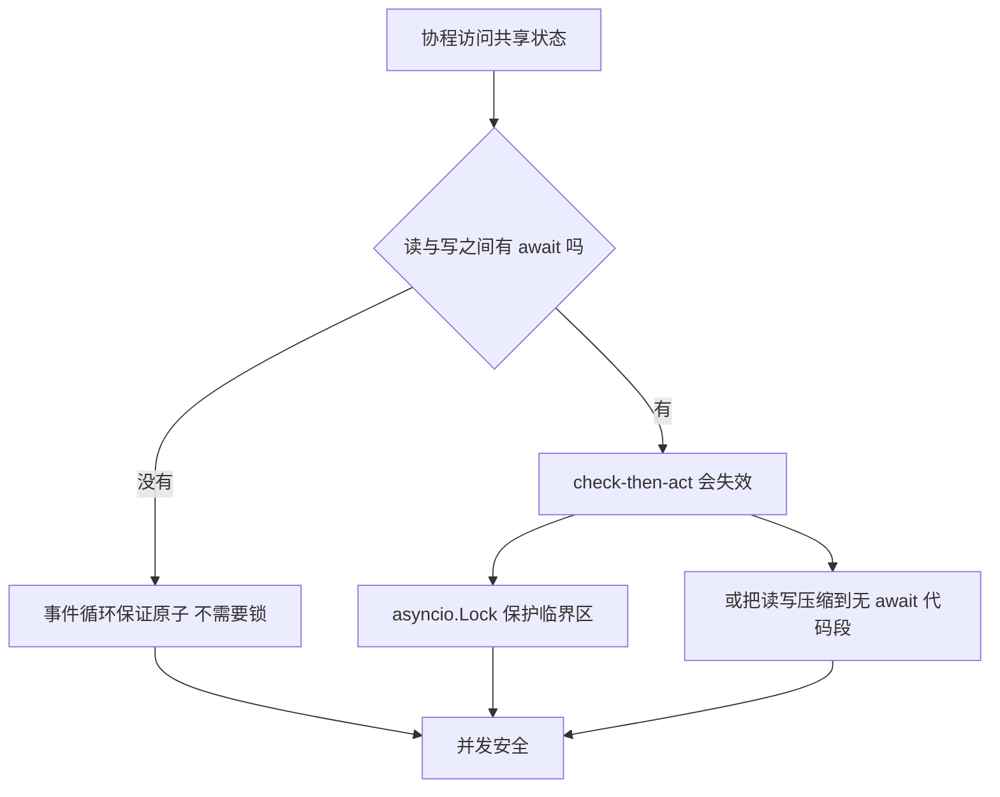

### Q596 · 协程的并发安全边界:哪些地方不需要锁,哪些必须加

> 难度:★★★★ | 标签:并发安全, asyncio.Lock, 原子性

**问**:事件循环是单线程的,还有必要用 asyncio.Lock 吗?到底什么操作在协程间不安全?

**答**:单线程事件循环保证了"两个 await 之间的纯同步代码"不会被切走,所以不含 await 的读-改-写序列是天然原子的,不需要锁。但只要读写之间夹了 await,控制权就可能交给其他协程,经典 check-then-act 就会坏:读到旧值 → await → 别的协程改了 → 写回覆盖。因此判断标准只有一条:从"读"到"写"之间有没有 await(或任何 yield 点)。有,就 asyncio.Lock;没有,就别加锁白付开销。这条边界也解释了为什么 `dict[k] += 1` 在协程里安全、跨线程就不安全。另外注意 asyncio 锁与事件循环的绑定:3.10 起原语改为首次 await 时惰性绑定当前运行中的循环(loop 参数也在 3.10 弃用、3.12 移除),在 import 期创建通常可行;但在某个循环下用过一次的锁再到另一个 asyncio.run 的新循环里 await,仍会报 "got Future attached to a different loop"——锁的创建与使用要圈定在同一循环内,工程惯例是在事件循环运行期间创建。

```python
# file: code/02_并发与网络工程/q596_async_atomic.py
import asyncio

counter = 0
# asyncio 锁与循环的绑定: 3.10 起原语在首次 await 时惰性绑定运行中的循环,
# import 期创建通常可行; 但在循环 A 用过的锁拿到循环 B(asyncio.run 新开)里
# await 仍会报 "got Future attached to a different loop"。
# 稳妥做法: 在事件循环运行期间创建(本例在 main 里创建)。
lock = None


async def unsafe_increment(n: int) -> None:
    global counter
    for _ in range(n):
        v = counter       # 读
        await asyncio.sleep(0)  # 中断点: 其他协程插入执行
        counter = v + 1   # 写回旧值 → 丢失更新


async def safe_increment(n: int) -> None:
    global counter
    for _ in range(n):
        async with lock:
            v = counter
            await asyncio.sleep(0)  # 即使有中断点, 临界区内没有竞争者
            counter = v + 1


async def atomic_without_await(n: int) -> None:
    global counter
    for _ in range(n):
        counter += 1  # 无 await: 事件循环保证原子, 不需要锁


async def run(target, n: int, label: str) -> None:
    global counter
    counter = 0
    await asyncio.gather(*[target(100) for _ in range(n)])
    print(f"{label}: {counter} / 期望 {n * 100}")


async def main() -> None:
    global lock
    lock = asyncio.Lock()  # 在运行中的循环里创建
    await run(unsafe_increment, 10, "含 await 无锁(丢失更新)")
    await run(safe_increment, 10, "含 await 加锁")
    assert counter == 10 * 100, "加锁路径不允许丢失更新"
    await run(atomic_without_await, 10, "无 await 裸写(天然原子)")
    assert counter == 10 * 100, "无 await 路径天然原子"


if __name__ == "__main__":
    asyncio.run(main())
```

**追问**:1) asyncio.Lock 为什么不能跨线程用?——它依赖当前循环的 call_soon 唤醒等待者,别的线程调用 release 时没有循环上下文;跨线程要用 run_coroutine_threadsafe 或 threading.Lock。2) 不需要锁的场景?——单线程循环内「await 点之间」的操作原子(无 await 的读改写序列);dict/list 单操作;循环内计数器。3) 必须锁/协调的场景?——跨 await 的 check-then-act;共享外部资源(连接池、限流);与线程混合;跨线程共享(Q598)。4) 生产陷阱?——循环内无 await 序列当「可能被切走」过度加锁;跨线程误用 asyncio 锁(Q600);把「单线程」当「无并发」(await 交错仍是并发)。

---



---
