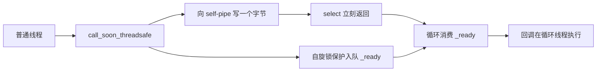

### Q600 · call_soon_threadsafe:跨线程唤醒事件循环

> 难度:★★★☆ | 标签:call_soon_threadsafe, 自唤醒管道, asyncio

**问**:为什么事件循环要专门提供 threadsafe 版本的 call_soon?它内部靠什么立刻唤醒?

**答**:事件循环空闲时阻塞在 select/epoll 上,普通线程往 _ready 队列塞回调,循环并不知道,可能继续睡。`call_soon_threadsafe` 做两件事:线程安全地入队(内部有自旋锁),然后向"自唤醒管道"(self-pipe socket)写一个字节——这个管道 fd 也在被 select 监听,字节一到循环立刻醒来处理回调。这就是经典的 self-pipe trick:把"线程间的信号"转成"内核可监听的 IO 事件"。asyncio 的 stop() 也是靠这个机制实现的。

```python
# file: code/02_并发与网络工程/q600_self_pipe.py
import asyncio
import threading
import time

fired_at: list = []


async def main() -> None:
    loop = asyncio.get_running_loop()

    async def idle_waiter() -> None:
        # 循环此刻没有任何 IO, 正阻塞在 select 上
        await asyncio.sleep(1.0)

    t0 = time.perf_counter()

    def fire_from_thread() -> None:
        time.sleep(0.2)  # 确保 loop 已进入空闲 select
        fired_at.append(time.perf_counter() - t0)
        loop.call_soon_threadsafe(
            lambda: fired_at.append(time.perf_counter() - t0)
        )

    threading.Thread(target=fire_from_thread).start()
    await asyncio.sleep(0.5)  # 期间 loop 空闲, 靠 self-pipe 被唤醒处理回调
    print("各时间点:", [f"{t:.2f}s" for t in fired_at])
    print("threadsafe 回调无需 IO 事件即可唤醒循环")


asyncio.run(main())
```

**追问**:1) loop.stop() 与 add_signal_handler 之间的关系是什么?——信号处理回调本质上也是通过 call_soon_threadsafe(信号处理由信号线程或自管道转入)排队的,统一走"事件入队→循环消费"模型。2) 跨线程唤醒的机制?——call_soon_threadsafe 写 self-pipe 的写端,select 立即唤醒读端处理;信号 handler(set_wakeup_fd)走同通道(Q551 的 self-pipe 故事);这是「信号→IO」的统一抽象。3) 使用纪律?——跨线程只能用 _threadsafe 版;handler 里只做轻排队、重活转 Task;信号只投主线程。4) 生产陷阱?——普通 call_soon 跨线程(Q581);handler 里做阻塞清理;优雅关闭依赖信号但没配 fallback(超时强杀)。

---



---
