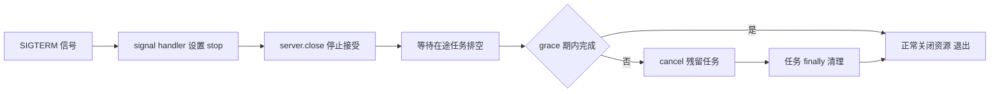

### Q602 · 异步服务优雅关闭的完整分层

> 难度:★★★★ | 标签:优雅关闭, 信号, asyncio

**问**:一个 asyncio TCP 服务收到 SIGTERM,从信号到进程退出要经过哪几步?每一步的失败模式是什么?

**答**:标准四层:1) 信号→控制流:loop.add_signal_handler 注册 SIGTERM/SIGINT,handler 设置 stop future,绝不直接 exit;2) 停止接受:`server.close()` + wait_closed,新连接被拒,存量连接不受影响;3) 排空:等在途任务完成,给一个上限(grace period),期间可以拒绝新请求只处理旧的;4) 回收:排空超时的任务 cancel 掉,等它们完成清理(处理 CancelledError),最后关闭连接池等资源。跳过第 3 步会掐断用户请求,跳过第 4 步会卡住退出或丢任务,K8s 的 terminationGracePeriodSeconds 就是给这套流程的时间预算。

```python
# file: code/02_并发与网络工程/q602_graceful_shutdown.py
import asyncio
import os
import signal
import threading

active: set = set()


async def handle(reader: asyncio.StreamReader, writer: asyncio.StreamWriter) -> None:
    task = asyncio.current_task()
    active.add(task)
    try:
        data = await asyncio.wait_for(reader.readline(), timeout=5)
        await asyncio.sleep(0.3)  # 模拟业务处理
        writer.write(b"processed:" + data)
        await writer.drain()
    except asyncio.CancelledError:
        writer.write(b"server-closing\n")  # 尽力通知
        try:
            await asyncio.wait_for(writer.drain(), 0.1)
        except (asyncio.TimeoutError, ConnectionError):
            pass
        raise
    finally:
        active.discard(task)
        writer.close()
        try:
            await writer.wait_closed()
        except Exception:
            pass


async def main() -> None:
    loop = asyncio.get_running_loop()
    stop: asyncio.Future = loop.create_future()
    for sig in (signal.SIGINT, signal.SIGTERM):
        loop.add_signal_handler(sig, stop.set_result, sig.name)

    # 模拟运维在 0.8s 后发 SIGTERM
    threading.Timer(0.8, lambda: os.kill(os.getpid(), signal.SIGTERM)).start()

    server = await asyncio.start_server(handle, "127.0.0.1", 0)
    port = server.sockets[0].getsockname()[1]
    print(f"[1] 服务启动 port={port}")

    async def client() -> None:
        r, w = await asyncio.open_connection("127.0.0.1", port)
        w.write(b"hello\n")
        await w.drain()
        print("client 收到:", (await r.readline()).decode().strip())
        w.close()
        await w.wait_closed()

    client_task = asyncio.create_task(client())

    sig = await stop
    print(f"[2] 收到 {sig}: 停止接受新连接")
    server.close()
    await server.wait_closed()

    print("[3] 排空在途任务 (grace=2s)")
    if active:
        done, pending = await asyncio.wait(list(active), timeout=2)
        if pending:
            print(f"[4] 强制取消 {len(pending)} 个残留任务")
            for t in pending:
                t.cancel()
            await asyncio.gather(*pending, return_exceptions=True)

    await client_task
    print("[5] 资源回收完毕, 退出")


asyncio.run(main())
```

**追问**:1) 排空期间 LB 还在发新请求怎么办?——先从服务发现摘除自己(或向 LB 发健康检查失败),再开始关闭,否则新连接会持续涌来导致永远排不空。2) 优雅关闭的完整分层?——摘除流量(健康检查失败/服务发现下线)→ 停止接新 → 排空在途请求(deadline 兜底,Q1285)→ 关依赖(连接池 flush)→ 退出;K8s preStop + terminationGracePeriod 是运维层对应。3) 与信号处理的对接?——SIGTERM handler 触发分层关闭(Q551/600);清理不能阻塞 handler 本体;超时强杀兜底(supervisor)。4) 生产陷阱?——直接 exit 让在途请求全断;健康检查仍通过导致排不完;连接池强杀丢事务;日志未 flush。

---



---
