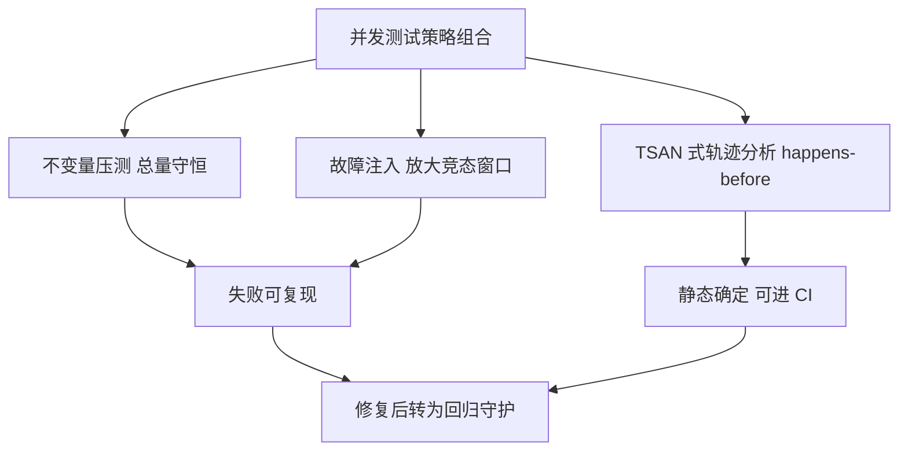

### Q608 · 不变量压测:并发正确性的守护测试

> 难度:★★★☆ | 标签:不变量, 压测, 正确性

**问**:怎么为一段并发代码设计"跑不坏"的测试?

**答**:核心是找系统的不变量——无论怎么并发都必须成立的性质,然后高强度压测断言它:转账系统"总额守恒"、缓存"读到的值要么旧要么新不撕裂"、限流器"任一秒放行数不超阈值"。写法:多线程随机操作 + 定期快照断言 + 结束时终检,持续几十秒抓小概率;配合 Q606 的注入钩子放大窗口。不变量测试与单元测试互补:单测验证单步逻辑,不变量测试验证"组合行为下系统仍守恒"。选对不变量是关键——它应该业务可解释,而不是实现细节。

```python
# file: code/02_并发与网络工程/q608_invariant_stress.py
import random
import threading
import time


def run_system(locked: bool, seconds: float = 0.5) -> int:
    accounts = {"a": 100000, "b": 100000}
    lock = threading.Lock()
    violations = [0]

    def check_invariant() -> None:
        while not stop.is_set():
            if locked:
                with lock:
                    total = accounts["a"] + accounts["b"]
            else:
                total = accounts["a"] + accounts["b"]  # 无锁读可能撕裂
            if total != 200000:
                violations[0] += 1
            time.sleep(0.001)

    def mover() -> None:
        rng = random.Random(threading.get_ident())
        while not stop.is_set():
            amount = rng.randint(1, 50)
            if locked:
                with lock:
                    accounts["a"] -= amount
                    accounts["b"] += amount
            else:
                # 无锁: 读-改-写被 GIL 切换打散, 总额读数漂移
                a = accounts["a"]
                if a >= amount:
                    accounts["a"] = a - amount
                    accounts["b"] += amount

    stop = threading.Event()
    checker = threading.Thread(target=check_invariant)
    movers = [threading.Thread(target=mover) for _ in range(4)]
    checker.start()
    for m in movers:
        m.start()
    time.sleep(seconds)
    stop.set()
    checker.join()
    for m in movers:
        m.join()
    return violations[0]


if __name__ == "__main__":
    bad = run_system(locked=False)
    good = run_system(locked=True)
    print(f"无锁版本: 检测到 {bad} 次不变量破坏")
    print(f"加锁版本: 检测到 {good} 次不变量破坏")
    assert good == 0
```

**追问**:1) 不变量测试通过了能宣布线程安全吗?——不能宣布,只能增强信心;它受限于轮次与路径覆盖,配合代码审查(锁协议)与 TSAN 式轨迹分析才构成完整证据链。2) 不变量的选取?——业务不变量(余额非负、唯一 id)、结构不变量(树高、链表长度)、统计不变量(总量守恒);断言失败要留下失败现场(Q568)。3) 与故障注入的组合?——随机延迟+并发压测让不变量频繁受检;失败样本自动留存;轮次与并发度按 CI 时长权衡。4) 生产陷阱?——不变量太弱(恒真);压测 flaky 未定位就重跑;证据链只有压测一层。

---



---
