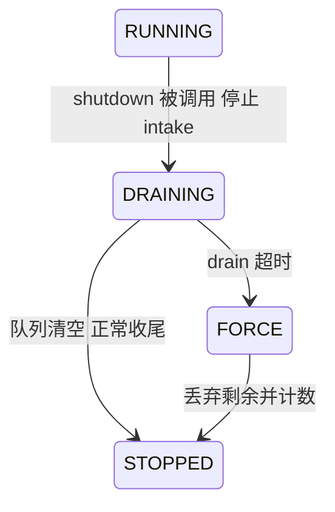

### Q614 · 可排空的工作池:优雅关闭的通用形态

> 难度:★★★☆ | 标签:drain, 优雅关闭, 工作池

**问**:一个线程池要下线,但队列里还有几百个任务,怎么做到"能排的排完、排不完的明确丢弃"?

**答**:shutdown 分三态:1) 停止 intake——接受标志置 false,新的 submit 立刻失败,调用方能感知;2) 排空——在 drain_timeout 内等队列清空(workers 继续消费),定期报告进度;3) 收尾——超时则统计剩余并清空(明确丢弃,记日志),然后给每个 worker 发毒丸(None)令其退出并 join。关键工程价值是"丢弃要有数":宁可显式丢弃并报警,也不能静默卡死或丢得不明不白。这个形态适用于任何"生产者-队列-消费者"结构的下线。

```python
# file: code/02_并发与网络工程/q614_drain_pool.py
import queue
import threading
import time


class DrainablePool:
    def __init__(self, workers: int = 3) -> None:
        self._q: queue.Queue = queue.Queue()
        self._accepting = True
        self._processed = 0
        self._lock = threading.Lock()
        self._ws = [
            threading.Thread(target=self._run, daemon=True) for _ in range(workers)
        ]
        for w in self._ws:
            w.start()

    def submit(self, fn) -> None:
        if not self._accepting:
            raise RuntimeError("pool closed: 拒绝新任务")
        self._q.put(fn)

    def _run(self) -> None:
        while True:
            fn = self._q.get()
            if fn is None:  # 毒丸
                return
            fn()
            with self._lock:
                self._processed += 1

    def shutdown(self, drain_timeout: float = 0.5) -> dict:
        self._accepting = False
        deadline = time.monotonic() + drain_timeout
        while self._q.qsize() > 0 and time.monotonic() < deadline:
            time.sleep(0.02)
        dropped = 0
        while True:  # 清空剩余并计数
            try:
                self._q.get_nowait()
                dropped += 1
            except queue.Empty:
                break
        for _ in self._ws:
            self._q.put(None)
        for w in self._ws:
            w.join(timeout=2)
        return {"processed": self._processed, "dropped": dropped}


def job(i: int) -> None:
    time.sleep(0.01)


if __name__ == "__main__":
    pool = DrainablePool(workers=3)
    for i in range(300):
        pool.submit(lambda i=i: job(i))
    t0 = time.monotonic()
    stats = pool.shutdown(drain_timeout=0.4)
    print(f"完成 {stats['processed']}, 明确丢弃 {stats['dropped']}, "
          f"关闭耗时 {time.monotonic() - t0:.2f}s")
    assert stats["processed"] + stats["dropped"] == 300
```

**追问**:1) 排空时新任务不断进来永远排不完怎么办?——intake 已关就不会有新任务;若是外部生产者绕过 submit,排空逻辑要基于"队列水位连续 X 秒不再下降"的判断而不是单纯超时。2) 可排空工作池的契约?——submit 前检查 intake 标志;close() 关 intake;join() 等 queue.join(task_done);worker 收哨兵退出(Q1282);shut_down(timeout) 兜底。3) 与 ThreadPoolExecutor 的对照?——executor.shutdown(wait=True, cancel_futures=True) 内置此形态(Q614 正文);cancel 只清排队不杀在跑(Q564);理解手动版才能读懂库版。4) 生产陷阱?——先杀 worker 再排空;join 无超时卡死;哨兵数量与 worker 数不匹配(Q563 呼应)。

---



---
