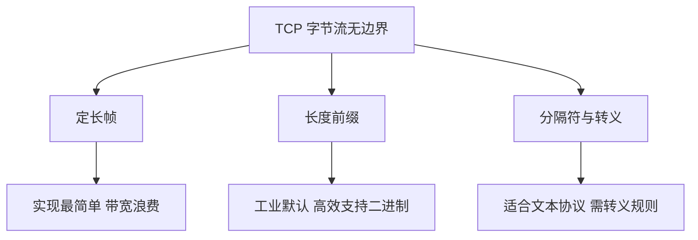

### Q622 · 粘包解法三:分隔符协议与转义

> 难度:★★★☆ | 标签:粘包, 协议设计, 转义

**问**:以 \n 分隔的文本协议(如 Redis/SMTP)怎么处理消息内容里恰好也有 \n?

**答**:分隔符协议用特殊字节序列定界,解析就是缓冲区内找分隔符、切出消息、残留留到下一轮。内容含分隔符时有两条路:禁止内容出现分隔符(Base64 编码后不含裸 \n,SMTP 正文靠 .\r\n 行配空行定界),或定义转义规则(内容中 \n 写作 \\n、反斜杠写作 \\\\),接收端先切分再反转义。要点:转义必须对称且处理"分隔符恰好被切成两半到达"——所以永远基于缓冲区找完整分隔符,而不是逐字节 recv 判断。分层也要干净:encode 负责转义出"载荷",frame 负责加分隔符,decode 只解"已切分的载荷"——roundtrip 断言直接 decode(encode(x)) 的话,载荷尾部挂着分隔符,断言必挂。

```python
# file: code/02_并发与网络工程/q622_delimiter_escape.py
import socket
import threading
import time

DELIM = b"\n"


def encode(msg: str) -> bytes:
    """转义为线上载荷(不含分隔符): 先转义反斜杠再转义换行, 顺序不能反。"""
    return msg.encode().replace(b"\\", b"\\\\").replace(b"\n", b"\\n")


def frame(msg: str) -> bytes:
    """完整一帧 = 转义载荷 + 分隔符; decode 只处理载荷本身。"""
    return encode(msg) + DELIM


def decode(raw: bytes) -> str:
    out = raw.replace(b"\\\\", b"\x00")  # 占位避免二次替换
    out = out.replace(b"\\n", b"\n").replace(b"\x00", b"\\")
    return out.decode()


class DelimParser:
    """基于缓冲区的分隔符解析: 天然处理半包与多包。"""

    def __init__(self) -> None:
        self.buf = b""

    def feed(self, data: bytes) -> list:
        self.buf += data
        msgs = []
        while True:
            idx = self.buf.find(DELIM)
            if idx < 0:
                break
            raw, self.buf = self.buf[:idx], self.buf[idx + 1:]
            msgs.append(decode(raw))
        return msgs


def server(stop: threading.Event, port_box: list) -> None:
    srv = socket.socket()
    srv.setsockopt(socket.SOL_SOCKET, socket.SO_REUSEADDR, 1)
    srv.bind(("127.0.0.1", 0))
    srv.listen(4)
    port_box.append(srv.getsockname()[1])
    srv.settimeout(0.2)
    while not stop.is_set():
        try:
            conn, _ = srv.accept()
        except socket.timeout:
            continue
        parser = DelimParser()
        try:
            while True:
                data = conn.recv(1024)
                if not data:
                    break
                for msg in parser.feed(data):
                    print(f"[server] 完整消息: {msg!r}")
                    conn.sendall(frame("ack:" + msg))
        except OSError:
            pass
        finally:
            conn.close()
    srv.close()


def client(port: int) -> None:
    c = socket.socket()
    c.connect(("127.0.0.1", port))
    # 消息内容含真实 \n 与 \, 编码后安全传输
    c.sendall(frame("line1\nline2") + frame("back\\slash"))
    c.settimeout(2)
    parser = DelimParser()
    got = []
    while len(got) < 2:
        got += parser.feed(c.recv(1024))
    for m in got:
        print("[client] 应答:", repr(m))
    c.close()


if __name__ == "__main__":
    stop = threading.Event()
    box: list = []
    t = threading.Thread(target=server, args=(stop, box), daemon=True)
    t.start()
    while not box:
        time.sleep(0.01)
    client(box[0])
    stop.set()
    assert decode(encode("a\nb\\c")) == "a\nb\\c"
    print("转义往返一致")
```

**追问**:1) 三种粘包解法怎么选?——定长适合指令帧;长度前缀是默认选择(高效、支持二进制);分隔符适合文本协议或已有生态兼容,选了就必须把转义规则写进协议文档。2) 为什么必须基于缓冲区找完整分隔符、不能逐字节判断?——分隔符 \r\n 可能被 TCP 拆成两次到达(半包),逐字节状态机要处理「\r 到了 \n 没到」的中间态;缓冲区找完整序列天然规避,代码也短。3) encode/decode 分层的依据?——转义(内容里的 \n 写作 \\n)作用于载荷、定界作用于原始流,混在一起就会出现「内容里的转义被误切」;分层后 roundtrip(encode→切分→decode)可以单测,这正是 demo 断言的设计。4) 生产陷阱?——转义规则没写进协议文档,三个月后没人记得 \\n 的含义;Base64 后以为还有裸 \n(实际没有,填充符是 =);切分用 universal newline 读文件把 \r\n 归一化破坏字节流。

---



---
