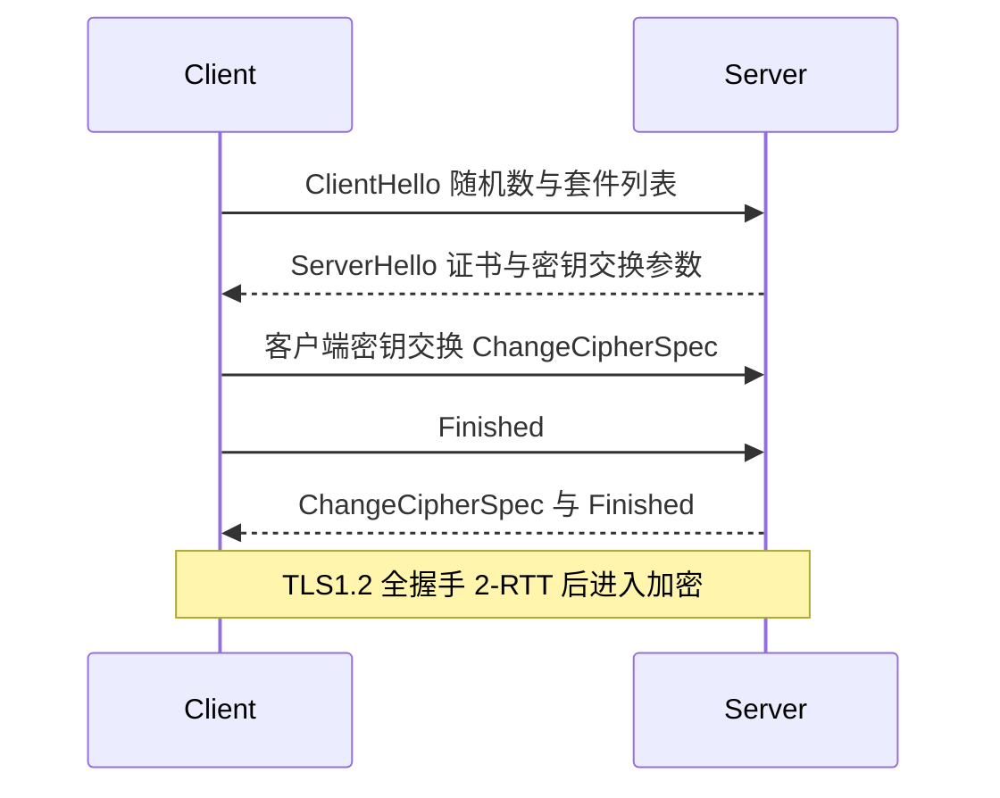

### Q628 · HTTPS 握手流程:TLS 1.2 与 1.3 对比

> 难度:★★★★ | 标签:TLS, 握手, HTTPS

**问**:TLS 握手每一步在交换什么?1.3 比 1.2 快在哪?

**答**:TLS 1.2 全握手 2-RTT:ClientHello(随机数+支持的套件)→ ServerHello(选定套件)+证书+密钥交换参数 → 客户端发密钥交换与 ChangeCipherSpec → 双方 Finished 校验后进入加密。TLS 1.3 压缩到 1-RTT:密钥交换只允许 (EC)DHE 且参数并入 Hello,证书在第一个服务端飞行中就加密发送,客户端第二轮即可发应用数据;还支持 0-RTT 恢复(有重放风险,只用于幂等请求)。证书链校验:叶子证书→中间 CA→根 CA,加上域名匹配与有效期,任何一环失败即握手失败。demo 里生成自签证书注意:`-addext` 是 OpenSSL 1.1.1+ 参数,macOS 自带的 LibreSSL 2.8.3 不认识,会 CalledProcessError——SAN 要走 `-config` 的扩展段写法,老 openssl 全兼容。

```python
# file: code/02_并发与网络工程/q628_tls_handshake.py
import socket
import ssl
import subprocess
import threading
import tempfile
import os
import time


def make_cert(tmpdir: str) -> tuple:
    """用 openssl 生成自签证书 (标准库无法生成证书, openssl 是系统能力)。

    不用 `-addext`: 它是 OpenSSL 1.1.1+ 参数, macOS 自带的 LibreSSL
    2.8.3 不认识; 改用 -config 扩展段写 SAN, 老 openssl 全兼容。
    """
    key = os.path.join(tmpdir, "server.key")
    cert = os.path.join(tmpdir, "server.crt")
    cnf = os.path.join(tmpdir, "san.cnf")
    with open(cnf, "w", encoding="utf-8") as f:
        f.write(
            "[req]\n"
            "distinguished_name = dn\n"
            "x509_extensions = v3_req\n"
            "prompt = no\n"
            "[dn]\n"
            "CN = 127.0.0.1\n"
            "[v3_req]\n"
            "subjectAltName = IP:127.0.0.1\n"
        )
    subprocess.run(
        ["openssl", "req", "-x509", "-newkey", "rsa:2048", "-nodes",
         "-keyout", key, "-out", cert, "-days", "365", "-config", cnf],
        check=True, capture_output=True)
    return key, cert


def main() -> None:
    with tempfile.TemporaryDirectory() as tmpdir:
        key, cert = make_cert(tmpdir)

        ctx = ssl.SSLContext(ssl.PROTOCOL_TLS_SERVER)
        ctx.load_cert_chain(cert, key)
        lsock = socket.socket()
        lsock.setsockopt(socket.SOL_SOCKET, socket.SO_REUSEADDR, 1)
        lsock.bind(("127.0.0.1", 0))
        lsock.listen(1)
        port = lsock.getsockname()[1]

        ready = threading.Event()

        def serve() -> None:
            ready.set()
            conn, _ = lsock.accept()
            try:
                with ctx.wrap_socket(conn, server_side=True) as tls:
                    tls.sendall(b"hello-tls")
            except ssl.SSLError as e:
                print("[server] 握手失败:", e)
            finally:
                conn.close()

        t = threading.Thread(target=serve, daemon=True)
        t.start()
        ready.wait()

        # 客户端: 自签证书场景关闭校验, 但仍能观察握手细节
        cctx = ssl.SSLContext(ssl.PROTOCOL_TLS_CLIENT)
        cctx.check_hostname = False
        cctx.verify_mode = ssl.CERT_NONE
        t0 = time.perf_counter()
        with socket.create_connection(("127.0.0.1", port), timeout=5) as raw:
            with cctx.wrap_socket(raw, server_hostname="127.0.0.1") as tls:
                dt = time.perf_counter() - t0
                print(f"协商协议: {tls.version()}")
                print(f"加密套件: {tls.cipher()[0]} ({tls.cipher()[1]} 位)")
                peer = tls.getpeercert(binary_form=False)
                print("CERT_NONE 模式下 getpeercert 返回:", peer)
                der = tls.getpeercert(binary_form=True)
                print(f"证书 DER {len(der)} 字节, 握手耗时 {dt * 1000:.0f}ms")
                print("应用数据:", tls.recv(64).decode())
        t.join()
        lsock.close()


if __name__ == "__main__":
    main()
```

**追问**:1) 怎么确认服务端支持的是 1.2 还是 1.3?——握手后 `tls.version()` 直接给出;命令行可用 `openssl s_client -tls1_3` 逐版本探测,生产监控里 TLS 版本分布是重要的兼容性指标。2) 0-RTT 与 1-RTT 的安全差异?——1.3 把密钥交换并入首个飞行,1-RTT 即可发应用数据;0-RTT early data 没有完整握手的防重放保护,可能被重放,只用于幂等请求(GET),服务端要显式开启并限制重放窗口。3) 证书链校验的顺序与常见断链?——叶子→中间 CA→根 CA,系统信任库只装根;服务端必须下发中间证书,漏发时「浏览器通、Python 客户端挂」——浏览器会做 AIA 补齐而 Python ssl 不做,这是排障时最常见的平台差异。4) 生产陷阱?——macOS 自带 LibreSSL 不认 -addext(demo 已踩);证书轮换后旧 session ticket 仍复用旧链;只关 verify_mode 忘了 check_hostname(默认跟随)。

---



---
