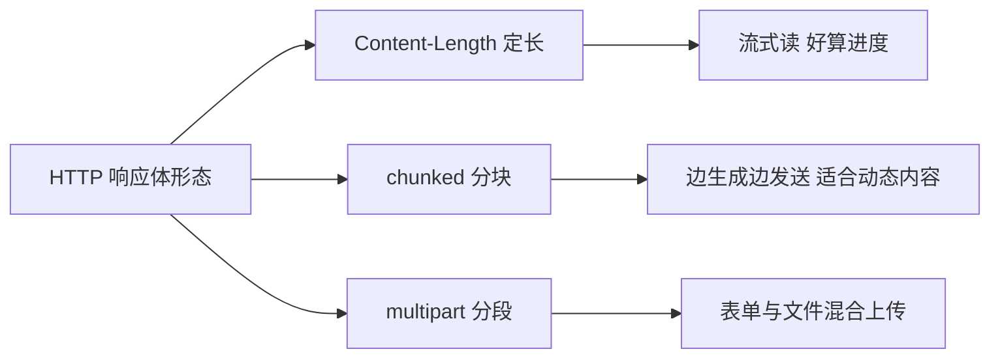

### Q634 · multipart/form-data 上传:手写编码与解析

> 难度:★★★☆ | 标签:multipart, 上传, HTTP

**问**:multipart/form-data 的报文结构是什么?boundary 的规则和坑有哪些?

**答**:multipart 用一个随机 boundary 把多个 part 分隔:每个 part 有自己的头部(Content-Disposition 带 name/filename、Content-Type),头与体用空行分隔,整体以 `--boundary--` 结束。客户端构造要点:boundary 必须不出现在内容里(随机长串),Content-Type 头里带 boundary 参数,part 之间的 \r\n 属于分隔符不属于内容。服务端解析:按 `--boundary` 切分,逐 part 解析头部与载荷。文件与字段一起传时顺序无所谓,但接收端要按 name 区分。

```python
# file: code/02_并发与网络工程/q634_multipart.py
import socket
import threading
import time
import uuid

BOUNDARY = "----pyboundary" + uuid.uuid4().hex[:16]


def build_multipart(fields: dict, file_field: tuple) -> bytes:
    """fields: 普通字段; file_field: (name, filename, content, ctype)。"""
    lines: list = []
    for name, value in fields.items():
        lines.append(f"--{BOUNDARY}\r\n".encode())
        lines.append(f'Content-Disposition: form-data; name="{name}"\r\n\r\n'.encode())
        lines.append(value.encode() + b"\r\n")
    name, filename, content, ctype = file_field
    lines.append(f"--{BOUNDARY}\r\n".encode())
    lines.append(
        f'Content-Disposition: form-data; name="{name}"; filename="{filename}"\r\n'.encode()
    )
    lines.append(f"Content-Type: {ctype}\r\n\r\n".encode())
    lines.append(content + b"\r\n")
    lines.append(f"--{BOUNDARY}--\r\n".encode())
    return b"".join(lines)


def parse_multipart(body: bytes, boundary: str) -> list:
    parts = []
    delim = b"--" + boundary.encode()
    for seg in body.split(delim):
        seg = seg.strip(b"\r\n-")
        if not seg or seg == b"--":
            continue
        head, _, content = seg.partition(b"\r\n\r\n")
        headers = {}
        for line in head.split(b"\r\n"):
            if b": " in line:
                k, v = line.split(b": ", 1)
                headers[k.decode().lower()] = v.decode()
        disp = headers.get("content-disposition", "")
        name = disp.split('name="')[1].split('"')[0] if 'name="' in disp else ""
        filename = disp.split('filename="')[1].split('"')[0] if 'filename="' in disp else None
        parts.append({"name": name, "filename": filename, "content": content})
    return parts


def server(stop: threading.Event, port_box: list, received: list) -> None:
    srv = socket.socket()
    srv.setsockopt(socket.SOL_SOCKET, socket.SO_REUSEADDR, 1)
    srv.bind(("127.0.0.1", 0))
    srv.listen(4)
    port_box.append(srv.getsockname()[1])
    srv.settimeout(0.2)
    while not stop.is_set():
        try:
            conn, _ = srv.accept()
        except socket.timeout:
            continue
        try:
            conn.settimeout(3)
            data = b""
            while b"\r\n\r\n" not in data:
                data += conn.recv(65536)
            head, body = data.split(b"\r\n\r\n", 1)
            ctype = next(l.split(b": ", 1)[1].decode() for l in head.split(b"\r\n")
                         if l.lower().startswith(b"content-type"))
            boundary = ctype.split("boundary=")[1]
            received.extend(parse_multipart(body, boundary))
            conn.sendall(b"HTTP/1.1 200 OK\r\nContent-Length: 2\r\n\r\nok")
        except Exception as e:
            print("[server] 解析失败:", repr(e))
        finally:
            conn.close()
    srv.close()


if __name__ == "__main__":
    stop = threading.Event()
    box: list = []
    got: list = []
    threading.Thread(target=server, args=(stop, box, got), daemon=True).start()
    while not box:
        time.sleep(0.01)

    file_content = b"PNG-data\x00\x01\x02-with\r\nnewlines"  # 内容含 \r\n 验证解析正确
    body = build_multipart(
        fields={"note": "hello"},
        file_field=("file", "img.png", file_content, "image/png"),
    )
    c = socket.create_connection(("127.0.0.1", box[0]), timeout=3)
    c.sendall(
        b"POST /upload HTTP/1.1\r\n"
        + f"Content-Type: multipart/form-data; boundary={BOUNDARY}\r\n".encode()
        + f"Content-Length: {len(body)}\r\n\r\n".encode()
        + body
    )
    c.settimeout(2)
    print("上传响应:", c.recv(64).split(b"\r\n")[0].decode())
    c.close()

    for p in got:
        print(f"  part name={p['name']} filename={p['filename']} bytes={len(p['content'])}")
    f = next(p for p in got if p["name"] == "file")
    assert f["content"] == file_content, "二进制内容被破坏"
    print("二进制内容往返一致, multipart 编解码正确")
    stop.set()
```

**追问**:1) 为什么上传接口要限制单个 part 大小?——解析器通常先把整个 body 读进内存,恶意超大文件会 OOM;流式解析(逐块找 boundary)+ 磁盘暂存是生产实现。2) boundary 冲突怎么防?——客户端用强随机长串(uuid4+时间戳级),内容里出现同串的概率工程上可忽略;解析端仍要校验 boundary 合法性;绝不能用固定字符串(可被构造内容攻击)。3) 为什么生产实现必须流式解析?——part 边界要扫到才知道,内存解析等于把整个 body 读进 RAM,恶意超大文件直接 OOM;逐块扫描+超阈值落盘是标准实现,Django/FastAPI 的 UploadFile 就是「小文件内存、大文件临时盘」的阈值策略,还要限 part 数量。4) 生产陷阱?——手拼报文漏掉 part 之间的 \r\n(400 且难查);文件名非 ASCII 未按 RFC 编码;用 split(';') 粗解析 Content-Type 里的 boundary,带引号就解析错。

---



---
