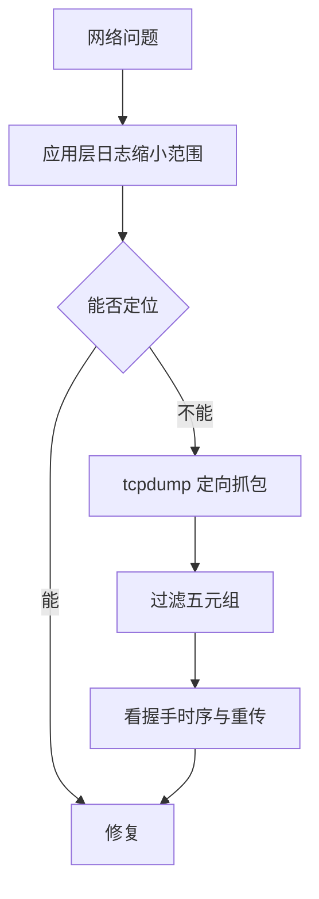

### Q646 · tcpdump 输出解析:SYN/SYN-ACK 时间线

> 难度:★★★☆ | 标签:tcpdump, 抓包分析, 排障

**问**:拿到一段 tcpdump 输出,怎么快速判断建连慢/重传问题?

**答**:三步:先按五元组过滤出目标连接;再看握手时序——SYN→SYN-ACK→ACK 的间隔(SYN-ACK 慢说明服务端 backlog 满/过载,SYN 重复出现说明丢包或被防火墙静默丢);最后看数据阶段的重传(TCPDump 里同一 seq 的包重复出现)。把日志解析成 (时间, 方向, 标志, seq) 事件表后,这些问题都变成几行代码的统计。真实排障中,`tcpdump -i any port 8080 -nn -S`(-S 显示绝对 seq)是标准采集姿势。

```python
# file: code/02_并发与网络工程/q646_tcpdump_parse.py
import re

SAMPLE = """
12:00:00.000001 IP 10.0.0.1.54321 > 10.0.0.2.8080: Flags [S], seq 1000, win 65535
12:00:00.000090 IP 10.0.0.2.8080 > 10.0.0.1.54321: Flags [S.], seq 5000, ack 1001, win 65535
12:00:00.000120 IP 10.0.0.1.54321 > 10.0.0.2.8080: Flags [.], ack 5001, win 65535
12:00:00.000200 IP 10.0.0.1.54321 > 10.0.0.2.8080: Flags [P.], seq 1001:1101, ack 5001
12:00:00.000500 IP 10.0.0.2.8080 > 10.0.0.1.54321: Flags [P.], seq 5001:5100, ack 1101
12:00:00.005000 IP 10.0.0.2.8080 > 10.0.0.1.54321: Flags [P.], seq 5001:5100, ack 1101
12:00:00.005100 IP 10.0.0.1.54321 > 10.0.0.2.8080: Flags [.], ack 5101, win 65535
"""

LINE = re.compile(
    r"(?P<ts>\d+:\d+:\d+\.\d+)\s+IP\s+(?P<src>[\d.]+)\.(?P<sport>\d+)\s+>\s+"
    r"(?P<dst>[\d.]+)\.(?P<dport>\d+):\s+Flags\s+\[(?P<flags>[^\]]+)\]"
    r"(?:, seq (?P<seq>[\d:]+))?(?:, ack (?P<ack>\d+))?"
)


def parse(text: str) -> list:
    events = []
    for line in text.strip().splitlines():
        m = LINE.search(line)
        if not m:
            continue
        ts = m.group("ts")
        h, mi, rest = ts.split(":")
        sec, frac = rest.split(".")
        t = int(h) * 3600 + int(mi) * 60 + int(sec) + int(frac) / 1e6
        events.append({
            "t": t, "dir": "C>S" if m.group("sport") == "54321" else "S>C",
            "flags": m.group("flags"), "seq": m.group("seq"),
        })
    return events


def analyze(events: list) -> None:
    syn = next(e for e in events if e["flags"] == "S")
    synack = next(e for e in events if e["flags"] == "S.")
    print(f"建连耗时: {(synack['t'] - syn['t']) * 1000:.1f}ms (SYN→SYN-ACK)")

    seen: dict = {}
    for e in events:
        if e["flags"].startswith("P") and e["seq"]:
            start = e["seq"].split(":")[0]
            if start in seen:
                print(f"发现重传: seq {e['seq']} 首见于 {seen[start] - events[0]['t']:.6f}s "
                      f"重发于 {e['t'] - events[0]['t']:.6f}s")
            else:
                seen[start] = e["t"] if isinstance(e["t"], float) else seen.get(start, e["t"])
    # 简化: 直接对比相同 seq 区间
    seqs = [e["seq"] for e in events if e["seq"] and ":" in e["seq"]]
    dup = {s for s in seqs if seqs.count(s) > 1}
    if dup:
        print(f"重复 seq 区间: {dup} → 存在重传, 结合 RTT 判断丢包率")

    flags_flow = " → ".join(e["flags"] for e in events)
    print("标志流:", flags_flow)


if __name__ == "__main__":
    events = parse(SAMPLE)
    analyze(events)
```

**追问**:1) 为什么 tcpdump 要加 -S?——默认显示相对序号,重传判断与跨包对比会失真;绝对序号才能可靠识别"同一 seq 重复出现"。2) 相对序号为什么失真?——tcpdump 默认把每个方向的首包 seq 显示为相对 0,重传识别靠「同一 seq 重复出现」,相对值跨包对比与两方向混合分析都会失真;-S 显示绝对序号是采集标配。3) 怎么从时间线归因哪一端慢?——SYN→SYN-ACK 间隔≈服务端建连响应(慢=backlog 满/过载,Q618);SYN-ACK→ACK≈纯网络;数据阶段看重复 ACK 与零窗口探测判断接收方处理不过来;RST 出现的位置决定是拒绝还是中断。4) 生产陷阱?——无过滤全量抓包把生产机磁盘打满;抓包开销本身改变时序(尤其 -A 打印内容);多机时间线对比时钟不同步(先校 NTP 再谈时序)。

---



---
