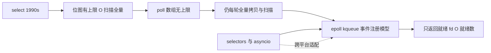

### Q652 · kqueue:BSD/macOS 的事件机制

> 难度:★★★☆ | 标签:kqueue, macOS, 多路复用

**问**:kqueue 和 epoll 设计上的主要差别是什么?

**答**:kqueue 是 BSD/macOS 的多路复用机制,能力面比 epoll 更宽:不止 fd,还能监听信号、进程事件(PROC)、定时器(EVFILT_TIMER)、文件变更(VNODE),统一用 kevent 结构体描述(filter+ident+flags)。语义上默认是**水平触发**(只要接收缓冲仍有数据,每次 kevent 都会返回该 knote),`EV_CLEAR` 才把事件切成边缘触发:取出事件后内核清除状态,只有下一次状态变化才再报;epoll 是 Linux 专属、只管 fd 但更简单。工程结论:直接依赖其中任何一个是平台锁定,跨平台代码应使用 selectors/asyncio 这类适配层,libuv/uvloop 内部正是做了这层统一。

```python
# file: code/02_并发与网络工程/q652_kqueue.py
import select
import socket


def main() -> None:
    if hasattr(select, "kqueue"):
        kq = select.kqueue()
        a, b = socket.socketpair()
        a.setblocking(False)
        # 注册 EVFILT_READ 过滤器
        event = select.kevent(a, select.KQ_FILTER_READ, select.KQ_EV_ADD)
        kq.control([event], 0)

        b.send(b"kqueue-data")
        events = kq.control(None, 4, 0.5)  # 最多取 4 个, 500ms 超时
        for ev in events:
            print(f"kqueue 事件: ident={ev.ident} filter={ev.filter} data={ev.data}")
            if ev.filter == select.KQ_FILTER_READ:
                print("  读出:", a.recv(64))
        # 注销
        kq.control([select.kevent(a, select.KQ_FILTER_READ, select.KQ_EV_DELETE)], 0)
        a.close()
        b.close()
        kq.close()
    else:
        print("本平台无 kqueue, 展示 selectors 统一层的等价写法")
        portable_demo()


def portable_demo() -> None:
    sel = select.DefaultSelector() if hasattr(select, "DefaultSelector") else None
    if sel is None:
        import selectors
        sel = selectors.DefaultSelector()
    import selectors
    sel = selectors.DefaultSelector()
    a, b = socket.socketpair()
    sel.register(a, selectors.EVENT_READ, "tag-a")
    b.send(b"portable-data")
    for key, _ in sel.select(timeout=0.5):
        print(f"selectors 事件: {key.data} → {key.fileobj.recv(64)}")
    sel.close()
    a.close()
    b.close()


if __name__ == "__main__":
    main()
```

**追问**:1) 为什么 asyncio 不直接暴露 epoll/kqueue API?——暴露即锁定平台与实现细节;适配层(DefaultSelector)让用户代码零修改跑在 Linux/macOS/Windows,这正是分层抽象的价值。2) EV_CLEAR 与 epoll 触发模式怎么对应?——kqueue 默认水平触发(缓冲有数据每次 kevent 都返回),EV_CLEAR 标志切为边缘语义(取走即清,下次状态变化才报),等价 epoll 的 EPOLLET;同一概念两套名字,读 BSD 代码先对齐词汇。3) kqueue 能力面比 epoll 宽在哪?——EVFILT_SIGNAL(信号)、EVFILT_PROC(进程事件)、EVFILT_TIMER(定时器)、EVFILT_VNODE(文件变更),统一 kevent 结构(filter+ident+flags);BSD 上单一定义能做完整事件循环,跨平台统一由 libuv/uvloop 这类库封装。4) 生产陷阱?——直接用 kqueue 代码锁定平台,上不了 Linux;EVFILT_READ 语义是「可读」不是「读了多少」,NOTE_* 返回标志没检查就当普通读处理;filter 注册与删除不对称,残留 knote 产生幽灵事件。

---



---
