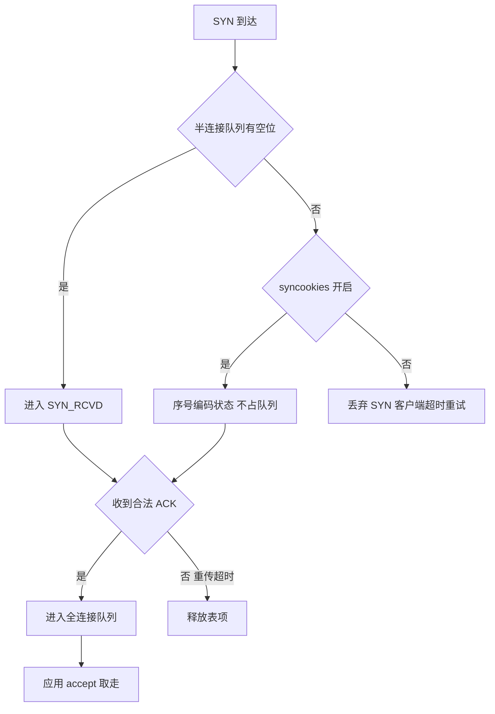

### Q658 · 半开连接与 SYN Flood:backlog 之下的攻防

> 难度:★★★★ | 标签:SYN Flood, syncookies, 防护

**问**:SYN Flood 的原理是什么?内核和应用各有哪些防护手段?

**答**:SYN Flood 攻击者发大量 SYN 但不回最后 ACK,半连接队列被占满,正常用户 SYN 被丢,服务不可用。防护分层:内核层——syncookies(不存半连接状态,把状态编码进 SYN-ACK 的序号里,收到合法 ACK 再重建)、调大 backlog 与 synack 重试、降低 retry 次数;网络层——上游清洗/ACL 限源;应用层——连接级限流(Q656)挡变种的慢连接攻击。应用视角的观察信号:accept 速率正常但建连成功率骤降、半连接队列溢出计数(netstat -s 的 SYNs to LISTEN sockets dropped)增长。

```python
# file: code/02_并发与网络工程/q658_syn_backlog.py
import socket
import threading
import time


def main() -> None:
    srv = socket.socket()
    srv.setsockopt(socket.SOL_SOCKET, socket.SO_REUSEADDR, 1)
    srv.bind(("127.0.0.1", 0))
    srv.listen(1)  # 极小 backlog 模拟受攻击状态
    port = srv.getsockname()[1]
    print("服务端 listen(1), 暂停 accept (模拟被 SYN 打满的处理瓶颈)")

    conns: list = []
    outcomes: list = []

    def flood(i: int) -> None:
        s = socket.socket()
        s.settimeout(1.0)
        t0 = time.monotonic()
        try:
            s.connect(("127.0.0.1", port))
            outcomes.append((i, "established", (time.monotonic() - t0) * 1000))
            conns.append(s)
        except (socket.timeout, OSError) as e:
            outcomes.append((i, f"failed {type(e).__name__}", (time.monotonic() - t0) * 1000))
            s.close()

    threads = [threading.Thread(target=flood, args=(i,)) for i in range(15)]
    for t in threads:
        t.start()
    for t in threads:
        t.join()

    ok = [o for o in outcomes if o[1] == "established"]
    fail = [o for o in outcomes if o[1] != "established"]
    print(f"15 个并发 SYN: 建连成功 {len(ok)}, 失败 {len(fail)} (队列溢出被丢/超时)")
    print("  成功者平均建连耗时:",
          f"{sum(o[2] for o in ok) / max(len(ok), 1):.1f}ms")

    print("应用开始 accept 排空 → 内核队列中的连接被接管")
    srv.settimeout(0.5)
    served = 0
    try:
        while True:
            conn, _ = srv.accept()
            served += 1
            conn.close()
    except socket.timeout:
        pass
    print(f"accept 排空: {served} 个")
    for c in conns:
        c.close()
    print("防护结论: syncookies + backlog 调优保内核, 连接级限流保应用")


if __name__ == "__main__":
    main()
```

**追问**:1) syncookies 有什么副作用?——它绕过了半连接队列也就丢了部分 TCP 选项协商(SACK 等),且无法响应窗口缩放,所以是"被攻击时保命"而不是常态配置,Linux 在队列溢出时自动启用。2) syncookies 的原理与代价?——把连接状态编码进 SYN-ACK 的序号(加密散列),不占半连接队列,收到合法 ACK 才重建;代价是丢部分选项协商(SACK、窗口缩放),所以是「被攻击时保命」而非常态,Linux 在队列溢出时自动启用。3) 怎么观测确认攻击?——netstat -s 的「SYNs to LISTEN sockets dropped」增长、ss -n state syn-recv 计数暴涨、来源分散(伪造)或异常集中;应用层信号:accept 正常但建连成功率骤降——先分清是 SYN flood 还是慢连接攻击。4) 生产陷阱?——盲目调大 backlog 反而放大半连接内存,攻击时更早 OOM;只调内核不做上游清洗,带宽先被打满;把 Slowloris(应用层慢连接)当 SYN flood 处理,方向完全错,要用连接级限流(Q656)。

---



---
