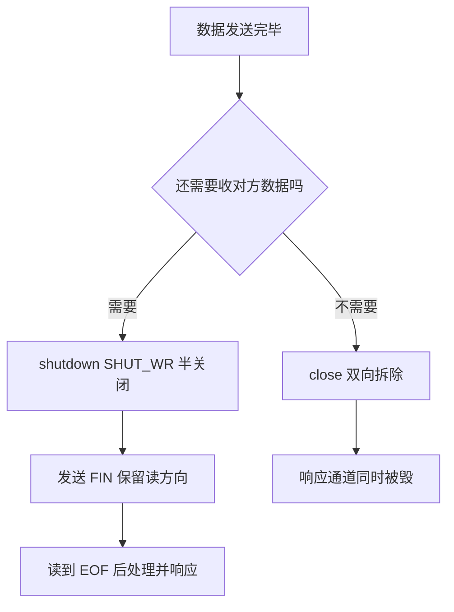

### Q664 · 半关闭 shutdown:EOF 语义与全连接拆除的区别

> 难度:★★★☆ | 标签:shutdown, 半关闭, EOF

**问**:close 和 shutdown(SHUT_WR) 有什么区别?哪些协议场景必须用半关闭?

**答**:close 关闭整个 socket(fd 引用计数归零后双向拆除、发送 RST 视缓冲情况),而 shutdown(SHUT_WR) 只发送 FIN 表示"我没有更多数据要发了",但仍可以读对方继续发来的数据——这就是半关闭。必须半关闭的经典场景:客户端发完请求即 shutdown(WR),服务端读到 EOF 才知道"请求体结束"(无 Content-Length 的流式请求),然后回响应;`cat file | nc host port` 管道场景同理。close 的另一个坑:有多个 fd 副本(线程共享、dup)时 close 只减引用不拆连接;Linger 不当会丢缓冲数据。

```python
# file: code/02_并发与网络工程/q664_half_close.py
import socket
import threading
import time


def server(stop: threading.Event, port_box: list) -> None:
    srv = socket.socket()
    srv.setsockopt(socket.SOL_SOCKET, socket.SO_REUSEADDR, 1)
    srv.bind(("127.0.0.1", 0))
    srv.listen(4)
    port_box.append(srv.getsockname()[1])
    srv.settimeout(0.2)
    while not stop.is_set():
        try:
            conn, _ = srv.accept()
        except socket.timeout:
            continue
        try:
            # 读到 EOF (对端 shutdown WR) 才认为请求结束
            request = b""
            while True:
                data = conn.recv(1024)
                if not data:
                    print("[server] 收到 EOF: 请求体结束, 开始响应")
                    break
                request += data
            conn.sendall(b"response-based-on-" + request)
            # 服务端也半关闭: 发完响应关闭写方向, 再等对端关闭
            conn.shutdown(socket.SHUT_WR)
            conn.close()
        except OSError:
            pass
    srv.close()


def client_half_close(port: int) -> None:
    c = socket.create_connection(("127.0.0.1", port))
    c.sendall(b"stream-request")
    c.shutdown(socket.SHUT_WR)   # 只关写: 保留读能力
    print("[client] 已 shutdown WR, 仍可读响应")
    c.settimeout(2)
    print("[client] 响应:", c.recv(64).decode())
    c.close()


def client_full_close(port: int) -> None:
    """对照组: 直接 close, 响应可能永远收不到。"""
    c = socket.create_connection(("127.0.0.1", port))
    c.sendall(b"full-close-request")
    c.close()  # 双向拆除: 服务端的响应发往已死连接
    print("[client] full close: 响应通道已毁")


if __name__ == "__main__":
    stop = threading.Event()
    box: list = []
    threading.Thread(target=server, args=(stop, box), daemon=True).start()
    while not box:
        time.sleep(0.01)
    port = box[0]
    client_half_close(port)   # 正确姿势
    time.sleep(0.1)
    client_full_close(port)   # 反例
    time.sleep(0.1)
    stop.set()
```

**追问**:1) 服务端怎么区分"对端半关闭"和"网络故障"?——半关闭是干净 EOF(recv 返回 b"");故障通常伴随 RST(recv 抛 ConnectionResetError)或超时,处理路径应不同(前者正常收尾,后者告警重试)。2) close 与 shutdown 的引用计数差异?——close 只减 fd 引用计数:dup/fork/线程共享存在另一副本时连接根本不拆;shutdown 直接作用于连接本身,与副本数无关——「线程共享 socket 关不掉」的根因就在这。3) 哪些协议设计依赖半关闭?——无长度头的服务:客户端发完请求 shutdown(WR),服务端读到 EOF 即知请求结束(`nc host < file` 模式);HTTP/1.0 早期无 Content-Length 的响应体也靠连接关闭定界——EOF 本身是一种定界协议。4) 生产陷阱?——SO_LINGER 配置不当:开启且超时 0 会 RST 丢数据,不开则 close 可能阻塞;期待 close 让对端收到 EOF 却有副本仍打开;把 recv 返回 b''(干净 EOF)当错误处理,与网络故障(RST/超时)混为一谈(Q665)。

---



---
