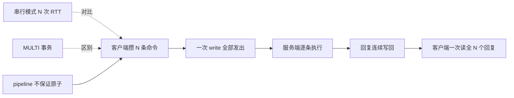

### Q670 · RESP 管线化:pipeline 与 MULTI 的区别

> 难度:★★★☆ | 标签:pipeline, Redis, RTT 优化

**问**:Redis 的 pipeline 为什么能把批量写入提速一个数量级?它和 MULTI 事务是一回事吗?

**答**:pipeline 把 N 条命令一次性写出,服务端逐条执行后把 N 个回复连续写回,网络成本从 N 次 RTT 变 1 次——批量导入/查询的标准优化。与 MULTI 的区别:pipeline 只是"攒着发",不保证原子性,中间可能插入其他客户端的命令;MULTI/EXEC 是服务端事务,命令入队后一起原子执行。还要注意 pipeline 不是越大越好:整包命令与回复都堆在内存,过大会打爆缓冲,一般按几百到几千条分批。下面实测串行与管线化的耗时差。

```python
# file: code/02_并发与网络工程/q670_resp_pipeline.py
import socket
import threading
import time
from q668_resp_parser import RespParser
from q669_resp_client import encode_command, dispatch  # 复用编解码与语义


def server(stop: threading.Event, port_box: list) -> None:
    srv = socket.socket()
    srv.setsockopt(socket.SOL_SOCKET, socket.SO_REUSEADDR, 1)
    srv.bind(("127.0.0.1", 0))
    srv.listen(8)
    port_box.append(srv.getsockname()[1])
    srv.settimeout(0.2)
    while not stop.is_set():
        try:
            conn, _ = srv.accept()
        except socket.timeout:
            continue
        parser = RespParser()
        try:
            conn.settimeout(2)
            while True:
                data = conn.recv(65536)
                if not data:
                    break
                replies = b"".join(dispatch(cmd) for cmd in parser.feed(data))
                conn.sendall(replies)
        except OSError:
            pass
        finally:
            conn.close()
    srv.close()


def bench(port: int, n: int = 200) -> tuple:
    c = socket.create_connection(("127.0.0.1", port), timeout=3)
    c.settimeout(3)
    parser = RespParser()
    pending: list = []  # 未消费的回复队列 (feed 的返回值汇入, 消费时弹出)

    # 串行: 一发一收
    t0 = time.perf_counter()
    for i in range(n):
        c.sendall(encode_command("SET", f"k{i}", "v"))
        while not pending:
            pending.extend(parser.feed(c.recv(65536)))
        pending.pop(0)
    t_seq = time.perf_counter() - t0

    # 管线化: 全部命令一次写出, 再统一读回复
    parser2 = RespParser()
    pending2: list = []
    batch = b"".join(encode_command("SET", f"k{i}", "v") for i in range(n))
    t0 = time.perf_counter()
    c.sendall(batch)  # 1 次 RTT
    got = 0
    while got < n:
        if pending2:
            pending2.pop(0)
            got += 1
            continue
        pending2.extend(parser2.feed(c.recv(65536)))
    t_pipe = time.perf_counter() - t0
    c.close()
    return t_seq, t_pipe


if __name__ == "__main__":
    stop = threading.Event()
    box: list = []
    threading.Thread(target=server, args=(stop, box), daemon=True).start()
    while not box:
        import time
        time.sleep(0.01)
    t_seq, t_pipe = bench(box[0])
    print(f"串行 200 条: {t_seq * 1000:.1f}ms ({t_seq / 200 * 1000:.3f}ms/条)")
    print(f"管线 200 条: {t_pipe * 1000:.1f}ms ({t_pipe / 200 * 1000:.3f}ms/条)")
    print(f"提速约 {t_seq / max(t_pipe, 1e-9):.0f}x — 省掉的是 N-1 次 RTT")
    stop.set()
```

**追问**:1) 为什么真实 Redis 上 pipeline 提升比本例更夸张?——本机回环 RTT 极小;真实网络 1ms RTT 下,200 条串行仅网络等待就 200ms,管线化仍是 1ms,加上服务端 epoll 唤醒次数减少,差距更大。2) pipeline 与 MULTI 的原子性差异有什么后果?——pipeline 中间可插入其他客户端的命令,「读-改-写」序列仍会竞态,扣款类必须 MULTI/EXEC+WATCH(乐观锁)或 Lua 脚本;把 pipeline 当事务是经典事故源。3) 批量上限怎么定?——命令与回复都整批驻留内存(客户端攒、服务端输出缓冲也攒),过大打爆两端;几百到几千条分批,大 value 的 GET 批量要更小,同时盯 client-output-buffer-limit。4) 生产陷阱?——fire-and-forget 攒几万条不取回复(内存爆+错误不可见);异步客户端里多协程共用连接的 pipeline,回复按请求序错位归属;pipeline 里夹管理命令(EXEC 前的观测)导致语义混乱。

---



---
