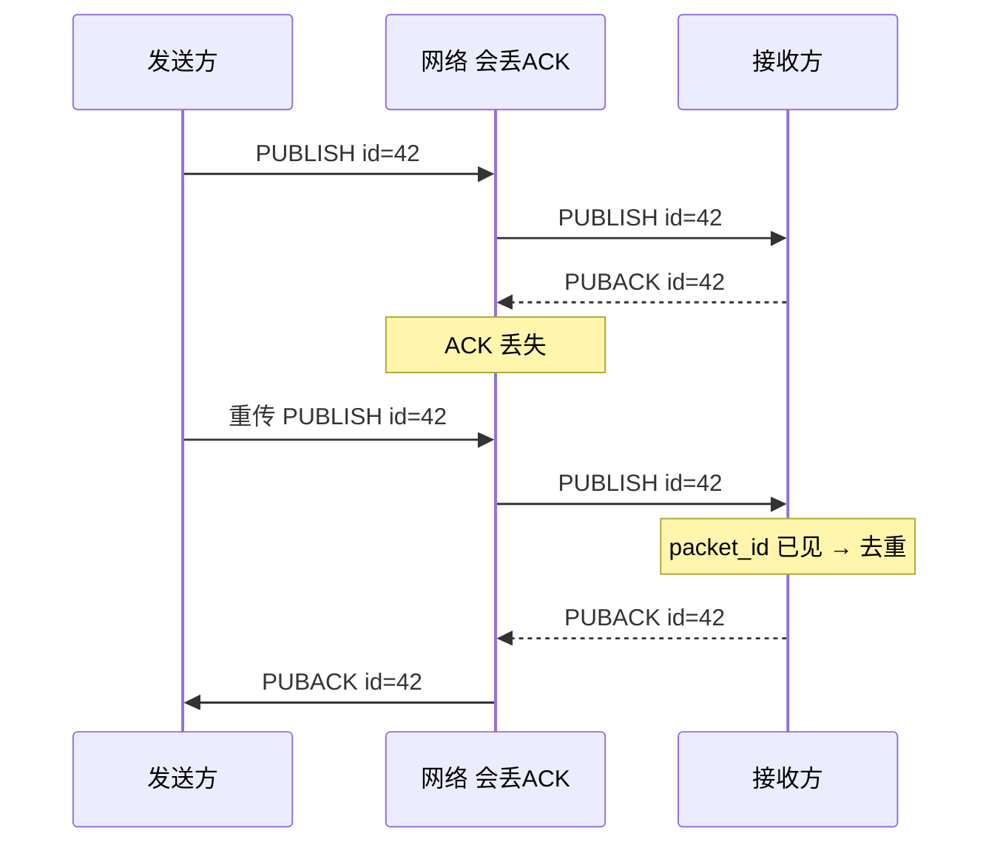

### Q676 · MQTT QoS1:至少一次的重传与去重

> 难度:★★★★ | 标签:QoS, 重传, 恰好一次

**问**:QoS1 的"至少一次"是怎么实现的?为什么会有重复消息,接收端怎么办?

**答**:QoS1 = PUBLISH + PUBACK 双向确认:发送方发出带 packet_id 的 PUBLISH 后进入等待,超时未收到 PUBACK 就重传同一 packet_id,直到确认(或达到重试上限判死链路)。重复的根源:ACK 本身可能在路上丢——发送方重传了,但接收端其实第一次就收到了,于是同一条消息处理两次。所以接收端必须按 packet_id 去重(记录已处理的 id 直到确认完成),并且业务侧要配合幂等(Q706)。"恰好一次"(QoS2)用四步握手中转态解决重复,但成本翻倍,大多数业务 QoS1 + 幂等更划算。

```python
# file: code/02_并发与网络工程/q676_qos1.py
import queue
import threading
import time


class Qos1Channel:
    """模拟 QoS1 通道: 指定前 N 个 ACK 丢弃(确定性), 发送方重传, 接收端去重。

    注意别用 random 概率丢包: 丢包率 1.0 会把所有 ACK 全丢光,
    重传路径上产生的重复次数就不止 1, 断言不稳定。
    """

    def __init__(self, drop_first_ack: int = 1) -> None:
        self.drop_first_ack = drop_first_ack
        self._ack_seq = 0
        self.inbound: "queue.Queue[dict]" = queue.Queue()
        self.acks: "queue.Queue[int]" = queue.Queue()
        self.delivered: list = []
        self.seen_ids: set = set()
        self.dup_detected = 0
        self._stop = threading.Event()
        threading.Thread(target=self._receiver, daemon=True).start()

    def _receiver(self) -> None:
        while not self._stop.is_set():
            try:
                msg = self.inbound.get(timeout=0.1)
            except queue.Empty:
                continue
            pid = msg["packet_id"]
            if pid in self.seen_ids:
                self.dup_detected += 1
                print(f"[receiver] 重复 PUBLISH id={pid} → 去重, 仅重发 ACK")
            else:
                self.seen_ids.add(pid)
                self.delivered.append(msg["payload"])
                print(f"[receiver] 首次交付: {msg['payload']} (id={pid})")
            self._ack_seq += 1
            if self._ack_seq <= self.drop_first_ack:
                print(f"[network] PUBACK id={pid} 丢失 → 发送方将重传")
            else:
                self.acks.put(pid)  # PUBACK

    def send_with_retry(self, payload: str, packet_id: int,
                        timeout: float = 0.1, max_retry: int = 3) -> bool:
        for attempt in range(1, max_retry + 1):
            print(f"[sender] PUBLISH 尝试 {attempt}: {payload} (id={packet_id})")
            self.inbound.put({"packet_id": packet_id, "payload": payload})
            try:
                acked = self.acks.get(timeout=timeout)
                if acked == packet_id:
                    print(f"[sender] 收到 PUBACK id={packet_id}, 交付确认")
                    return True
            except queue.Empty:
                continue  # 超时重传同一 packet_id
        return False

    def close(self) -> None:
        self._stop.set()


if __name__ == "__main__":
    ch = Qos1Channel(drop_first_ack=1)  # 首个 ACK 必丢, 强制走一次重传路径
    ok = ch.send_with_retry("temp=23.5", packet_id=42)
    time.sleep(0.2)
    ch.close()
    print(f"\n交付结果: {ch.delivered}")
    print(f"重复检测: 接收端发现 {ch.dup_detected} 次重复, 业务只处理 1 次")
    print(f"发送方确认: {ok}")
    assert ok, "重传后应收到 PUBACK"
    assert ch.delivered == ["temp=23.5"], "去重保证恰好处理一次"
    assert ch.dup_detected == 1
```

**追问**:1) 为什么 QoS2 需要 four-way 而两个包不够?——两步(发+确认)无法区分"重复投递"和"首次投递后 ACK 丢";QoS2 用 PUBLISH→PUBREC→PUBREL→PUBCOMP 四步把"存储待确认"变成显式状态,双方都能幂等推进。2) packet_id 的生命周期怎么管理?——同一 id 从发出到确认期间不可复用,确认后回收;QoS2 的四步里同一 id 要跨 PUBREC/PUBREL 多个状态,状态机按 id 记阶段;重传沿用同一 id 才能让接收端去重。3) 协议层去重与业务幂等的分工?——协议层按 packet_id 只能保证「投递一次给业务」,业务处理完、确认发出前崩溃仍会重复;所以端到端必须业务幂等(Q706),两层防线缺一不可。4) 生产陷阱?——重传间隔固定无退避,弱网重传风暴;去重表不随确认释放,长期运行内存涨;把 QoS2 当「业务恰好一次」(业务处理与确认之间崩溃仍重复)。

---



---
