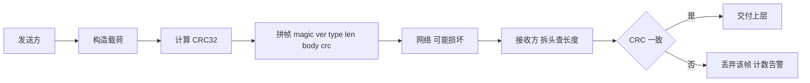

### Q682 · CRC 校验:原理与 zlib.crc32

> 难度:★★★☆ | 标签:CRC, 校验和, 可靠性

**问**:CRC 比 simple checksum 强在哪?CRC32 能检测出所有错误吗?

**答**:CRC 是多项式除法取余:把数据看作多项式比特串,除以约定的生成多项式,余数作为校验值。相比累加和,它对"突发错误"的检测能力有数学保证——CRC32(多项式 0xEDB88320)可检测所有 ≤32 位突发、所有奇数个位错误、所有 ≤5 位随机错误。但它不是加密学摘要:恶意构造碰撞很容易,防篡改要用 HMAC/SHA-256;它只防"意外损坏"(线路噪声、内存位翻转)。标准库 zlib.crc32 是查表实现,自己写逐位版用于理解原理,两者结果必须一致。

```python
# file: code/02_并发与网络工程/q682_crc.py
import zlib


def crc32_bitwise(data: bytes) -> int:
    """逐位 CRC32 (生成多项式 0xEDB88320, 反射算法)。"""
    crc = 0xFFFFFFFF
    for byte in data:
        crc ^= byte
        for _ in range(8):
            if crc & 1:
                crc = (crc >> 1) ^ 0xEDB88320
            else:
                crc >>= 1
    return crc ^ 0xFFFFFFFF


def build_table() -> list:
    table = []
    for i in range(256):
        c = i
        for _ in range(8):
            c = (c >> 1) ^ 0xEDB88320 if c & 1 else c >> 1
        table.append(c)
    return table


TABLE = build_table()


def crc32_table(data: bytes) -> int:
    crc = 0xFFFFFFFF
    for byte in data:
        crc = TABLE[(crc ^ byte) & 0xFF] ^ (crc >> 8)
    return crc ^ 0xFFFFFFFF


if __name__ == "__main__":
    samples = [b"", b"a", b"hello world", bytes(range(256)), b"123456789"]
    for s in samples:
        a, b, c = crc32_bitwise(s), crc32_table(s), zlib.crc32(s) & 0xFFFFFFFF
        assert a == b == c, s
        print(f"  {s[:12]!r:<18} CRC32 = {a:08x}")

    # 检测能力演示: 单位翻转一定被发现
    original = b"critical payload 0x42"
    base = crc32_table(original)
    flipped = bytearray(original)
    flipped[5] ^= 0x10  # 翻转一个比特
    assert crc32_table(bytes(flipped)) != base
    print("单比特翻转被 CRC 捕获:", crc32_table(bytes(flipped)) != base)

    # 局限演示: CRC 不是防篡改工具 — 利用 GF(2) 线性性, 瞬间构造同 CRC 的不同数据
    # 原理: 等长消息满足 crc(m ^ d) = crc(m) ^ crc(d) ^ crc(全零); 末尾 5 字节
    # 提供 40 比特自由度 > 32 位 CRC, 必有非零比特组合使 CRC 不变 (40>32, 鸽笼)
    L = len(original)
    zero_crc = crc32_table(b"\x00" * L)
    basis: dict = {}  # XOR 线性基: 最高有效位 -> (列向量, 所用比特组合)
    kernel = None
    for i in range(40):  # 逐列建基, 某列被先前列线性表出时即找到碰撞组合
        e = bytearray(L)
        e[L - 5 + i // 8] = 1 << (i % 8)
        v, combo = crc32_table(bytes(e)) ^ zero_crc, 1 << i
        while v:
            h = v.bit_length() - 1
            if h not in basis:
                basis[h] = (v, combo)
                break
            v ^= basis[h][0]
            combo ^= basis[h][1]
        else:            # v 归零: 这 40 个比特的该组合与原文 CRC 一致
            kernel = combo
            break
    assert kernel, "40 比特自由度必有非零碰撞 (rank ≤ 32 < 40)"
    forged = bytearray(original)
    for i in range(40):  # 把解出的碰撞比特组合异或进末尾 5 字节
        if kernel >> i & 1:
            forged[L - 5 + i // 8] ^= 1 << (i % 8)
    assert bytes(forged) != original and crc32_table(bytes(forged)) == base
    assert zlib.crc32(bytes(forged)) & 0xFFFFFFFF == zlib.crc32(original) & 0xFFFFFFFF
    print(f"构造出同 CRC 的不同数据: {bytes(forged)!r} → 防恶意篡改必须用 HMAC (Q375)")
```

**追问**:1) 为什么协议里 CRC 常放在帧尾而不是帧头?——发送端先算好体再拼头更自然;且"头定长+CRC 在尾"让校验计算不用先剥离头;有些协议头里带"头 CRC"、尾带"全帧 CRC"双保险(如以太网)。2) CRC32 的保证边界怎么表述?——对突发错误与奇数个位错误有数学保证(边界由生成多项式决定,如 CRC32 可检测全部 ≤32 位突发);精确结论要按多项式说,别背含糊的「能检测大多数错误」。3) 为什么 CRC 不能防篡改?——CRC 是无密钥的线性运算,攻击者可改数据并同步重算校验值;防篡改用 HMAC-SHA256 或签名;CRC 的定位是「防意外损坏」——线路噪声、内存位翻转。4) 生产陷阱?——把 zlib.crc32 当安全校验用;计算时校验字段未置零(结果恒错);大帧校验在纯 Python 逐位实现里跑(zlib.crc32 是 C 实现,且支持分段累积 crc 参数)。

---



---
