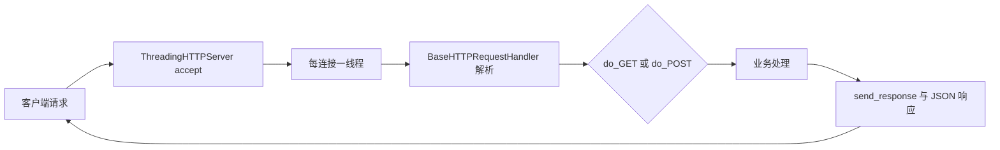

### Q688 · ThreadingHTTPServer:标准库写生产可用的 HTTP 服务

> 难度:★★☆ | 标签:http.server, 路由, 标准库

**问**:不用框架,标准库的 http.server 能做到什么程度?离生产还差什么?

**答**:BaseHTTPRequestHandler 提供 do_GET/do_POST 钩子与 send_response/send_header/end_headers 的完整控制,配合 ThreadingHTTPServer 每连接一线程即可跑路由/JSON/健康检查;http.server 自带日志与 HEAD/GET 语义。离生产的差距:进程级并发(单机多 worker 靠外层,如 systemd/gunicorn 模式)、专业路由与中间件、HTTP/2、以及默认要关的 DNS 反查(protocol_version 要显式设 HTTP/1.1 才有 keep-alive)。适合内部工具、健康检查端点、mock 服务;重业务请上框架,但"标准库能写对"仍是面试底线。

```python
# file: code/02_并发与网络工程/q688_http_server.py
import json
import socket
import threading
import time
import urllib.error
from http.server import BaseHTTPRequestHandler, ThreadingHTTPServer
import urllib.request

# 本机回环演示: 显式直连, 避免环境里的 http_proxy 把 urlopen 劫持到代理端口
urllib.request.install_opener(urllib.request.build_opener(urllib.request.ProxyHandler({})))

START = time.monotonic()


def wait_port(port: int, timeout: float = 3.0) -> None:
    """等服务端端口可建立 TCP 连接再发请求, 消除服务启动竞态。"""
    deadline = time.monotonic() + timeout
    while True:
        try:
            with socket.create_connection(("127.0.0.1", port), timeout=0.2):
                return
        except OSError:
            if time.monotonic() >= deadline:
                raise
            time.sleep(0.05)


class Handler(BaseHTTPRequestHandler):
    protocol_version = "HTTP/1.1"  # 显式开启 keep-alive

    def _json(self, code: int, obj: dict) -> None:
        body = json.dumps(obj).encode()
        self.send_response(code)
        self.send_header("Content-Type", "application/json")
        self.send_header("Content-Length", str(len(body)))
        self.end_headers()
        self.wfile.write(body)

    def do_GET(self) -> None:
        if self.path == "/hello":
            self._json(200, {"msg": "hello", "uptime": round(time.monotonic() - START, 2)})
        elif self.path == "/healthz":
            self._json(200, {"status": "ok"})
        else:
            self._json(404, {"error": "not found", "path": self.path})

    def do_POST(self) -> None:
        if self.path == "/echo":
            length = int(self.headers.get("Content-Length", 0))
            data = self.rfile.read(length)
            self._json(200, {"you_sent": json.loads(data) if data else None})
        else:
            self._json(405, {"error": "method/path not allowed"})

    def log_message(self, fmt: str, *args) -> None:  # 自定义访问日志
        print(f"[http] {self.address_string()} {fmt % args}")


def server(stop: threading.Event, port_box: list) -> None:
    srv = ThreadingHTTPServer(("127.0.0.1", 0), Handler)
    port_box.append(srv.server_address[1])
    srv.timeout = 0.2
    while not stop.is_set():
        srv.handle_request()  # 单步循环以便响应停止信号
    srv.server_close()


if __name__ == "__main__":
    stop = threading.Event()
    box: list = []
    threading.Thread(target=server, args=(stop, box), daemon=True).start()
    while not box:
        time.sleep(0.01)
    wait_port(box[0])
    base = f"http://127.0.0.1:{box[0]}"

    print("GET /hello:", urllib.request.urlopen(base + "/hello", timeout=2).read().decode())
    try:
        print("GET /none: ", urllib.request.urlopen(base + "/none", timeout=2).read().decode())
    except urllib.error.HTTPError as e:  # 4xx/5xx 也是响应: urllib 以 HTTPError 呈现, 错误体照样可读
        print("GET /none: ", e.code, e.read().decode())
    req = urllib.request.Request(base + "/echo", data=json.dumps({"x": 1}).encode(),
                                 headers={"Content-Type": "application/json"})
    print("POST /echo:", urllib.request.urlopen(req, timeout=2).read().decode())
    stop.set()
```

**追问**:1) 为什么 BaseHTTPRequestHandler 默认是 HTTP/1.0 行为?——历史保守默认;protocol_version 不设为 1.1 时每个请求新连接且不带 Content-Length 语义,压测/复用都会失真,这是标准库 HTTP 服务的第一坑。2) protocol_version 设为 HTTP/1.1 之后要自己管什么?——响应必须显式带 Content-Length(或自行分块),否则 keep-alive 连接无法定界,客户端挂死等——「开了 keep-alive 就卡」的根因(Q627 同理)。3) 标准库方案离生产差哪几件?——进程级并发(外层多 worker)、专业路由/中间件、TLS(需外层反代)、优雅关闭、限流与日志治理;定位是内部工具/健康检查/mock 服务,重业务上框架但「标准库能写对」是底线。4) 生产陷阱?——默认 HTTP/1.0 行为(见原问)导致压测与连接复用全部失真;do_POST 不按 Content-Length 读 body,残留数据污染下一请求;异常未兜底返回 500,连接悬挂泄漏。

---



---
