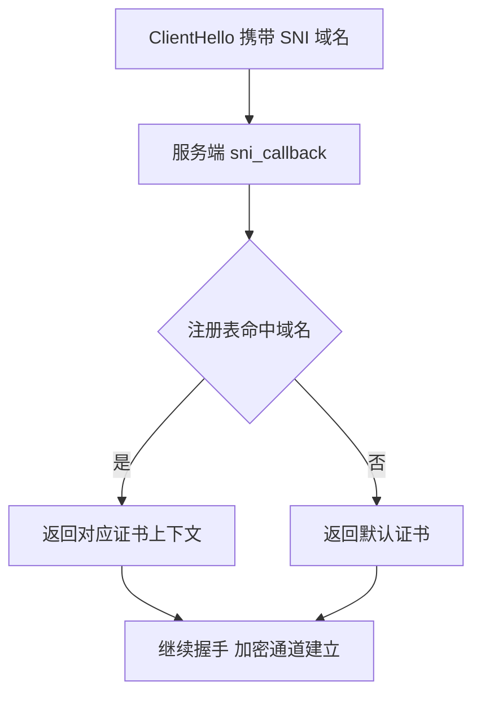

### Q694 · SNI 与多域名证书:一台机器多个 HTTPS 站点

> 难度:★★★★ | 标签:SNI, 多域名, TLS

**问**:一个 IP 上托管多个 HTTPS 站点,证书怎么选?SNI 在哪一步起作用?

**答**:TLS 握手 ClientHello 里带 SNI(server_name)扩展,表明要访问的域名;服务端据此选择证书与上下文——Python 用 SSLContext.sni_callback 实现:握手时按 server_name 返回不同的 SSLContext(各自加载证书)。客户端通过 wrap_socket(server_hostname=...) 发送 SNI 并做主机名校验。坑:SNI 只能是域名,直连 IP 无 SNI(所以 IP 站点用单证书);ESNI/ECH 加密 SNI 是新方向;老客户端(Java 6/XP)不支持 SNI 会拿到默认证书导致校验失败。还有个环境坑:macOS 自带的 LibreSSL 构建里 sni_callback 返回 SSLContext 会直接 TypeError("an integer is required")且握手告警 INTERNAL_ERROR——demo 要按 `ssl.OPENSSL_VERSION` 探测,LibreSSL 下退化为"SNI 日志 + 默认证书"演示,OpenSSL 1.1+ 构建才演示真正的按域名切证书。

---



```python
# file: code/02_并发与网络工程/q694_sni.py
import os
import socket
import ssl
import subprocess
import tempfile
import threading
import time


def gen_cert(tmpdir: str, domain: str) -> tuple:
    """自签证书: SAN 走 -config 扩展段, 兼容 macOS LibreSSL(见 Q628)。"""
    key = os.path.join(tmpdir, f"{domain}.key")
    cert = os.path.join(tmpdir, f"{domain}.crt")
    cnf = os.path.join(tmpdir, f"{domain}.cnf")
    with open(cnf, "w", encoding="utf-8") as f:
        f.write(
            "[req]\n"
            "distinguished_name = dn\n"
            "x509_extensions = v3_req\n"
            "prompt = no\n"
            f"[dn]\nCN = {domain}\n"
            "[v3_req]\n"
            f"subjectAltName = DNS:{domain}\n"
        )
    subprocess.run(
        ["openssl", "req", "-x509", "-newkey", "rsa:2048", "-nodes",
         "-keyout", key, "-out", cert, "-days", "30", "-config", cnf],
        check=True, capture_output=True)
    return key, cert


if __name__ == "__main__":
    with tempfile.TemporaryDirectory() as tmpdir:
        contexts = {}
        keypairs = {}
        for domain in ("api.a-test.com", "admin.b-test.com"):
            key, cert = gen_cert(tmpdir, domain)
            ctx = ssl.SSLContext(ssl.PROTOCOL_TLS_SERVER)
            ctx.load_cert_chain(cert, key)
            contexts[domain] = ctx
            keypairs[domain] = (key, cert)

        default_ctx = contexts["api.a-test.com"]

        # LibreSSL(macOS 系统自带)的 sni_callback 只认"返回 None",
        # 返回 SSLContext 会 TypeError 且握手失败; OpenSSL 1.1+ 才支持切换
        can_switch = "LibreSSL" not in ssl.OPENSSL_VERSION
        if not can_switch:
            print(f"检测到 {ssl.OPENSSL_VERSION}:")
            print("  该构建 sni_callback 不支持返回 SSLContext 切换证书,")
            print("  退化为 SNI 日志演示: 回调只记录 server_name, 全部连接用默认证书")

        _tls = threading.local()  # 回调与 wrap_socket 在同一线程, 用线程局部传递选择结果

        def sni_callback(sslobj, server_name, ctx):
            chosen = contexts.get(server_name, default_ctx)
            cn = server_name if chosen is not default_ctx else "api.a-test.com"
            print(f"  [sni] ClientHello server_name={server_name!r} → 证书 {cn}")
            _tls.chosen = cn
            # OpenSSL 1.1+ 返回选定 context 即切换; LibreSSL 只能返回 None
            return chosen if can_switch else None

        main_ctx = ssl.SSLContext(ssl.PROTOCOL_TLS_SERVER)
        if not can_switch:
            key, cert = keypairs["api.a-test.com"]
            main_ctx.load_cert_chain(cert, key)  # 降级模式: 固定默认证书
        main_ctx.sni_callback = sni_callback

        l = socket.socket()
        l.bind(("127.0.0.1", 0))
        l.listen(8)
        port = l.getsockname()[1]

        def serve() -> None:
            while True:
                try:
                    conn, _ = l.accept()
                except OSError:
                    return
                try:
                    with main_ctx.wrap_socket(conn, server_side=True) as tls:
                        # 服务端 getpeercert() 返回的是客户端证书(无 mTLS 时为
                        # None), 要知道自己发的是哪张证书只能由回调记录
                        if can_switch:
                            cn = getattr(_tls, "chosen", "api.a-test.com")
                        else:
                            cn = "api.a-test.com"  # 降级模式固定默认证书
                        tls.sendall(cn.encode())
                except Exception as e:
                    # 兜底捕获, 不能让服务线程崩掉饿死后续连接
                    print(f"  [server] 连接处理失败: {e!r}")

        threading.Thread(target=serve, daemon=True).start()
        time.sleep(0.1)

        for name in ("api.a-test.com", "admin.b-test.com", "unknown.c-test.com"):
            print(f"客户端访问 {name}:")
            cctx = ssl.SSLContext(ssl.PROTOCOL_TLS_CLIENT)
            cctx.check_hostname = False  # 聚焦 SNI 选择行为, 不做域名校验
            cctx.verify_mode = ssl.CERT_NONE
            try:
                with socket.create_connection(("127.0.0.1", port), timeout=5) as raw:
                    with cctx.wrap_socket(raw, server_hostname=name) as tls:
                        print(f"  ← 收到 CN: {tls.recv(64).decode()}")
            except ssl.SSLError as e:
                print("  握手失败:", e)
        l.close()
```

**追问**:1) CDN 是怎么用 SNI 的?——CDN 边缘节点持有多租户证书池,按 SNI 动态选证书;客户自带证书时节点加载客户的证书,同一 IP 服务成千上万个 HTTPS 域名,这就是 SNI 的商业价值。2) sni_callback 实现的要点与坑?——按 server_name 返回对应 SSLContext,返回 None 用默认;macOS LibreSSL 构建下 sni_callback 会 TypeError(demo 已踩),生产统一 Linux OpenSSL 并做平台分支。3) 无 SNI 场景怎么办?——直连 IP 无 SNI:用带 IP SAN 的单证书;老客户端不支持 SNI 拿默认证书校验失败(升级客户端或独立 IP);ECH(加密 SNI)是新方向,会改变中间件的可见性。4) 生产陷阱?——证书池缺默认证书,无 SNI 握手直接失败;SNI 域名与证书 SAN 不匹配,部分客户端挂;CDN 自管证书模式下边缘证书更新不同步,新旧证书混杂。

---
