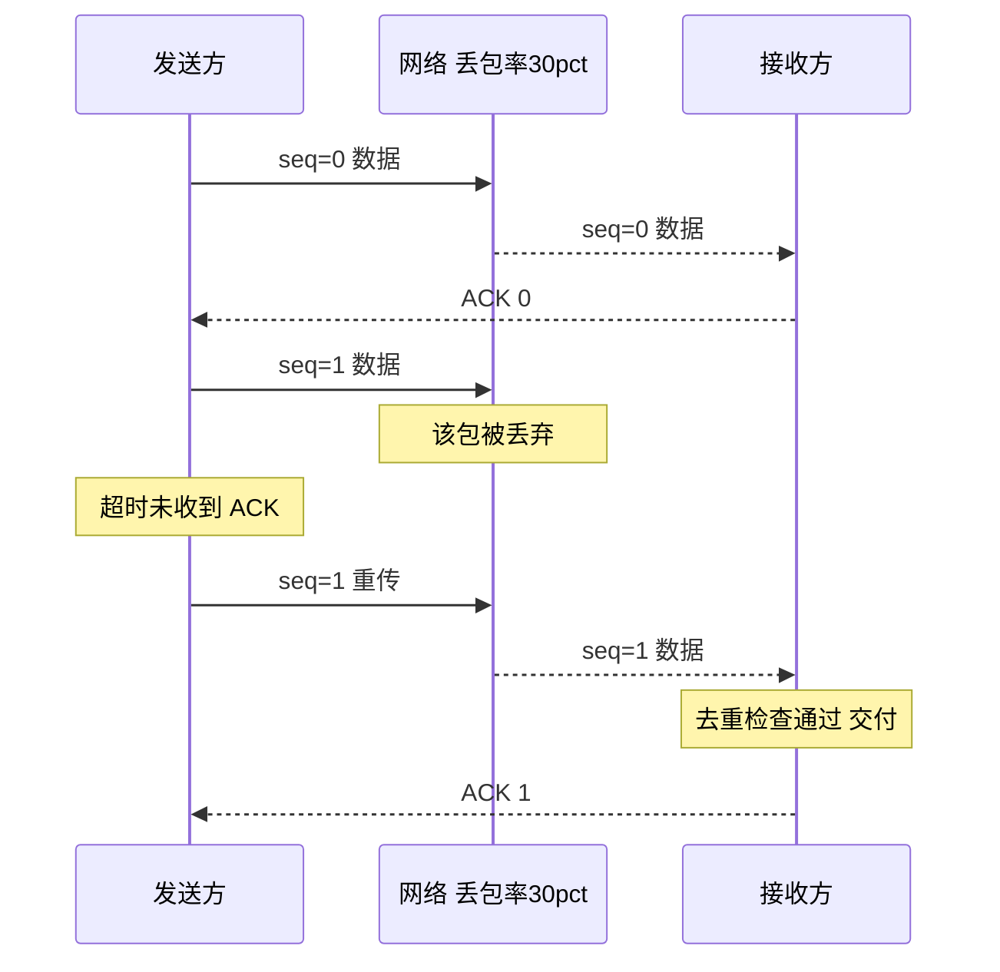

### Q700 · 丢包与重传:模拟观察 ARQ 行为

> 难度:★★★☆ | 标签:丢包, 重传, 可靠性

**问**:UDP 之上自己实现"可靠传输",要处理哪些问题?这和 TCP 的重传有什么差距?

**答**:最简 ARQ(自动重传请求)=序号+确认+超时重传:发送方每包带序号,等 ACK,超时重发;接收方去重(同序号收到多次只交付一次)并回 ACK。立刻遇到 TCP 早已解决的深水区:重传超时怎么定(需要 RTT 估计+退避)、ACK 丢了怎么区分"包丢"还是"ACK 丢"(序号去重)、洪峰重传风暴(需要拥塞控制)、效率(滑动窗口 vs 停等)。实验可见:20% 丢包下停等 ARQ 吞吐暴跌,TCP 用累积确认+快速重传+拥塞窗口把这种情况处理得优雅得多——这也是"不要轻易自研可靠 UDP"的原因,除非用 QUIC/KCP 这类成熟方案。

```python
# file: code/02_并发与网络工程/q700_arq_retransmit.py
import queue
import random
import select
import socket
import threading
import time

LOSS = 0.3  # 模拟 30% 丢包
random.seed(42)


class ReliableUdpReceiver(threading.Thread):
    def __init__(self, sock: socket.socket) -> None:
        super().__init__(daemon=True)
        self.sock = sock
        self.delivered: list = []
        self.seen: set = set()
        self.dups = 0
        self.stop = threading.Event()

    def run(self) -> None:
        self.sock.settimeout(0.1)
        while not self.stop.is_set():
            try:
                data, addr = self.sock.recvfrom(2048)
            except socket.timeout:
                continue
            seq, payload = data.split(b":", 1)
            n = int(seq)
            if n in self.seen:
                self.dups += 1  # 重传导致重复: 去重但必须重发 ACK
            else:
                self.seen.add(n)
                self.delivered.append(payload.decode())
            self.sock.sendto(b"ACK" + seq, addr)  # ACK 也可能丢


def sender(sock: socket.socket, peer: tuple, messages: list,
           timeout: float = 0.05) -> dict:
    sock.settimeout(0.01)  # ACK 读取窗口; 超时后回头检查重传时钟
    pending: dict = {}  # seq -> (send_time, payload)
    next_seq = 0
    sent_count = 0
    done = 0
    while done < len(messages):
        now = time.monotonic()
        # 补发: 未确认且超时
        for seq, (t0, payload) in list(pending.items()):
            if now - t0 > timeout:
                sock.sendto(f"{seq}:".encode() + payload, peer)
                sent_count += 1
                pending[seq] = (now, payload)
        # 发新包 (窗口=1 停等: 未确认时不发新)
        if not pending and next_seq < len(messages):
            payload = messages[next_seq]
            sock.sendto(f"{next_seq}:".encode() + payload, peer)
            sent_count += 1
            pending[next_seq] = (now, payload)
            next_seq += 1
        # 收 ACK
        try:
            ack, _ = sock.recvfrom(64)
            seq = int(ack[3:])
            if seq in pending:
                del pending[seq]
                done += 1
        except socket.timeout:
            pass
        time.sleep(0.002)
    return {"sent": sent_count, "delivered": done}


def lossy_network(stop: threading.Event, sender_side: socket.socket,
                  receiver_side: socket.socket, rx_addr: tuple) -> None:
    """双向有损转发, 模拟不可靠网络 (数据与 ACK 一视同仁地丢)。
    sender_side: 发送方发数据的入口; receiver_side: 固定端口的出口 —
    接收方按"数据来源地址"回 ACK, 恰好回到这里, 再经同样丢包回给发送方。"""
    sender_side.settimeout(0.1)
    receiver_side.settimeout(0.1)
    tx_addr = None  # 首个数据包的来源地址, 即发送方的回程地址
    while not stop.is_set():
        ready, _, _ = select.select([sender_side, receiver_side], [], [], 0.1)
        for s in ready:
            try:
                data, addr = s.recvfrom(2048)
            except OSError:
                continue
            if random.random() < LOSS:
                continue
            if s is sender_side:
                tx_addr = addr
                receiver_side.sendto(data, rx_addr)
            elif tx_addr:
                sender_side.sendto(data, tx_addr)


if __name__ == "__main__":
    rx_sock = socket.socket(socket.AF_INET, socket.SOCK_DGRAM)
    rx_sock.bind(("127.0.0.1", 0))
    mid_sock = socket.socket(socket.AF_INET, socket.SOCK_DGRAM)
    mid_sock.bind(("127.0.0.1", 0))
    net_sock = socket.socket(socket.AF_INET, socket.SOCK_DGRAM)  # 面向接收方的固定出口
    net_sock.bind(("127.0.0.1", 0))
    tx_sock = socket.socket(socket.AF_INET, socket.SOCK_DGRAM)
    tx_sock.bind(("127.0.0.1", 0))

    receiver = ReliableUdpReceiver(rx_sock)
    receiver.start()
    stop = threading.Event()
    threading.Thread(target=lossy_network,
                     args=(stop, mid_sock, net_sock, rx_sock.getsockname()),
                     daemon=True).start()

    messages = [f"msg-{i}".encode() for i in range(20)]
    # 发送方 → 有损网络 → 接收方
    t0 = time.monotonic()
    stats = sender(tx_sock, mid_sock.getsockname(), messages)
    dt = time.monotonic() - t0
    time.sleep(0.2)
    stop.set()
    receiver.stop.set()
    receiver.join(timeout=1)

    print(f"原始 {len(messages)} 条, 实际发送 {stats['sent']} 次 "
          f"(重传 {stats['sent'] - len(messages)} 次), 耗时 {dt * 1000:.0f}ms")
    print(f"接收端交付 {len(receiver.delivered)} 条, 去重 {receiver.dups} 次")
    assert sorted(receiver.delivered) == sorted(m.decode() for m in messages)
    print("全部消息最终送达: 序号+ACK+超时重传+去重 = 可靠性, 代价是停等的低吞吐")
```

**追问**:1) 停等 ARQ 的吞吐上限是多少?——每 RTT 一包,吞吐 = 包大小/RTT;100ms RTT 下 1KB 包只有 10KB/s,这解释了为什么 TCP 必须有滑动窗口与流水线确认。2) 重传超时怎么定才科学?——固定值在 RTT 波动下要么过激(误重传)要么过缓;TCP 的做法:SRTT 平滑估计+偏差项(RTO=SRTT+4·RTTVAR)再指数退避;自研可靠传输至少要采样 RTT 动态调整。3) 停等与滑动窗口的差距有多大?——停等吞吐=包大小/RTT(每 RTT 一包);滑动窗口流水线确认,窗口要达带宽×RTT(BDP)才能吃满链路;再加拥塞控制防打爆网络——TCP 三十年的打磨都在这里,自研前先掂量。4) 生产陷阱?——重传无上限形成重传风暴;ACK 去重缺失重复交付;自研可靠 UDP 不做拥塞控制,与 TCP 共存时把网络拖垮(用 QUIC/KCP 成熟方案)。

---



---
