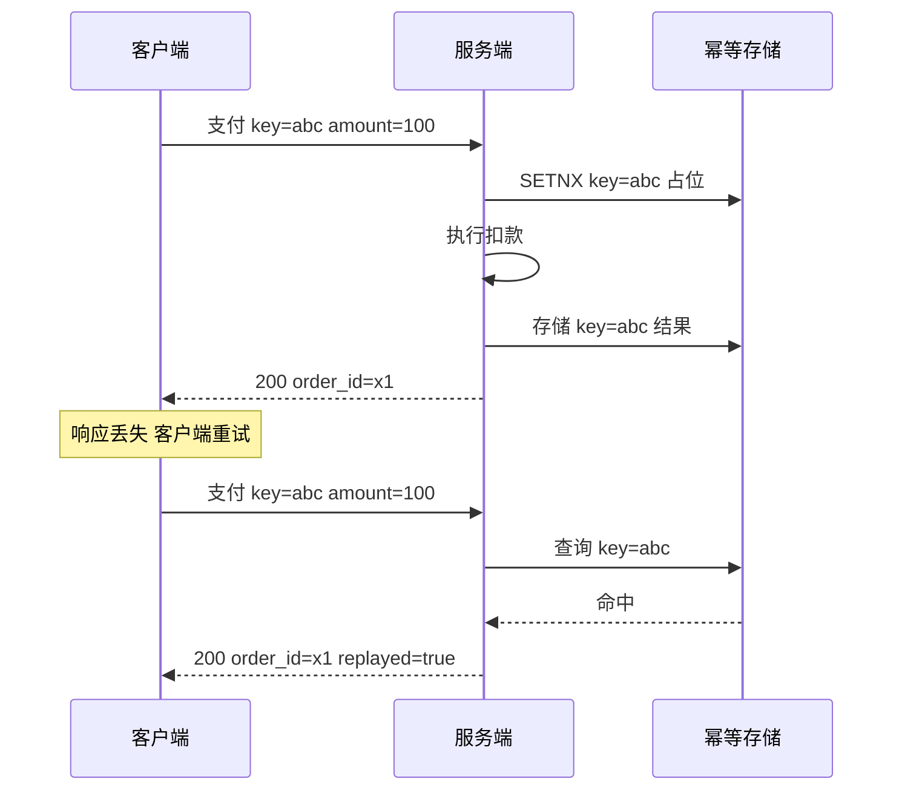

### Q706 · 幂等键:重试安全的前提

> 难度:★★★☆ | 标签:幂等, 重试, 一致性

**问**:为什么"带重试就必须带幂等"?幂等键方案怎么设计?

**答**:重试把"同一次业务操作"变成多次网络请求,非幂等操作(创建订单/扣款)会重复执行——不是网络层能解决的,必须业务层保证。幂等键方案:客户端生成唯一 key(如 UUID),随请求携带;服务端以 key 做去重——首次执行并把"key→结果"存储(带 TTL),重复请求直接返回存储结果(标记 replayed)。关键细节:存储要在"执行前"占位(防并发双写,用唯一约束或分布式锁);响应必须幂等可重放(不包含一次性数据如服务端时间戳);key 作用域=业务操作级(同一单多次支付各有各的 key)。

```python
# file: code/02_并发与网络工程/q706_idempotency.py
import threading
import uuid


class PaymentService:
    """幂等支付: 相同 key 重放首次结果, 不同 key 正常执行。"""

    def __init__(self) -> None:
        self._store: dict = {}          # idem_key -> 响应
        self._inflight: set = set()     # 占位防并发双写
        self._lock = threading.Lock()
        self.executed: list = []

    def pay(self, idem_key: str, amount: int) -> dict:
        with self._lock:
            if idem_key in self._store:
                resp = dict(self._store[idem_key])
                resp["replayed"] = True
                return resp
            if idem_key in self._inflight:
                # 生产中这里应等待首请求结果; 简化为拒绝
                return {"error": "in-progress", "replayed": False}
            self._inflight.add(idem_key)
        try:
            # 真实执行 (这里只记录)
            resp = {"order_id": f"pay-{uuid.uuid4().hex[:8]}",
                    "amount": amount, "status": "paid"}
            self.executed.append(idem_key)
            with self._lock:
                self._store[idem_key] = resp  # TTL 存储, 生产用 Redis SETNX+TTL
            resp = dict(resp)
            resp["replayed"] = False
            return resp
        finally:
            with self._lock:
                self._inflight.discard(idem_key)


if __name__ == "__main__":
    svc = PaymentService()
    key = str(uuid.uuid4())

    r1 = svc.pay(key, 100)
    print("首次支付:", r1)
    r2 = svc.pay(key, 100)  # 网络超时后客户端重试: 同 key
    print("同 key 重试:", r2)
    r3 = svc.pay(key, 100)
    print("同 key 再试:", r3)
    assert r1["order_id"] == r2["order_id"] == r3["order_id"]
    assert r2["replayed"] and r3["replayed"]
    assert len(svc.executed) == 1, "业务只执行了一次"

    r4 = svc.pay(str(uuid.uuid4()), 100)  # 新业务: 新 key
    print("新 key 支付:", r4)
    assert r4["order_id"] != r1["order_id"]
    print(f"\n执行次数 {len(svc.executed)}, 请求次数 4 → 重试安全")
    print("要点: 执行前占位 + 结果存储 + 响应可重放")
```

**追问**:1) 幂等键的 TTL 怎么定?——覆盖"客户端最大重试窗口"(如 24h),过期后同 key 会再次执行;因此 key 里通常编码业务约束(订单号),即使超 TTL,数据库唯一约束仍兜底。2) 为什么必须「执行前占位」?——并发两个同 key 请求同时查「无记录」然后都执行,重复发生;占位(唯一约束 insert 或分布式锁)让第二个请求等待或返回「处理中」;占位记录带状态(执行中/完成)与 TTL,超时可探测重置。3) 存储选型与恢复语义?——DB 唯一约束强一致(支付类首选)vs Redis SETNX 快但丢失风险要评估;崩溃恢复:执行中状态超时后可安全重置的前提是业务操作本身可重放;重放响应不能含一次性字段。4) 生产陷阱?——幂等键用时间戳/自增 id(每次重试都是新 key,形同虚设);TTL 短于客户端重试窗口;重放响应带服务端时间戳,比对逻辑误判;业务表没有唯一约束兜底,幂等层一崩全崩。

---



---
