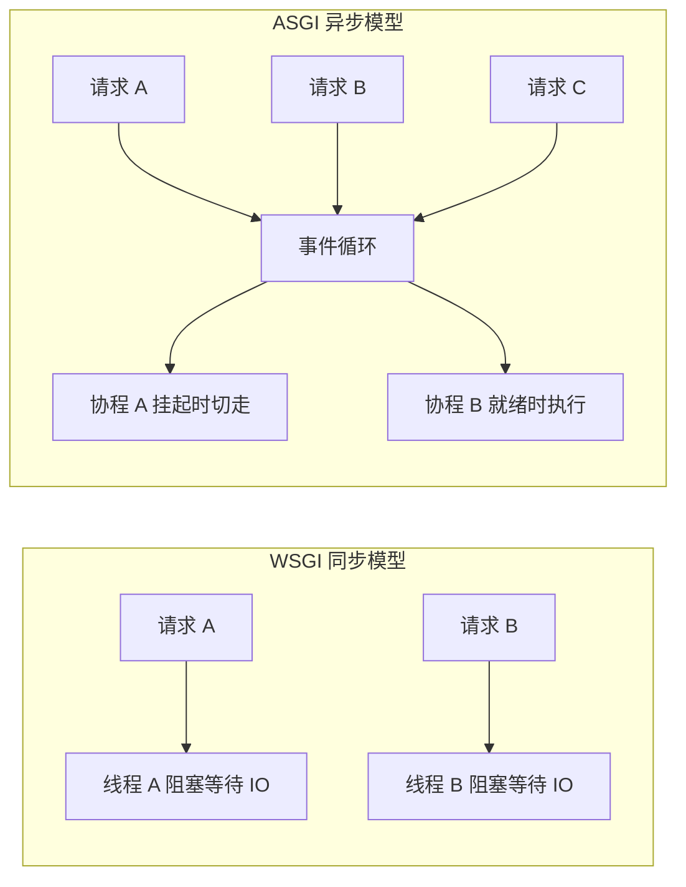

### Q088 · WSGI 与 ASGI 核心区别对比

> 难度:★★★ | 标签:WSGI, ASGI, 并发模型

**问**:从并发模型、生态、适用场景三个维度对比 WSGI 和 ASGI,并画出两者处理请求的差异。

**答**:WSGI 是同步阻塞模型,一个请求占一个线程/进程,靠多进程多线程扩容,适合传统同步框架 Flask/Django(经典模式);ASGI 基于事件循环,协程在 IO 等待时让出控制权,适合高并发 IO、长连接、实时推送场景。生态上 WSGI 有 Gunicorn+Flask/Django 成熟组合,ASGI 对应 Uvicorn/Hypercorn + FastAPI/Django(3.0+ ASGI 模式)。CPU 密集型逻辑在 ASGI 里仍会阻塞事件循环,需要线程池或进程池辅助。

```python
# file: code/03_Web后端开发/q088_concurrence_demo.py
import asyncio
import time

def sync_fetch(name: str) -> str:
    time.sleep(1)          # 模拟阻塞 IO,占用线程
    return f'{name} done'

async def async_fetch(name: str) -> str:
    await asyncio.sleep(1)  # 模拟非阻塞 IO,让出事件循环
    return f'{name} done'

def run_wsgi_style():
    start = time.time()
    results = [sync_fetch(f'job-{i}') for i in range(3)]  # 串行,约 3s
    print(results, round(time.time() - start, 2))

async def run_asgi_style():
    start = time.time()
    results = await asyncio.gather(*(async_fetch(f'job-{i}') for i in range(3)))
    print(results, round(time.time() - start, 2))  # 并发,约 1s

if __name__ == '__main__':
    run_wsgi_style()
    asyncio.run(run_asgi_style())
```

**追问**:
- CPU 密集逻辑在 ASGI 里怎么办?——事件循环会被占住,要用 `run_in_threadpool`/进程池下放,或拆独立 worker;选 ASGI 不等于自动获得 CPU 并行。
- Django 3.0+ 的 ASGI 模式有什么约束?——全链路必须异步:ORM 用 async 接口或 `sync_to_async` 包装,混用同步 ORM 会隐式起线程,收益打折。
- 从 WSGI 迁到 ASGI 的第一步做什么?——先盘点同步依赖(requests、同步 ORM、阻塞 SDK),没有全异步生态支撑前,收益主要来自 worker 数量而非协程。


