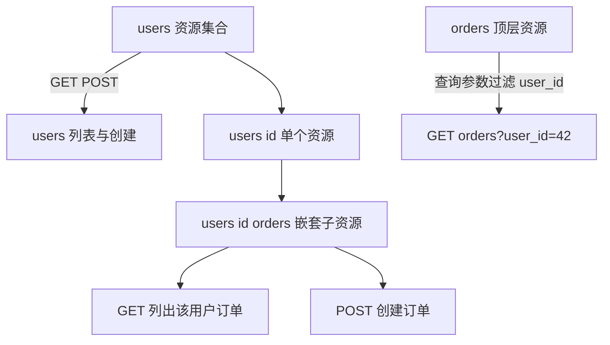

### Q093 · REST 资源嵌套与关系设计

> 难度:★★☆ | 标签:REST, 资源建模

**问**:一对多关系在 REST 中如何表达?嵌套资源 URL 什么时候该用,什么时候不该用?

**答**:一对多用路径嵌套表达,如 `GET /users/{user_id}/orders` 表示某用户的订单列表;嵌套层级建议不超过两层,更深的关联改用"资源 + 查询参数"或先取 ID 再查,例如 `GET /orders?user_id=42`,避免 `/a/1/b/2/c/3` 这类深层 URL 难以维护。多对多关系通常把关联本身建模为资源,如 `POST /enrollments` 记录选课关系。

```python
# file: code/03_Web后端开发/q093_nested_resource.py
try:
    from fastapi import FastAPI, HTTPException
except ImportError:
    print("该题演示需要第三方库 fastapi:pip install fastapi[all],原理见正文")
    raise SystemExit(0)

app = FastAPI()
orders: dict[int, list[dict]] = {1: [{'id': 1, 'item': 'book'}]}

@app.get('/users/{user_id}/orders')          # 嵌套:用户下的订单
def user_orders(user_id: int):
    if user_id not in orders:
        raise HTTPException(404, 'user not found')
    return {'user_id': user_id, 'orders': orders[user_id]}

@app.get('/orders')                           # 平铺 + 查询参数过滤,更灵活
def all_orders(user_id: int | None = None):
    data = orders
    if user_id is not None:
        data = {user_id: orders.get(user_id, [])}
    return [{'user_id': uid, **o} for uid, lst in data.items() for o in lst]
```



**追问**:
- 嵌套创建订单该用什么 URL?——`POST /users/42/orders`,语义是"在用户 42 下创建订单",也可用顶层 `POST /orders` 传 body。
- 深层嵌套的查询怎么办?——超过两层改用查询参数或分步查询;`/a/1/b/2/c/3` 的缓存与权限校验都难做。
- 多对多建模成资源有什么好处?——关系可带属性与生命周期(`POST /enrollments`),能独立分页、审计;隐藏在中间表里则无法演进。
- 嵌套 URL 的权限怎么校验?——先校验父资源归属(`users/42` 是否当前用户),再校验子资源;漏掉父级校验是越权高发点。
